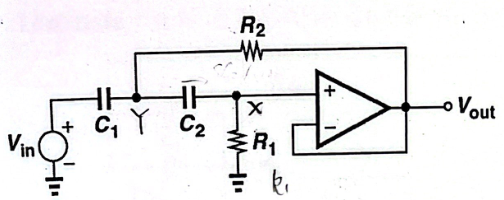

# 기출 2023-1 기말 4 — 단위 이득 연산증폭기 2차 high-pass filter의 전달 함수와 R1, Q 설계

## 조건
- 그림의 회로를 이용해 2차 high-pass filter를 설계
- 이상적인 op amp로 가정
- (2) 전용: Biquad filter에서 $C_1 = C_2 = 1\ \text{pF}$, $R_2 = 10\ \text{k}\Omega$으로 설계
- (2) 전용: 목표 $\omega_n = 50\ \text{M rad/s}$ ($\approx 2\pi \times 8\ \text{MHz}$)

## 구할 것
- (1) 회로의 전달함수 $V_{out}/V_{in}$을 $R_1$, $R_2$, $C_1$, $C_2$로 나타낸 식
- (2) $\omega_n = 50\ \text{M rad/s}$가 되도록 하는 $R_1$ 값, 그리고 2차 filter의 $Q$ 값

## 회로 — Fig Q4
```spice
VIN  n1    0     {V_in}    ; + 단자 위
C1   n1    n2    {C_1}
C2   n2    n3    {C_2}
R1   n3    0     {R_1}
R2   n2    Vout  {R_2}
X1   n3    Vout  Vout  opamp    ; in+ = n3, in- = Vout (단위 이득 귀환)
```
- 단자: Vout = 출력 (개방 원)
- 표시: 노드 라벨 V_out (출력 원 오른쪽) / 소자 라벨 V_in (전압원 왼쪽), C1 (커패시터 아래), C2 (커패시터 아래), R1 (저항 오른쪽), R2 (가로 저항 위), 연산증폭기 (라벨 없음) / 부호 전압원 V_in "+" (원 오른쪽 위), "−" (원 오른쪽 아래); 연산증폭기 "+" (위 입력, 삼각형 안), "−" (아래 입력, 삼각형 안) / 화살표 없음 / 수치·면적 라벨 없음
- 배치: 왼쪽 원형 전압원 V_in (아래 접지), 위 단자에서 세로선이 올라가 오른쪽으로 꺾여 가로 C1, n2 접속점, 가로 C2, n3 접속점, 연산증폭기 + 입력이 한 가로선 높이 / n2 접속점에서 세로선이 위로 올라가 오른쪽으로 꺾여 가로 R2를 지나 연산증폭기 위를 넘어 모서리에서 아래로 꺾여 Vout 접속점 / n3 접속점에서 아래로 세로 R1, 그 아래 접지 / 연산증폭기는 오른쪽을 향한 삼각형, 출력 → Vout 접속점 → V_out 원 / − 입력에서 왼쪽으로 짧게 나가 모서리에서 아래로 꺾여 연산증폭기 아래를 지나 오른쪽으로 가고, 모서리에서 위로 꺾여 Vout 접속점 / 접속점 (세 갈래 이상, 3곳): n2 = 왼쪽 C1 + 오른쪽 C2 + 위 R2 선 (점), n3 = 왼쪽 C2 + 오른쪽 + 입력 + 아래 R1 (점), Vout = 왼쪽 연산증폭기 출력 + 위 R2 선 + 아래 − 입력 귀환선 + 오른쪽 V_out 원 (점) / 교차: 없음


> 참고: 답안지 손글씨가 겹침 (n2 접속점 아래 "Y", n3 접속점 오른쪽 아래 "x", R1 아래 "k₁" 비슷한 글자, C2 위와 R2 아래의 흐린 획). "Y", "x"는 손글씨라 노드 라벨로 넣지 않음. 원문 "10 KΩ"은 kΩ으로 적음
