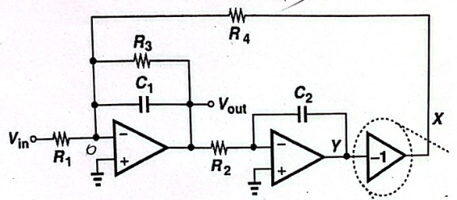

# 기출 2023-1 기말 5 — 두 적분기와 반전기로 된 biquad의 low-pass 전달 함수 V_Y/V_in

## 원문
다음 회로를 이용한 filter를 설계한다. 단, 이상적인 op amp를 가정한다. Low-pass filter의 전달함수($V_Y/V_{in}(s)$)를 $R_1$, $R_2$, $R_3$, $R_4$, $C_1$, $C_2$에 관한 식으로 구하시오.

## 조건
- 그림의 회로를 이용해 filter를 설계
- 이상적인 op amp로 가정
- 소자 값은 주어지지 않음 (원문에 없음)

## 구할 것
- Low-pass filter의 전달함수 $V_Y/V_{in}(s)$를 $R_1$, $R_2$, $R_3$, $R_4$, $C_1$, $C_2$로 나타낸 식

## 회로 — Fig Q5
```spice
R1   Vin   n1    {R_1}
X1   0     n1    Vout  opamp    ; in+ = 접지, in- = n1
R3   n1    Vout  {R_3}
C1   n1    Vout  {C_1}
R2   Vout  n2    {R_2}
X2   0     n2    Y     opamp    ; in+ = 접지, in- = n2
C2   n2    Y     {C_2}
X3   Y     X     box "-1"       ; 이득 −1 블록 (삼각형, 점선 원 안)
R4   X     n1    {R_4}
```
- 단자: Vin = 입력 (개방 원) / Vout = 출력 (개방 원)
- 표시: 노드 라벨 V_in (입력 원 왼쪽), V_out (출력 원 오른쪽), Y (Y 접속점 왼쪽 위, 둘째 연산증폭기 출력 위), X (−1 블록 출력선 오른쪽 위, 오른쪽 세로선 옆) / 소자 라벨 R1 (가로 저항 아래), R3 (가로 저항 위), C1 (커패시터 위), R4 (맨 위 가로 저항 아래), R2 (가로 저항 아래), C2 (커패시터 위), "−1" (삼각형 블록 안), 연산증폭기 둘 (라벨 없음) / 부호 두 연산증폭기 모두 "−" (위 입력, 삼각형 안), "+" (아래 입력, 삼각형 안) / 화살표 없음 / 수치·면적 라벨 없음
- 배치: 왼쪽→오른쪽 V_in 원, 가로 R1, n1 아래 접속점, 첫째 연산증폭기, 아래 Vout 접속점, 가로 R2, n2 접속점, 둘째 연산증폭기, Y 접속점, −1 블록, X 선 / 연산증폭기와 −1 블록은 모두 오른쪽을 향한 삼각형 / 첫째 연산증폭기 위에 R3(위)과 C1(아래)이 나란히 n1 세로선과 Vout 세로선 사이에 걸림 / n1 세로선은 맨 위 R4 선 높이에서 − 입력 높이까지 내려오며 R3 높이, C1 높이, − 입력 높이에 접속점 / Vout 세로선은 R3 오른쪽 끝 모서리에서 아래로 내려와 C1 높이의 위 Vout 접속점(오른쪽 V_out 원), 연산증폭기 출력 높이의 아래 Vout 접속점까지 / 두 연산증폭기의 + 입력은 왼쪽으로 짧게 나가 아래로 꺾여 접지 / C2는 n2에서 세로선이 위로 올라가 오른쪽으로 꺾여 둘째 연산증폭기 위를 지나 모서리에서 아래로 꺾여 Y 접속점 (귀환 커패시터) / −1 블록 출력에서 가로선이 오른쪽으로 가 모서리에서 위로 꺾여 그림 맨 위 높이까지 올라가, 왼쪽으로 꺾여 가로 R4를 지나 n1 세로선 위 끝 / −1 블록 둘레에 점선 원이 있고, 점선 원 오른쪽 위에서 점선이 오른쪽 아래로 뻗어 나감 / 접속점 (세 갈래 이상, 7곳): n1 위 = 위 R4 선 + 오른쪽 R3 + 아래 세로선 (점), n1 가운데 = 위 세로선 + 오른쪽 C1 + 아래 세로선 (점), n1 아래 = 왼쪽 R1 + 오른쪽 − 입력 + 위 세로선 (점), 위 Vout = 위 R3 선 + 왼쪽 C1 + 오른쪽 V_out 원 + 아래 세로선 (점), 아래 Vout = 왼쪽 연산증폭기 출력 + 위 세로선 + 오른쪽 R2 (점), n2 = 왼쪽 R2 + 오른쪽 − 입력 + 위 C2 선 (점), Y = 왼쪽 둘째 연산증폭기 출력 + 위 C2 선 + 오른쪽 −1 블록 입력 (점) / 교차: 없음


> 참고: 답안지 손글씨가 겹침 (n1 아래 접속점 아래의 "o" 비슷한 글자, 크롭 오른쪽 위에 문제 글의 $V_Y/V_{in}(s)$를 두른 손글씨 곡선 끝). −1 블록 둘레의 점선 원과 점선은 인쇄된 것 (보조 출처: 손정리 노트에 실린 같은 그림에도 있음)

## 풀이
### 가상 접지 노드의 KCL
- 두 연산증폭기의 − 입력은 가상 접지(이상적, + 입력이 접지)
- 첫째: $V_{in}/R_1 + V_X/R_4 + V_{out}(1/R_3 + sC_1) = 0$
- 둘째: $V_{out}/R_2 + sC_2V_Y = 0$ → $V_{out} = -sR_2C_2V_Y$. $-1$ 블록: $V_X = -V_Y$
### 전달함수
- 대입: $V_{in}/R_1 = V_Y[1/R_4 + sR_2C_2/R_3 + s^2R_2C_1C_2]$
- $\dfrac{V_Y}{V_{in}}(s) = \dfrac{R_4/R_1}{s^2R_2R_4C_1C_2 + sR_2R_4C_2/R_3 + 1}$
### 답
- $\dfrac{V_Y}{V_{in}}(s) = \dfrac{R_4/R_1}{s^2R_2R_4C_1C_2 + sR_2R_4C_2/R_3 + 1}$
