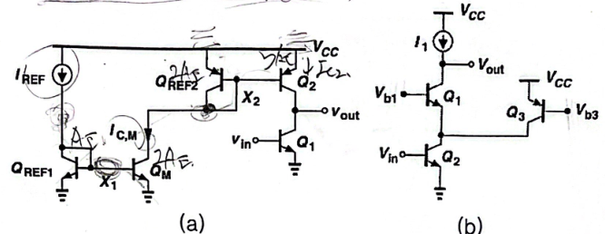

# 기출 2023-1 중간 2 — 이미터 면적비 전류 거울로 바이어스한 CE 단과 전류를 빼는 Q3가 붙은 바이폴라 캐스코드

## 원문
다음 회로에 대해 주어진 조건을 이용하여 질문에 답하시오.

: $V_{CC} = 2.5\ \text{V}$, $I_{REF} = 100\ \mu\text{A}$, $V_T = 25\ \text{mV}$, $\beta = 200$, $V_{A,n} = V_{A,p} = 5\ \text{V}$, $Q_{REF1} = A_E$, $Q_M = 2A_E$, $Q_{REF2} = 2A_E$, $Q_2 = 5A_E$, 단, $g_m r_o \gg 1$로 가정하고, 베이스 전류는 무시한다.

(1) 회로 (a)의 $Q_1$ 바이어스 전류와 전압 이득을 각각 구하시오.

(2) 회로 (b)의 출력저항과 전압이득을 각각 구하시오. 단, $I_1 = I_{c3} = 0.5\ \text{mA}$, $I_{c2} = 1\ \text{mA}$이다.

## 조건
- 회로: 그림 (a), (b)
- $V_{CC} = 2.5\ \text{V}$, $I_{REF} = 100\ \mu\text{A}$
- $V_T = 25\ \text{mV}$, $\beta = 200$
- $V_{A,n} = V_{A,p} = 5\ \text{V}$
- 이미터 면적: $Q_{REF1} = A_E$, $Q_M = 2A_E$, $Q_{REF2} = 2A_E$, $Q_2 = 5A_E$ (앞머리 "이미터 면적"은 원문에 없음)
- $g_m r_o \gg 1$로 가정
- 베이스 전류는 무시
- (2) 전용 (회로 (b)): $I_1 = I_{c3} = 0.5\ \text{mA}$, $I_{c2} = 1\ \text{mA}$
- 바이어스 전압 $V_{b1}$, $V_{b3}$ 값은 주어지지 않음 (원문에 없음)

## 구할 것
- (1) 회로 (a)의 $Q_1$ 바이어스 전류와 전압 이득
- (2) 회로 (b)의 출력 저항과 전압 이득

## 회로 — Fig Q2(a)
```spice
IREF   VCC   X1    {I_REF}
QREF1  X1    X1    0    npn    ; 좌우 반전 (베이스 오른쪽), 다이오드 연결
QM     X2    X1    0    npn
QREF2  X2    X2    VCC  pnp    ; 좌우 반전 (베이스 오른쪽), 다이오드 연결
Q2     vout  X2    VCC  pnp
Q1     vout  vin   0    npn
* 이미터 면적 A_E, 2A_E, 5A_E는 문제 문장에만 인쇄됨 (그림에는 없음)
```
- 단자: VCC = 2.5 V 전원 (가로 레일) / vin = 소신호 입력 (개방 원) / vout = 출력 (개방 원)
- 표시: 노드 라벨 V_CC (레일 오른쪽 끝), X_1 (베이스 공통선 아래, 다이오드 연결 접속점 오른쪽), X_2 (X2 접속점 아래 오른쪽, 세로선 오른쪽), v_in (입력 원 왼쪽), v_out (출력 원 오른쪽) / 소자 라벨 I_REF (전류원 왼쪽), Q_REF1 (Q_REF1 왼쪽), Q_M (Q_M 오른쪽 아래), Q_REF2 (Q_REF2 왼쪽), Q_2 (Q2 오른쪽 아래), Q_1 (Q1 오른쪽) / 부호 없음 / 화살표 "I_C,M": QM 컬렉터 세로선, 아래 방향(QM 컬렉터로 들어감), 도선 위, 글자는 화살표 왼쪽 / 수치·면적 라벨 없음
- 배치: 맨 위 굵은 가로 레일 V_CC (왼쪽 끝은 I_REF 위, 오른쪽 끝은 Q2 이미터 너머) / 왼쪽 세로줄 위→아래 I_REF 전류원(화살표 아래), 위 X1 접속점, Q_REF1, 접지 / Q_REF1 npn 좌우 반전(베이스 막대 오른쪽, 컬렉터 왼쪽 위, 이미터 왼쪽 아래·화살표 바깥) / 위 X1 접속점에서 가로선이 오른쪽으로 나가 아래로 꺾여 베이스 공통선의 아래 X1 접속점 (다이오드 연결) / 베이스 공통선은 Q_REF1 베이스에서 Q_M 베이스까지 베이스 높이로 가로지름 / Q_M은 Q_REF1 오른쪽, npn 보통 방향(베이스 왼쪽, 이미터 오른쪽 아래·화살표 바깥), 이미터 아래 접지 / Q_M 컬렉터에서 세로선이 위로 올라가(I_C,M 화살표) Q_REF2 아래 높이에서 오른쪽으로 꺾이고, 그 가로선이 Q_REF2 컬렉터 아래 접속점을 지나 X2 접속점 바로 아래에서 위로 꺾여 X2 접속점 / Q_REF2는 가운데 위, pnp 좌우 반전(베이스 막대 오른쪽, 이미터 왼쪽 위·화살표가 막대 쪽으로 들어감, 컬렉터 왼쪽 아래), 이미터에서 세로선이 위로 레일, 컬렉터에서 세로선이 아래로 가로선 / X2 접속점에서 베이스 높이의 가로선이 왼쪽 Q_REF2 베이스, 오른쪽 Q2 베이스로 / 오른쪽 세로줄 위→아래 Q2, vout 접속점, Q1, 접지 / Q2 pnp 보통 방향(베이스 왼쪽, 이미터 오른쪽 위·화살표가 막대 쪽으로 들어감, 컬렉터 아래), 이미터에서 세로선이 위로 레일 / Q1 npn 보통 방향(베이스 왼쪽, 컬렉터 위, 이미터 아래·화살표 바깥) / vout 접속점에서 가로선이 오른쪽 v_out 원, v_in 원 → 가로선 → Q1 베이스 / 접속점 (세 갈래 이상, 5곳): ① 위 X1 = 위 I_REF + 아래 Q_REF1 컬렉터 + 오른쪽 다이오드 연결선 (점) ② 아래 X1 = 왼쪽 Q_REF1 베이스 + 오른쪽 Q_M 베이스 + 위 다이오드 연결선 (점) ③ Q_REF2 컬렉터 아래 = 왼쪽 Q_M 컬렉터 쪽 가로선 + 오른쪽 X2 쪽 가로선 + 위 Q_REF2 컬렉터 (손글씨에 가려 점 여부 판독 불가) ④ X2 = 왼쪽 Q_REF2 베이스 + 오른쪽 Q2 베이스 + 아래 세로선 (점) ⑤ vout = 위 Q2 컬렉터 + 아래 Q1 컬렉터 + 오른쪽 v_out 선 (점) / 교차: 없음

## 회로 — Fig Q2(b)
```spice
I1  VCC   Vout  {I_1}
Q1  Vout  Vb1   n1   npn
Q2  n1    Vin   0    npn
Q3  n1    Vb3   VCC  pnp    ; 좌우 반전 (베이스 오른쪽), 컬렉터 = n1
* VCC는 T 전원 기호 두 개 (I1 위, Q3 이미터 위)
```
- 단자: VCC = 2.5 V 전원 (T 전원 기호 2개, 둘 다 V_CC로 인쇄) / Vb1, Vb3 = 이상적 DC 바이어스, 값 미지정 (점 단자) / Vin = 입력 (개방 원) / Vout = 출력 (개방 원)
- 표시: 노드 라벨 V_CC (위 T 기호 오른쪽), V_CC (Q3 위 T 기호 오른쪽), V_out (출력 원 오른쪽), V_b1 (점 단자 왼쪽), V_in (입력 원 왼쪽), V_b3 (점 단자 오른쪽) / 소자 라벨 I_1 (전류원 왼쪽), Q_1, Q_2 (각 트랜지스터 오른쪽), Q_3 (Q3 왼쪽, 컬렉터 옆) / 부호 없음 / 화살표 없음 / 수치·면적 라벨 없음
- 배치: 왼쪽 세로줄 위→아래 VCC T 기호, I_1 전류원(화살표 아래), Vout 접속점, Q1, n1 접속점, Q2, 접지 / Q1, Q2 npn 보통 방향(베이스 왼쪽, 컬렉터 위, 이미터 아래·화살표 바깥) / Vout 접속점에서 가로선이 오른쪽 V_out 원 / Q3은 오른쪽, Q1 높이보다 조금 아래, pnp 좌우 반전(베이스 막대 오른쪽, 이미터 왼쪽 위·화살표가 막대 쪽으로 들어감, 컬렉터 왼쪽 아래) / Q3 이미터에서 세로선이 위로 따로 그린 VCC T 기호 / Q3 베이스 → 가로선 → 오른쪽 V_b3 점 단자 / Q3 컬렉터에서 세로선이 n1 높이까지 내려가 모서리에서 왼쪽으로 꺾여 긴 가로선으로 n1 접속점 / V_b1 점 단자 → 가로선 → Q1 베이스, V_in 원 → 가로선 → Q2 베이스 / Q2 이미터 아래 접지 / 접속점 (세 갈래 이상, 2곳): ① Vout = 위 I_1 + 아래 Q1 컬렉터 + 오른쪽 V_out 가로선 (점) ② n1 = 위 Q1 이미터 + 아래 Q2 컬렉터 + 오른쪽 Q3 컬렉터로 가는 가로선 (점) / 교차: 없음


> 참고: 답안지 손글씨가 겹침 ((a)의 I_REF 둘레 동그라미와 그 아래 세로선 낙서, X_1 베이스 공통선 위 동그라미, Q_REF2 컬렉터 아래 검은 덩어리, 트랜지스터 옆 "A_E", "2A_E", "5A_E"와 Q2 옆 "I_c2" 화살표, 위쪽의 밑줄·가로 획). (a)의 이미터 면적 글자는 모두 손글씨임

## 힌트
### (2) $Q_3$는 $Q_1$ 이미터에 $r_{O3}$ 병렬
- $Q_3$의 베이스는 DC 바이어스라서, 소신호에서는 컬렉터와 AC 접지($V_{CC}$) 사이의 $r_{O3}$만 남는다
- 그래서 $Q_1$ 이미터 쪽 저항에는 $r_{O2}$에 $r_{O3}$가 병렬로 더해지고, $Q_1$은 $Q_2$보다 작은 전류($I_1$)로 바이어스된다

## 풀이
### (1) 거울 전류와 $Q_1$ 바이어스
- 베이스 전류를 무시하면 복사 전류는 이미터 면적비를 따른다: $I_{C,M} = (2A_E/A_E) I_{REF} = 200\ \mu\text{A}$
- $Q_{REF2}$가 $I_{C,M}$을 받아 $Q_2$로 복사: $|I_{C2}| = (5A_E/2A_E) I_{C,M} = 500\ \mu\text{A}$
- $Q_1$은 $Q_2$와 직렬이라 $I_{C1} = |I_{C2}| = 0.500\ \text{mA}$
### (1) 전압 이득
- $g_{m1} = I_{C1}/V_T = 20.0\ \text{mS}$, $r_{O1} = V_{A,n}/I_{C1} = 10.0\ \text{k}\Omega$, $r_{O2} = V_{A,p}/|I_{C2}| = 10.0\ \text{k}\Omega$
- $X_2$에는 신호가 없어 $Q_2$는 부하 $r_{O2}$로 본다: $A_v = -g_{m1}(r_{O1} \parallel r_{O2}) = -20.0\ \text{mS} \times 5.00\ \text{k}\Omega = -100$
### (2) 소신호 파라미터
- $Q_1$ ($0.5\ \text{mA}$): $g_{m1} = I_1/V_T = 20.0\ \text{mS}$, $r_{\pi 1} = \beta/g_{m1} = 10.0\ \text{k}\Omega$, $r_{O1} = V_A/I_1 = 10.0\ \text{k}\Omega$
- $Q_2$ ($1\ \text{mA}$): $g_{m2} = 40.0\ \text{mS}$, $r_{O2} = 5.00\ \text{k}\Omega$. $Q_3$: $r_{O3} = V_A/I_{c3} = 10.0\ \text{k}\Omega$
### (2) 출력 저항과 이득
- $Q_3$ 베이스는 DC 바이어스라 $r_{O3}$만 남아 $Q_1$ 이미터 저항 $R_E = r_{O2} \parallel r_{O3}$, $R_E \parallel r_{\pi 1} = 2.50\ \text{k}\Omega$
- $g_{m1}(R_E \parallel r_{\pi 1}) = 50 \gg 1$: $R_{out} \approx g_{m1} r_{O1} (R_E \parallel r_{\pi 1}) = 500\ \text{k}\Omega$
- $G_m \approx g_{m2}$ ($1/g_{m1} = 50\ \Omega \ll R_E$): $A_v = -g_{m2} R_{out} = -2.00 \times 10^4$
### 답
- (1) $Q_1$ 바이어스 전류 $0.500\ \text{mA}$, $A_v = -100$
- (2) $R_{out} \approx 500\ \text{k}\Omega$, $A_v \approx -2.00 \times 10^4$
