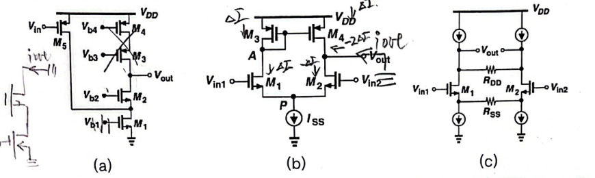

# 기출 2023-1 중간 3 — 폴디드 캐스코드, 전류 거울 부하 차동쌍, R_DD·R_SS 차동쌍의 출력 저항·G_m·이득

## 원문
다음 회로에 대해 질문에 답하시오.

: $I_{SS} = 1\ \text{mA}$, $I_{D1} = I_{D2} = 0.5\ \text{mA}$, $(W/L)_{1,2} = 200/0.2$, $(W/L)_{3,4} = 400/0.2$, $R_{DD} = 2\ \text{k}\Omega$, $R_{SS} = 200\ \Omega$, $\mu_n C_{ox} = 100\ \mu\text{A/V}^2$, $\mu_p C_{ox} = 50\ \mu\text{A/V}^2$, $g_m r_o \gg 1$로 가정한다.

(1) 회로 (a)의 출력저항과 전압이득의 식을 각각 구하시오. (각 MOSFET의 $g_m$과 $r_o$에 관한 식으로 표현하시오.)

(2) 주어진 조건을 이용하여 회로 (b)의 transconductance($G_m$)와 전압이득을 각각 구하시오. 단, $\lambda_n = \lambda_p = 0.1\ \text{V}^{-1}$로 가정한다.

(3) 주어진 조건을 이용하여 회로 (c)의 차동 전압이득을 구하시오. 단, $\lambda = 0$으로 가정한다.

## 조건
- 회로: 그림 (a), (b), (c)
- $I_{SS} = 1\ \text{mA}$, $I_{D1} = I_{D2} = 0.5\ \text{mA}$
- $(W/L)_{1,2} = 200/0.2$, $(W/L)_{3,4} = 400/0.2$
- $R_{DD} = 2\ \text{k}\Omega$, $R_{SS} = 200\ \Omega$
- $\mu_n C_{ox} = 100\ \mu\text{A/V}^2$, $\mu_p C_{ox} = 50\ \mu\text{A/V}^2$
- $g_m r_o \gg 1$로 가정
- (2) 전용 (회로 (b)): $\lambda_n = \lambda_p = 0.1\ \text{V}^{-1}$로 가정
- (3) 전용 (회로 (c)): $\lambda = 0$으로 가정
- 바이어스 전압 $V_{b1}$–$V_{b4}$와 $V_{DD}$ 값, (c)의 네 전류원 값은 주어지지 않음 (원문에 없음)

## 구할 것
- (1) 회로 (a)의 출력 저항과 전압 이득의 식 (각 MOSFET의 $g_m$과 $r_o$로 나타냄)
- (2) 주어진 조건으로 회로 (b)의 transconductance $G_m$과 전압 이득
- (3) 주어진 조건으로 회로 (c)의 차동 전압 이득

## 회로 — Fig Q3(a)
```spice
M5  n1    Vin  VDD  pmos
M4  n2    Vb4  VDD  pmos
M3  Vout  Vb3  n2   pmos
M2  Vout  Vb2  n1   nmos
M1  n1    Vb1  0    nmos
* n1 = M2 소스, M1 드레인, M5 드레인이 만나는 노드, 라벨 없음
```
- 단자: VDD = 전원, 값 미지정 (가로 레일) / Vb4, Vb3, Vb2, Vb1 = 이상적 DC 바이어스, 값 미지정 (점 단자) / Vin = 입력 (개방 원) / Vout = 출력 (개방 원)
- 표시: 노드 라벨 V_DD (레일 오른쪽 끝), V_in (입력 원 왼쪽), V_b4, V_b3, V_b2, V_b1 (각 점 단자 왼쪽), V_out (출력 원 오른쪽) / 소자 라벨 M_5 (M5 아래, 드레인 선 왼쪽), M_4, M_3, M_2, M_1 (각 트랜지스터 오른쪽) / 부호 없음 / 화살표 없음 / 수치·면적 라벨 없음
- 배치: 맨 위 굵은 가로 레일 V_DD / M5는 왼쪽 위, pmos 보통 방향(게이트 왼쪽, 소스 위·화살표가 채널 쪽으로 들어감, 드레인 아래), 소스에서 세로선이 위로 레일 / 오른쪽 세로줄 위→아래 M4, M3, Vout 접속점, M2, n1 접속점, M1, 접지 / M4, M3 pmos 보통 방향(게이트 왼쪽, 소스 위·화살표가 채널 쪽으로 들어감, 드레인 아래), M4 소스에서 세로선이 위로 레일 / M4 드레인에서 곧은 세로선이 M3 소스로 (n2, 라벨 없음) / M2, M1 nmos 보통 방향(게이트 왼쪽, 드레인 위, 소스 아래·화살표 바깥) / M5 드레인에서 긴 세로선이 n1 높이까지 내려가 모서리에서 오른쪽으로 꺾여 n1 접속점 / Vout 접속점에서 가로선이 오른쪽 V_out 원 / 각 점 단자 → 가로선 → 각 게이트, V_in 원 → 가로선 → M5 게이트 / M1 소스 아래 접지 / 접속점 (세 갈래 이상, 2곳): ① Vout = 위 M3 드레인 + 아래 M2 드레인 + 오른쪽 V_out 선 (점) ② n1 = 위 M2 소스 + 아래 M1 드레인 + 왼쪽 M5 드레인 가로선 (점) / 교차: 없음

## 회로 — Fig Q3(b)
```spice
M3   A     A     VDD  pmos   ; 좌우 반전 (게이트 오른쪽), 다이오드 연결
M4   Vout  A     VDD  pmos
M1   A     Vin1  P    nmos
M2   Vout  Vin2  P    nmos   ; 좌우 반전 (게이트 오른쪽)
ISS  P     0     {I_SS}
```
- 단자: VDD = 전원, 값 미지정 (가로 레일) / Vin1, Vin2 = 입력 (개방 원) / Vout = 출력 (개방 원)
- 표시: 노드 라벨 V_DD (레일 오른쪽 끝), A (A 접속점 왼쪽 아래), P (P 접속점 왼쪽 아래), V_in1 (왼쪽 입력 원 왼쪽), V_in2 (오른쪽 입력 원 오른쪽), V_out (출력 원 오른쪽) / 소자 라벨 M_3 (M3 왼쪽 아래), M_4 (M4 오른쪽 아래), M_1 (M1 오른쪽), M_2 (M2 왼쪽), I_SS (전류원 오른쪽) / 부호 없음 / 화살표 없음 / 수치·면적 라벨 없음
- 배치: 맨 위 굵은 가로 레일 V_DD / 왼쪽 세로줄 위→아래 M3, A 접속점, M1 / 오른쪽 세로줄 위→아래 M4, Vout 접속점, M2 / M3 pmos 좌우 반전(게이트 막대 오른쪽, 소스 왼쪽 위·화살표가 채널 쪽으로 들어감, 드레인 왼쪽 아래), M4 pmos 보통 방향(게이트 왼쪽, 소스 오른쪽 위), 두 소스에서 세로선이 위로 레일 / M3, M4 게이트는 가운데 게이트 접속점을 지나는 게이트 높이의 가로선으로 이어짐 / 게이트 접속점에서 세로선이 아래로 내려가 A 높이에서 왼쪽으로 꺾여 A 접속점 (다이오드 연결) / Vout 접속점에서 가로선이 오른쪽 V_out 원 / M1 nmos 보통 방향(게이트 왼쪽), M2 nmos 좌우 반전(게이트 오른쪽, 드레인 왼쪽 위, 소스 왼쪽 아래·화살표 바깥) / V_in1 원 → 가로선 → M1 게이트, M2 게이트 → 가로선 → V_in2 원 / 두 소스는 아래로 내려가 가로선으로 가운데 P 점에서 만남, P에서 아래로 I_SS(화살표 아래), 그 아래 접지 / 접속점 (세 갈래 이상, 4곳): ① 게이트 접속점 = 왼쪽 M3 게이트 + 오른쪽 M4 게이트 + 아래 다이오드 연결선 (점) ② A = 위 M3 드레인 + 아래 M1 드레인 + 오른쪽 다이오드 연결선 (점) ③ Vout = 위 M4 드레인 + 아래 M2 드레인 + 오른쪽 V_out 선 (점) ④ P = 왼쪽 M1 소스 선 + 오른쪽 M2 소스 선 + 아래 I_SS (점) / 교차: 없음

## 회로 — Fig Q3(c)
```spice
I1   VDD   out1   ; 라벨·값 없음
I2   VDD   out2   ; 라벨·값 없음
RDD  out1  out2  {R_DD}
M1   out1  Vin1  n1   nmos
M2   out2  Vin2  n2   nmos   ; 좌우 반전 (게이트 오른쪽)
RSS  n1    n2    {R_SS}
I3   n1    0      ; 라벨·값 없음
I4   n2    0      ; 라벨·값 없음
* out1, out2 = 두 출력 원. 원 사이에 V_out 라벨 하나 (차동 출력)
```
- 단자: VDD = 전원, 값 미지정 (가로 레일) / Vin1, Vin2 = 입력 (개방 원) / out1, out2 = 차동 출력 V_out의 두 단자 (개방 원, 각각에는 라벨 없음)
- 표시: 노드 라벨 V_DD (레일 오른쪽 끝), V_out (두 출력 원 사이), V_in1 (왼쪽 입력 원 왼쪽), V_in2 (오른쪽 입력 원 오른쪽) / 소자 라벨 R_DD (위 가로 저항 아래), R_SS (아래 가로 저항 아래), M_1 (M1 오른쪽), M_2 (M2 왼쪽), I1–I4 (라벨 없음) / 부호 없음 / 화살표 없음 / 수치·면적 라벨 없음
- 배치: 맨 위 굵은 가로 레일 V_DD / 왼쪽 세로줄 위→아래 전류원(화살표 아래), out1 첫 접속점, out1 둘째 접속점, M1, n1 접속점, 전류원(화살표 아래), 접지 / 오른쪽 세로줄은 좌우 대칭으로 전류원, out2 첫 접속점, out2 둘째 접속점, M2, n2 접속점, 전류원, 접지 / M1 nmos 보통 방향(게이트 왼쪽, 드레인 위, 소스 아래·화살표 바깥), M2 nmos 좌우 반전(게이트 막대 오른쪽, 드레인 왼쪽 위, 소스 왼쪽 아래·화살표 바깥) / out1 첫 접속점에서 가로선이 오른쪽 출력 원, out2 첫 접속점에서 가로선이 왼쪽 출력 원 (두 원이 가운데에서 마주 보고 그 사이에 V_out) / 두 둘째 접속점 사이에 가로로 놓인 R_DD (M1, M2 드레인 바로 위 높이) / n1, n2 사이에 가로로 놓인 R_SS (소스 바로 아래 높이) / V_in1 원 → 가로선 → M1 게이트, M2 게이트 → 가로선 → V_in2 원 / 접속점 (세 갈래 이상, 6곳): ① out1 첫 = 위 전류원 + 아래 세로선 + 오른쪽 출력선 (점) ② out1 둘째 = 위 세로선 + 아래 M1 드레인 + 오른쪽 R_DD (점) ③ n1 = 위 M1 소스 + 아래 전류원 + 오른쪽 R_SS (점) ④ out2 첫 = 위 전류원 + 아래 세로선 + 왼쪽 출력선 (점) ⑤ out2 둘째 = 위 세로선 + 아래 M2 드레인 + 왼쪽 R_DD (점) ⑥ n2 = 위 M2 소스 + 아래 전류원 + 왼쪽 R_SS (점) / 교차: 없음


> 참고: 답안지 손글씨가 겹침 ((a)의 M3·M4 위 X자 획, V_b1 둘레 세로 획, (a) 왼쪽에 손으로 그린 작은 회로와 "iout", (b)의 "ΔI"·"−2ΔI"·"iout" 글자와 화살표, V_out 원 위 화살표와 V_in2 오른쪽 밑줄). (b)의 V_out 원과 라벨은 손글씨 화살표·획에 일부 가려졌으나 판독됨

## 힌트
### (1) 출력 단락하면 $M_5$ 전류는 $M_2$로
- $M_5$는 입력을 받는 CS 소자이고, 그 드레인이 $M_1$ 드레인과 $M_2$ 소스가 만나는 노드로 접혀 들어간다(접힌 캐스코드)
- 출력을 AC 접지로 단락하면 $M_2$ 소스에서 본 저항이 약 $1/g_{m2}$라, $r_{O1} \parallel r_{O5}$보다 훨씬 작아 신호 전류가 거의 모두 $M_2$를 지난다(출력이 열려 있으면 이 저항이 $r_O$ 급으로 커지므로 이렇게 보지 않는다)
- 출력 저항의 아래쪽은 이 병렬 저항으로 축퇴된 $M_2$ 캐스코드로 본다
### (3) $R_{DD}$, $R_{SS}$ 가운데는 가상 접지
- 차동 입력에서 두 드레인, 두 소스가 각각 크기는 같고 방향이 반대로 움직이므로 두 저항의 가운데 점은 소신호 전압이 0이다
- 그래서 반회로에서는 두 저항의 절반이 각각 부하와 축퇴 저항이 되고, 이상적 전류원은 개방으로 본다

## 풀이
### (1) 출력 저항과 전압 이득
- $M_2$ 소스에 $M_1$, $M_5$가 병렬이라 $M_2$는 $r_{O1} \parallel r_{O5}$로 축퇴된 캐스코드 (축퇴가 $r_O$ 급이라 $g_{m2}(r_{O1} \parallel r_{O5}) \gg 1$): $R_{out} \approx [g_{m2} r_{O2}(r_{O1} \parallel r_{O5})] \parallel (g_{m3} r_{O3} r_{O4})$
- 출력 단락: $M_2$ 소스 저항 약 $1/g_{m2}$가 작아 $M_5$ 신호 전류가 거의 모두 $M_2$로 간다, $G_m \approx g_{m5}$ (개방이면 전류가 나뉘지만 노턴 등가라 이득은 같음)
- $V_{in}$이 오르면 $M_5$ 전류가 줄어 $V_{out}$이 내려간다: $A_v = -g_{m5} R_{out}$
### (2) $G_m$과 전압 이득
- $I_D = 0.5\ \text{mA}$: $g_{m1} = 10.0\ \text{mS}$ ($\sqrt{2\mu_n C_{ox}(W/L)I_D}$), $r_{O2} = r_{O4} = 20.0\ \text{k}\Omega$ ($1/\lambda I_D$)
- 출력 단락: $M_1$ 전류가 거울로 복사되어 $M_2$ 전류와 더해진다, $G_m = g_{m1} = 10.0\ \text{mS}$
- $A_v = G_m (r_{O2} \parallel r_{O4}) = 100$
### (3) 반회로와 차동 이득
- 양쪽이 반대로 움직여 $R_{DD}$, $R_{SS}$ 가운데는 가상 접지: 반회로 부하 $R_{DD}/2$, 축퇴 $R_{SS}/2$, 전류원 개방
- $A_v = -(R_{DD}/2)/(1/g_{m1}+R_{SS}/2)$, 곧 $-5.00$
### 답
- (1) $R_{out} \approx [g_{m2} r_{O2}(r_{O1} \parallel r_{O5})] \parallel (g_{m3} r_{O3} r_{O4})$, $A_v \approx -g_{m5} R_{out}$
- (2) $G_m = 10.0\ \text{mS}$, $A_v = 100$ ($V_{out}/(V_{in1} - V_{in2})$)
- (3) $A_v = -5.00$ ($V_{out}/(V_{in1} - V_{in2})$)
