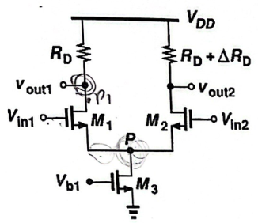

# 기출 2023-1 중간 4 — 부하 저항 불일치 ΔR_D가 있는 MOS 차동 증폭기의 입력 CM 범위, A_CM, A_CM-DM, CMRR

## 원문
다음 차동 증폭기에 대해 주어진 조건을 이용하여 질문에 답하시오.

: $V_{DD} = 1.8\ \text{V}$, $I_{D3} = 1\ \text{mA}$, $R_D = 1\ \text{k}\Omega$, $\Delta R_D = 20\ \Omega$, $(W/L)_{1,2} = 200/0.2$, $(W/L)_3 = 400/0.2$, $V_{TH,n} = 0.4\ \text{V}$, $\mu_n C_{ox} = 100\ \mu\text{A/V}^2$, $\lambda_n = 0.1\ \text{V}^{-1}$. 단, $g_m r_o \gg 1$로 가정한다.

(1) 입력 common-mode level($V_{CM,in}$)의 최대값과 최소값을 각각 구하시오.

(2) Common-mode 이득($A_{CM}$)과 common-mode to differential-mode 변환 이득($A_{CM-DM}$)을 각각 구하시오.

(3) Common-mode rejection ratio(CMRR)를 구하시오.

## 조건
- 회로: 그림의 차동 증폭기
- $V_{DD} = 1.8\ \text{V}$, $I_{D3} = 1\ \text{mA}$
- $R_D = 1\ \text{k}\Omega$, $\Delta R_D = 20\ \Omega$
- $(W/L)_{1,2} = 200/0.2$, $(W/L)_3 = 400/0.2$
- $V_{TH,n} = 0.4\ \text{V}$, $\mu_n C_{ox} = 100\ \mu\text{A/V}^2$, $\lambda_n = 0.1\ \text{V}^{-1}$
- $g_m r_o \gg 1$로 가정
- 바이어스 전압 $V_{b1}$ 값은 주어지지 않음 (원문에 없음)

## 구할 것
- (1) 입력 common-mode level $V_{CM,in}$의 최대값과 최소값
- (2) Common-mode 이득 $A_{CM}$과 common-mode to differential-mode 변환 이득 $A_{CM-DM}$
- (3) Common-mode rejection ratio (CMRR)

## 회로 — Fig Q4
```spice
RD1  VDD    vout1  {R_D}          ; 인쇄 라벨 R_D
RD2  VDD    vout2  {R_D+ΔR_D}     ; 인쇄 라벨 R_D + ΔR_D
M1   vout1  Vin1   P    nmos
M2   vout2  Vin2   P    nmos      ; 좌우 반전 (게이트 오른쪽)
M3   P      Vb1    0    nmos
```
- 단자: VDD = 1.8 V 전원 (가로 레일) / Vb1 = 이상적 DC 바이어스, 값 미지정 (점 단자) / Vin1, Vin2 = 입력 (개방 원) / vout1, vout2 = 출력 (개방 원)
- 표시: 노드 라벨 V_DD (레일 오른쪽 끝), v_out1 (왼쪽 출력 원 왼쪽), v_out2 (오른쪽 출력 원 오른쪽), V_in1 (왼쪽 입력 원 왼쪽), V_in2 (오른쪽 입력 원 오른쪽), P (P 접속점 위), V_b1 (점 단자 왼쪽) / 소자 라벨 R_D (왼쪽 저항 왼쪽), R_D + ΔR_D (오른쪽 저항 오른쪽), M_1 (M1 오른쪽), M_2 (M2 왼쪽), M_3 (M3 오른쪽) / 부호 없음 / 화살표 없음 / 수치·면적 라벨 없음
- 배치: 맨 위 굵은 가로 레일 V_DD / 왼쪽 세로줄 위→아래 R_D, vout1 접속점, M1 / 오른쪽 세로줄 위→아래 R_D + ΔR_D, vout2 접속점, M2 / vout1 접속점에서 가로선이 왼쪽 v_out1 원, vout2 접속점에서 가로선이 오른쪽 v_out2 원 (두 출력 원이 바깥쪽을 향함) / M1 nmos 보통 방향(게이트 왼쪽, 드레인 위, 소스 아래·화살표 바깥), M2 nmos 좌우 반전(게이트 막대 오른쪽, 드레인 왼쪽 위, 소스 왼쪽 아래·화살표 바깥) / V_in1 원 → 가로선 → M1 게이트, M2 게이트 → 가로선 → V_in2 원 / 두 소스는 아래로 내려가 가로선으로 가운데 P 점에서 만남 / P 아래 M3 (nmos 보통 방향, 게이트 왼쪽), V_b1 점 단자 → 가로선 → M3 게이트, M3 소스 아래 접지 / 접속점 (세 갈래 이상, 3곳): ① vout1 = 위 R_D + 아래 M1 드레인 + 왼쪽 출력선 (점, 손글씨 동그라미에 겹침) ② vout2 = 위 R_D + ΔR_D + 아래 M2 드레인 + 오른쪽 출력선 (점) ③ P = 왼쪽 M1 소스 선 + 오른쪽 M2 소스 선 + 아래 M3 드레인 (점, 손글씨 동그라미에 겹침) / 교차: 없음


> 참고: 답안지 손글씨가 겹침 (vout1 접속점 둘레 동그라미와 옆의 "ρ1"·점, P 접속점 둘레와 소스 가로선 위 동그라미). 두 출력 라벨의 v는 소문자로 인쇄됨

## 풀이
### DC·소신호 파라미터
- 각 쪽 $I_D = I_{D3}/2 = 0.5\ \text{mA}$. $V_{ov} = \sqrt{2I_D/[\mu_n C_{ox}(W/L)]}$로 $V_{ov1}$, $V_{ov3}$ 모두 $0.100\ \text{V}$
- $g_{m1} = 2I_D/V_{ov1} = 10.0\ \text{mS}$. $r_O = 1/(\lambda_n I_D)$로 $r_{O1} = 20.0\ \text{k}\Omega$, 테일 저항 $R_{SS} = r_{O3} = 10.0\ \text{k}\Omega$
### (1) 입력 CM 범위
- 최소 ($M_3$ 포화): $V_{TH,n} + V_{ov1} + V_{ov3} = 0.600\ \text{V}$
- 최대 ($M_1$, $M_2$ 포화): 낮은 쪽 드레인 $V_{DD} - (R_D + \Delta R_D) I_D$, 곧 $1.29\ \text{V}$에 $V_{TH,n}$을 더해 $1.69\ \text{V}$
### (2) $A_{CM}$과 $A_{CM-DM}$
- CM 입력에서 각 쪽 축퇴 저항은 $2R_{SS}$. $M_1$ 드레인 쪽 저항 $\approx g_{m1} r_{O1} (2R_{SS}) = 4.00\ \text{M}\Omega \gg R_D$라 $r_{O1}$ 무시
- $A_{CM} = -R_D/(1/g_{m1}+2R_{SS}) = -1\ \text{k}\Omega/(0.1+20)\ \text{k}\Omega = -4.98 \times 10^{-2}$ ($v_{out1}$)
- $A_{CM-DM} = \Delta R_D/(1/g_{m1}+2R_{SS}) = 20\ \Omega/20.1\ \text{k}\Omega = 9.95 \times 10^{-4}$ ($v_{out1} - v_{out2}$)
### (3) CMRR
- 차동 입력에서 $P$는 가상 접지(두 쪽 전류 변화가 반대). $r_{O1} = 20R_D$, (2)와 맞춰 무시: $|A_{DM}| = g_{m1}R_D = 10.0$
- $\text{CMRR} = |A_{DM}/A_{CM-DM}| = (1+2g_{m1}R_{SS})R_D/\Delta R_D = 1.01 \times 10^4$ ($80.0\ \text{dB}$)
### 답
- (1) $V_{CM,in,max} \approx 1.69\ \text{V}$, $V_{CM,in,min} = 0.600\ \text{V}$
- (2) $A_{CM} \approx -4.98 \times 10^{-2}$ ($v_{out1}$ 기준; $v_{out2}$ 기준 $-5.07 \times 10^{-2}$), $A_{CM-DM} \approx 9.95 \times 10^{-4}$
- (3) $\text{CMRR} \approx 1.01 \times 10^4$ ($80.0\ \text{dB}$)
