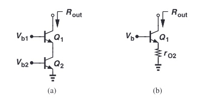

# 연습문제 9.1 — 목표 출력 저항에 필요한 Early 전압 (예제 9.1 변형)

## 조건
- 예제 9.1과 같은 회로·바이어스: Fig 9.2(a), $Q_1$, $Q_2$ 모두 $I_C = 1\ \text{mA}$, $\beta = 100$
- 바뀐 점: $V_A$가 미지수 (예제처럼 두 트랜지스터 동일), 목표 $R_{out} = 500\ \text{k}\Omega$

## 구할 것
- $R_{out} = 500\ \text{k}\Omega$이 되게 하는 $V_A$

## 상속·참조
- 예제 9.1 (E9.01): $V_A = 5\ \text{V}$일 때 $R_{out} \approx 328.9\ \text{k}\Omega$
- 식 (9.7): $R_{out} \approx g_{m1} r_{O1} \left( r_{O2} \parallel r_{\pi 1} \right)$

## 회로 — Fig 9.2(a)
```spice
Q1  out  Vb1  n1  npn
Q2  n1   Vb2  0   npn
```
- 단자: Vb1, Vb2 = 이상적 DC 바이어스(값 미지정) / out = 개방 출력 단자
- 표시: R_out = out을 위에서 아래로 들여다보는 화살표 / n1(Q1 이미터 = Q2 컬렉터)은 그림에 라벨 없음
- 배치: 위→아래 적층 Q1, Q2 / 두 베이스 단자는 왼쪽 / Q2 이미터 아래 접지 / 크롭 이미지 오른쪽의 (b)는 본문 등가회로라 이 문제와 무관


