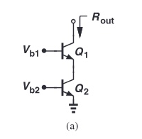

# 연습문제 9.2 — Q1의 Early 전압이 10 V일 때 (예제 9.2 변형)

## 원문
$Q_1$의 얼리 전압이 $10\ \text{V}$일 때 위의 예제를 다시 풀어라.

## 조건
- 예제 9.2와 같은 회로·바이어스: Fig 9.2(a), $Q_1$, $Q_2$ 모두 $I_C = 1\ \text{mA}$, $\beta = 100$, $V_{A2} = 50\ \text{V}$
- 바뀐 점: $Q_1$의 Early 전압 $V_{A1} = 10\ \text{V}$ (예제는 $5\ \text{V}$)

## 구할 것
- 예제 9.2를 다시 풂: 출력 저항 $R_{out}$를 구하고 식 (9.12)의 상한과 비교

## 상속·참조
- 예제 9.2 (E9.02): $V_{A1} = 5\ \text{V}$, $V_{A2} = 50\ \text{V}$일 때 $g_{m1} = (26\ \Omega)^{-1}$, $r_{\pi 1} = 2.6\ \text{k}\Omega$, $r_{O1} = 5\ \text{k}\Omega$, $r_{O2} = 50\ \text{k}\Omega$로 $R_{out} \approx 475\ \text{k}\Omega$, 상한 $500\ \text{k}\Omega$ (풀이의 가정: 상온 $V_T \approx 26\ \text{mV}$, $g_m = I_C/V_T$, $r_O = V_A/I_C$, $r_\pi = \beta V_T/I_C$)
- 식 (9.7): $R_{out} \approx g_{m1} r_{O1} \left( r_{O2} \parallel r_{\pi 1} \right)$
- 식 (9.12): 상한 $R_{out,max} \approx \beta_1 r_{O1}$

## 회로 — Fig 9.2(a)
```spice
Q1  out  Vb1  n1  npn
Q2  n1   Vb2  0   npn
```
- 단자: Vb1, Vb2 = 이상적 DC 바이어스, 값 미지정 (점 단자) / out = 출력, R_out 측정 단자 (개방 원)
- 표시: 노드 라벨 Vb1, Vb2 (각 점 단자 왼쪽) / 소자 라벨 Q1, Q2 (각 트랜지스터 오른쪽, 이미터 옆) / 부호 없음 / 화살표 "R_out": out 노드를 회로 쪽(아래)으로 들여다봄, 아래 방향, 도선 옆 별도 화살표 (┌ 꺾임: out 도선 오른쪽에 세로선을 두고 그 위 끝에서 짧은 가로선이 오른쪽 R_out 글자 쪽으로 뻗음, 화살촉은 아래 끝), 화살촉은 Q1 컬렉터 대각선 바로 위 높이에서 끝남 / 수치·면적 라벨 없음
- 배치: 한 세로줄 위→아래 out 원, Q1, Q2, 접지 / Q1, Q2 모두 보통 방향(베이스 막대 왼쪽, 컬렉터 오른쪽 위, 이미터 오른쪽 아래) / Vb1, Vb2 점 단자에서 가로선이 오른쪽으로 곧장 각 베이스 / Q1 컬렉터에서 세로선이 위로 올라가 out 원에서 끝남 / Q1 이미터에서 곧은 세로선이 Q2 컬렉터로 이어짐(n1, 라벨 없음) / Q2 이미터 아래 접지 기호 / 접속점: 없음 (세 갈래 이상 선이 만나는 곳 없음) / 교차: 없음



## 풀이
### 소신호 파라미터
- $g_{m1} = 1\ \text{mA}/26\ \text{mV} = 38.5\ \text{mS}$ ($V_T = 26\ \text{mV}$), $r_{\pi 1} = \beta/g_{m1} = 2.60\ \text{k}\Omega$
- $r_{O1} = 10\ \text{V}/1\ \text{mA} = 10.0\ \text{k}\Omega$, $r_{O2} = 50\ \text{V}/1\ \text{mA} = 50.0\ \text{k}\Omega$
### 캐스코드의 출력 저항
- $Q_2$ 베이스가 교류 접지라 $Q_1$은 $r_{O2}$로 이미터 축퇴, $r_{O2} \parallel r_{\pi 1} = 2.47\ \text{k}\Omega$
- $g_{m1}(r_{O2} \parallel r_{\pi 1}) = 95.1 \gg 1$이므로 $R_{out} \approx g_{m1} r_{O1} (r_{O2} \parallel r_{\pi 1}) = 95.1 \times 10\ \text{k}\Omega = 951\ \text{k}\Omega$
### 상한과 비교
- $R_{out,max} \approx \beta_1 r_{O1} = 100 \times 10\ \text{k}\Omega = 1.00\ \text{M}\Omega$ (식 (9.12))
- $R_{out}/R_{out,max} = 0.951$: 비율은 $r_{O2} \parallel r_{\pi 1}$과 $r_{\pi 1}$의 비라 $V_{A1}$과 무관하고, 두 값이 함께 2배가 된다
### 답
- $R_{out} \approx 951\ \text{k}\Omega$
- 상한 $R_{out,max} \approx 1.00\ \text{M}\Omega$보다 약 5% 작다 (예제처럼 상한의 약 95%).
