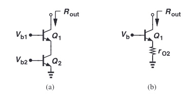

# 연습문제 9.3 — 출력 저항을 1.5배로 늘리는 해가 있는가 (예제 9.3 변형)

## 조건
- 예제 9.3과 같은 상황: Fig 9.2(a) 바이폴라 캐스코드에서 $Q_2$ 이미터와 접지 사이에 축퇴 저항 $R_E$를 넣음, $Q_1$과 $Q_2$는 같음
- 바뀐 점: 목표가 출력 임피던스 1.5배 증가 (예제는 2배)

## 구할 것
- 출력 임피던스를 1.5배로 만드는 $R_E$의 해가 존재하는지

## 상속·참조
- 예제 9.3 (E9.03) 풀이 (Fig 9.4): $Q_2$와 $R_E$를 등가 저항 $R_{outA}$로 바꿈
  - $R_{outA} = \left[1 + g_{m2} (R_E \parallel r_{\pi 2})\right] r_{O2} + R_E \parallel r_{\pi 2}$ (식 9.1을 $Q_2$에 적용)
  - $R_{out} \approx g_{m1} r_{O1} \left( R_{outA} \parallel r_{\pi 1} \right)$ (식 9.7에서 $r_{O2}$ 자리에 $R_{outA}$)
  - 2배 조건 $R_{outA} \parallel r_{\pi 1} = 2 (r_{O2} \parallel r_{\pi 1})$ → $R_{outA} = 2 r_{O2} r_{\pi 1} / (r_{\pi 1} - r_{O2})$, 보통 $r_{\pi 1} < r_{O2}$라 해가 없음
- 식 (9.7): 축퇴 없는 캐스코드 $R_{out} \approx g_{m1} r_{O1} \left( r_{O2} \parallel r_{\pi 1} \right)$

## 회로 — Fig 9.2(a)
```spice
Q1  out  Vb1  n1  npn
Q2  n1   Vb2  0   npn
```
- 단자: Vb1, Vb2 = 이상적 DC 바이어스, 값 미지정 (점 단자) / out = 출력, R_out 측정 단자 (개방 원)
- 표시: 노드 라벨 Vb1, Vb2 (각 점 단자 왼쪽) / 소자 라벨 Q1, Q2 (각 트랜지스터 오른쪽, 이미터 옆) / 부호 없음 / 화살표 "R_out": out 노드를 회로 쪽(아래)으로 들여다봄, 아래 방향, 도선 옆 별도 화살표 (┌ 꺾임: out 도선 오른쪽에 세로선을 두고 그 위 끝에서 짧은 가로선이 오른쪽 R_out 글자 쪽으로 뻗음, 화살촉은 아래 끝), 화살촉은 Q1 컬렉터 대각선 바로 위 높이에서 끝남 / 수치·면적 라벨 없음
- 배치: 한 세로줄 위→아래 out 원, Q1, Q2, 접지 / Q1, Q2 모두 보통 방향(베이스 막대 왼쪽, 컬렉터 오른쪽 위, 이미터 오른쪽 아래) / Vb1, Vb2 점 단자에서 가로선이 오른쪽으로 곧장 각 베이스 / Q1 컬렉터에서 세로선이 위로 올라가 out 원에서 끝남 / Q1 이미터에서 곧은 세로선이 Q2 컬렉터로 이어짐(n1, 라벨 없음) / Q2 이미터 아래 접지 기호 / 접속점: 없음 (세 갈래 이상 선이 만나는 곳 없음) / 교차: 없음


> 참고: 크롭 이미지 오른쪽의 (b)는 본문 등가회로(그림 9.2(b))라 이 문제와 무관
