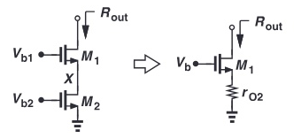

# 연습문제 9.5 — W/L = 32일 때 출력 임피던스 (예제 9.5 변형)

## 원문
$W/L = 32$일 때 출력 임피던스는 얼마인가?

## 조건
- 예제 9.5와 같은 NMOS 캐스코드(Fig 9.8)와 조건: $I_D = 0.5\ \text{mA}$, $\mu_n C_{ox} = 100\ \mu\text{A}/\text{V}^2$, $\lambda = 0.1\ \text{V}^{-1}$, $M_1$과 $M_2$가 같음
- 바뀐 점: $W/L = 32$ (두 트랜지스터 모두) (원문에 없음, 예제의 "M1 = M2" 가정을 이어받음)

## 구할 것
- 출력 임피던스 $R_{out}$

## 상속·참조
- 예제 9.5 (E9.05): 같은 조건에서 $R_{out} = 500\ \text{k}\Omega$이 되려면 $W/L = 15.6$ ($r_{O1} = r_{O2} = (\lambda I_D)^{-1} = 20\ \text{k}\Omega$, $g_{m1} = (800\ \Omega)^{-1}$)
- 식 (9.23): $R_{out} \approx g_{m1} r_{O1} r_{O2}$, $g_m = \sqrt{2 \mu_n C_{ox} (W/L) I_D}$

## 회로 — Fig 9.8
```spice
M1  out  Vb1  X  nmos
M2  X    Vb2  0  nmos
```
- 단자: Vb1, Vb2 = 이상적 DC 바이어스, 값 미지정 (점 단자) / out = 출력, R_out 측정 단자 (개방 원)
- 표시: 노드 라벨 Vb1, Vb2 (각 점 단자 왼쪽), X (M1–M2 연결선 왼쪽, 두 트랜지스터 사이) / 소자 라벨 M1, M2 (각 트랜지스터 오른쪽, 소스 옆) / 부호 없음 / 화살표 "R_out": out 노드를 아래로 들여다봄, 아래 방향, 도선 옆 별도 화살표 (┌ 꺾임: out 도선 오른쪽에 세로선, 위 끝에서 가로선이 오른쪽 R_out 글자 쪽으로, 화살촉은 아래 끝, M1 드레인 바로 위 높이) / 수치·면적 라벨 없음
- 배치: 한 세로줄 위→아래 out 원, M1, X, M2, 접지 / M1, M2 모두 NMOS 보통 방향(게이트 왼쪽, 드레인 위, 소스 아래·소스 화살표 바깥) / Vb1, Vb2 점 단자 → 가로선 → 각 게이트 / M1 드레인에서 세로선이 위로 out 원 / M1 소스에서 곧은 세로선이 M2 드레인으로 = X / M2 소스 아래 접지 / 접속점: 없음 / 교차: 없음

## 회로 — Fig 9.8(eq)
```spice
M1   out  Vb  n1  nmos
RO2  n1   0   {r_O2}
```
- 단자: Vb = 이상적 DC 바이어스, 값 미지정 (점 단자) / out = 출력, R_out 측정 단자 (개방 원)
- 표시: 노드 라벨 Vb (점 단자 왼쪽) / 소자 라벨 M1 (트랜지스터 오른쪽), r_O2 (세로 저항 오른쪽) / 부호 없음 / 화살표 "R_out": out 노드를 아래로 들여다봄, 아래 방향, 도선 옆 별도 화살표 (┌ 꺾임, 화살촉은 아래 끝) / 수치·면적 라벨 없음
- 배치: 왼쪽 회로 오른쪽에 속이 빈 오른쪽 방향 굵은 화살표(⇒) 다음에 그려짐 / 한 세로줄 위→아래 out 원, M1, 세로 저항 r_O2, 접지 / Vb 점 단자 → 가로선 → 게이트 / 접속점: 없음 / 교차: 없음


> 참고: Fig 9.8은 예제 상자 밖의 본문 그림(제목 "MOS 캐스코드 전류원과 등가 회로")이고, 오른쪽 등가회로는 본문 식 9.22–9.23 설명용

## 풀이
### 소신호 파라미터
- $g_m = \sqrt{2 \mu_n C_{ox} (W/L) I_D} = \sqrt{2 \times 100\ \mu\text{A/V}^2 \times 32 \times 0.5\ \text{mA}} = 1.79\ \text{mS} = (559\ \Omega)^{-1}$
- $r_O = 1/(\lambda I_D) = 1/(0.1\ \text{V}^{-1} \times 0.5\ \text{mA}) = 20.0\ \text{k}\Omega$ ($M_1$, $M_2$ 같음)
### 출력 저항
- $M_2$ 게이트가 교류 접지라 $M_1$ 소스에서 본 $M_2$는 $r_{O2}$ → $M_1$은 $r_{O2}$로 소스 축퇴
- $g_{m1} r_{O2} = 35.8 \gg 1$이므로 $R_{out} \approx g_{m1} r_{O1} r_{O2} = 35.8 \times 20\ \text{k}\Omega = 716\ \text{k}\Omega$
### 예제와 비교
- $g_m \propto \sqrt{W/L}$라 $W/L$이 $15.6 \to 32$로 약 2배가 되면 $R_{out}$은 $\sqrt{2}$배쯤($500 \to 716\ \text{k}\Omega$) 늘어난다
### 답
- $R_{out} \approx 716\ \text{k}\Omega$
