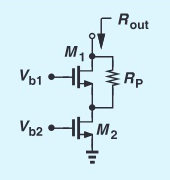

# 연습문제 9.6 — 출력 임피던스를 절반으로 떨어뜨리는 R_P (예제 9.6 이어서)

## 조건
- 예제 9.6의 회로: Fig 9.11, 기생 저항 $R_P$가 $M_1$의 드레인과 소스 사이에 있음
- 비교 기준: $R_P$가 없을 때의 출력 임피던스 (원문에 없음, "2배로 감소"의 기준을 해석한 것)

## 구할 것
- 출력 임피던스가 2배로 감소(절반이 됨)하는 $R_P$ 값

## 상속·참조
- 예제 9.6 (E9.06) 풀이: $R_P$가 $r_{O1}$과 병렬 → $R_{out} = g_{m1} (r_{O1} \parallel R_P) r_{O2}$ (식 9.27), 더 정확히는 $R_{out} = (1 + g_{m1} r_{O2})(r_{O1} \parallel R_P) + r_{O2}$ (식 9.28)
- $R_P$ 없을 때 식 (9.23): $R_{out} \approx g_{m1} r_{O1} r_{O2}$

## 회로 — Fig 9.11
```spice
M1  out  Vb1  n1  nmos
M2  n1   Vb2  0   nmos
RP  out  n1   {R_P}     ; M1 드레인 ↔ M1 소스
```
- 단자: Vb1, Vb2 = 이상적 DC 바이어스, 값 미지정 (점 단자) / out = 출력, R_out 측정 단자 (개방 원)
- 표시: 노드 라벨 Vb1, Vb2 (각 점 단자 왼쪽) / 소자 라벨 M1 (M1 드레인 위 접속점의 왼쪽, 게이트보다 위), M2 (M2 오른쪽, 소스 옆), R_P (세로 저항 오른쪽) / 부호 없음 / 화살표 "R_out": out 노드를 아래로 들여다봄, 아래 방향, 도선 옆 별도 화살표 (┌ 꺾임: out 도선 오른쪽, out 도선과 R_P 가지 사이에 세로선, 위 끝에서 가로선이 오른쪽 R_out 글자 쪽으로, 화살촉은 위 접속점 바로 위 높이) / 수치·면적 라벨 없음
- 배치: 한 세로줄 위→아래 out 원, 위 접속점, M1, 아래 접속점, M2, 접지 / M1, M2 모두 NMOS 보통 방향(게이트 왼쪽, 드레인 위, 소스 아래·화살표 바깥) / 위 접속점(M1 드레인 바로 위)에서 가로선이 오른쪽으로 나가 모서리에서 아래로 꺾여 M1 오른쪽에 세로로 놓인 R_P(M1 높이)를 지나 아래 모서리에서 왼쪽으로 꺾여 아래 접속점(M1 소스–M2 드레인 선, M2 바로 위)에 닿음 / Vb1, Vb2 점 단자 → 가로선 → 각 게이트 / M2 소스 아래 접지 / 접속점 (세 갈래 이상, 2곳): 위 = 위 out 원 + 아래 M1 드레인 + 오른쪽 R_P 가지 (점), 아래 n1 = 위 M1 소스 + 아래 M2 드레인 + 오른쪽 R_P 가지 (점) / 교차: 없음


