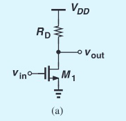

# 연습문제 9.7 — 폭과 바이어스 전류를 2배로 할 때 G_m의 변화 (예제 9.7 이어서)

## 원문
트랜지스터의 폭과 바이어스 전류가 2배로 된다면 $G_m$은 어떻게 변하는가?

## 조건
- 예제 9.7의 CS 단: Fig 9.13(a)
- 트랜지스터의 폭 $W$와 바이어스 전류 $I_D$를 모두 2배로 함 (길이 $L$ 등 나머지는 그대로) (원문에 없음)

## 구할 것
- $G_m$이 어떻게 변하는지

## 상속·참조
- 예제 9.7 (E9.07): 출력을 교류 접지에 단락하면 $G_m = i_{out}/v_{in} = g_{m1}$ (식 9.32)
- MOSFET 트랜스컨덕턴스 $g_m = \sqrt{2 \mu_n C_{ox} (W/L) I_D}$

## 회로 — Fig 9.13(a)
```spice
RD  VDD  vout  {R_D}
M1  vout vin   0  nmos
```
- 단자: VDD = 전원, 값 미지정 (T 전원 기호) / vin = 소신호 입력 (개방 원) / vout = 출력 (개방 원)
- 표시: 노드 라벨 VDD (T 기호 오른쪽), v_in (입력 원 왼쪽), v_out (출력 원 오른쪽) / 소자 라벨 R_D (저항 왼쪽), M1 (M1 오른쪽, 소스 옆) / 부호 없음 / 화살표 없음 / 수치·면적 라벨 없음
- 배치: 한 세로줄 위→아래 VDD T 기호, R_D, 드레인 접속점, M1, 접지 / M1 NMOS 보통 방향(게이트 왼쪽, 소스 아래·화살표 바깥) / v_in 원 → 가로선 → 게이트 / 드레인 접속점에서 가로선이 오른쪽으로 뻗어 v_out 원에서 끝남 / M1 소스 아래 접지 / 접속점 (세 갈래 이상, 1곳): 드레인 = 위 R_D + 아래 M1 드레인 + 오른쪽 v_out 선 (점) / 교차: 없음


