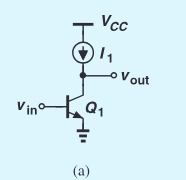

# 연습문제 9.8 — 이미터 축퇴된 CE 단의 전압 이득은 늘어나는가 (예제 9.8 이어서)

## 원문
트랜지스터가 이미터 저항 $R_E$에 의해 축퇴되었다고 가정하자. 트랜스컨덕턴스는 떨어지고 출력 저항은 올라간다. 전압 이득은 증가하는가? 감소하는가?

## 조건
- 예제 9.8의 공통 이미터 단: Fig 9.15(a) ($Q_1$, 전류원 부하 $I_1$)
- 바뀐 점: 트랜지스터가 이미터 저항 $R_E$로 축퇴됨 ($Q_1$ 이미터와 접지 사이에 $R_E$) (원문에 없음, 연결 위치는 "이미터 축퇴"의 뜻을 풀어 쓴 것)
- 원문이 주는 사실: 축퇴하면 트랜스컨덕턴스는 떨어지고 출력 저항은 올라감

## 구할 것
- 전압 이득이 증가하는지 감소하는지

## 상속·참조
- 예제 9.8 (E9.08): 축퇴 없을 때 $G_m = g_{m1}$, $R_{out} = r_{O1}$, $A_v = -G_m R_{out} = -g_{m1} r_{O1}$
- 식 (9.33) (보조 정리): $A_v = -G_m R_{out}$
- 식 (9.1): 이미터 축퇴된 트랜지스터의 컬렉터 쪽 출력 저항 $R_{out} = \left[1 + g_m (R_E \parallel r_\pi)\right] r_O + R_E \parallel r_\pi$

## 회로 — Fig 9.15(a)
```spice
I1  VCC   vout
Q1  vout  vin  0  npn
```
- 단자: VCC = 전원, 값 미지정 (T 전원 기호) / vin = 소신호 입력 (개방 원) / vout = 출력 (개방 원)
- 표시: 노드 라벨 VCC (T 기호 오른쪽), v_in (입력 원 왼쪽), v_out (출력 원 오른쪽) / 소자 라벨 I_1 (전류원 오른쪽), Q1 (Q1 오른쪽, 이미터 옆) / 부호 없음 / 화살표 없음 / 수치·면적 라벨 없음
- 배치: 한 세로줄 위→아래 VCC T 기호, I_1 전류원, 컬렉터 접속점, Q1, 접지 / Q1 npn 보통 방향(베이스 왼쪽, 컬렉터 오른쪽 위, 이미터 오른쪽 아래·화살표 바깥) / v_in 원 → 가로선 → 베이스 / 컬렉터 접속점에서 가로선이 오른쪽으로 뻗어 v_out 원에서 끝남 / Q1 이미터 아래 접지 / 접속점 (세 갈래 이상, 1곳): 컬렉터 = 위 I_1 + 아래 Q1 컬렉터 + 오른쪽 v_out 선 (점) / 교차: 없음


> 참고: 그림에는 R_E가 없음 (문제에서 이미터와 접지 사이에 넣는 것)
