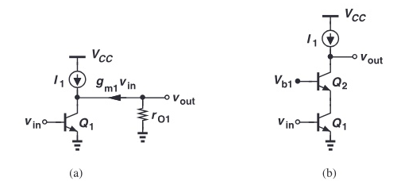

# 연습문제 9.9 — 전압 이득 5000을 주는 Early 전압 (예제 9.9 이어서)

## 조건
- 예제 9.9의 회로·바이어스: Fig 9.16(b) 바이폴라 캐스코드, 바이어스 전류 $1\ \text{mA}$, $\beta = 100$, 부하는 이상적인 전류원
- 바뀐 점: $V_A$가 미지수, 목표 전압 이득 $5000$
- $V_A$는 예제처럼 두 트랜지스터가 같음, 이득 5000은 크기 $|A_v|$ (원문에 없음)

## 구할 것
- 전압 이득 $5000$을 주는 Early 전압 $V_A$

## 상속·참조
- 예제 9.9 (E9.09): $V_A = 5\ \text{V}$일 때 $g_{m1} = (26\ \Omega)^{-1}$, $r_{\pi 1} \approx r_{\pi 2} \approx 2600\ \Omega$, $r_{O1} \approx r_{O2} = 5\ \text{k}\Omega$, $g_{m1}(r_{O1} \parallel r_{\pi 2}) = 65.8$, $|A_v| = 12{,}654$ (풀이의 가정: 상온 $V_T \approx 26\ \text{mV}$, $g_m = I_C/V_T$, $r_O = V_A/I_C$, $r_\pi = \beta V_T/I_C$)
- 식 (9.53): $A_v \approx -g_{m1} r_{O1}\, g_{m1} (r_{O1} \parallel r_{\pi 2})$

## 회로 — Fig 9.16(b)
```spice
I1  VCC   vout
Q2  vout  Vb1  n1  npn
Q1  n1    vin  0   npn
```
- 단자: VCC = 전원, 값 미지정 (T 전원 기호) / Vb1 = 이상적 DC 바이어스, 값 미지정 (점 단자) / vin = 소신호 입력 (개방 원) / vout = 출력 (개방 원)
- 표시: 노드 라벨 VCC (T 기호 오른쪽), v_out (출력 원 오른쪽), V_b1 (점 단자 왼쪽), v_in (입력 원 왼쪽) / 소자 라벨 I_1 (전류원 왼쪽), Q2, Q1 (각 트랜지스터 오른쪽, 이미터 옆) / 부호 없음 / 화살표 없음 / 수치·면적 라벨 없음
- 배치: 한 세로줄 위→아래 VCC T 기호, I_1 전류원, 컬렉터 접속점, Q2, Q1, 접지 / Q2, Q1 npn 보통 방향(베이스 왼쪽, 컬렉터 오른쪽 위, 이미터 오른쪽 아래) / 접속점에서 가로선이 오른쪽으로 뻗어 v_out 원 / V_b1 점 단자 → 가로선 → Q2 베이스, v_in 원 → 가로선 → Q1 베이스 / Q2 이미터에서 곧은 세로선이 Q1 컬렉터로 (n1, 라벨 없음) / Q1 이미터 아래 접지 / 접속점 (세 갈래 이상, 1곳): Q2 컬렉터 위 = 위 I_1 + 아래 Q2 컬렉터 + 오른쪽 v_out 선 (점) / 교차: 없음


> 참고: 크롭 이미지 왼쪽의 (a)는 본문 그림(CE 단에서 r_O1으로 흐르는 출력 전류)이라 이 문제와 무관
