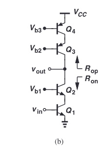

# 연습문제 9.10 — 컬렉터 바이어스 전류 0.5 mA로 다시 풀기 (예제 9.10 변형)

## 원문
컬렉터 바이어스 전류가 $0.5\ \text{mA}$일 경우 위의 예제를 다시 풀어라.

## 조건
- 예제 9.10과 같은 회로: Fig 9.19(b) 바이폴라 캐스코드 증폭기 + pnp 캐스코드 부하
- npn ($Q_1$, $Q_2$): $V_A = 5\ \text{V}$, $\beta = 100$ / pnp ($Q_3$, $Q_4$): $V_A = 4\ \text{V}$, $\beta = 50$
- 바뀐 점: 컬렉터 바이어스 전류 $0.5\ \text{mA}$ (예제는 $1\ \text{mA}$)
- 네 트랜지스터 모두 $0.5\ \text{mA}$를 흘림 (원문에 없음, 예제 풀이처럼 부하도 같은 전류로 봄)

## 구할 것
- 예제 9.10을 다시 풂: 전압 이득 $A_v$

## 상속·참조
- 예제 9.10 (E9.10): $1\ \text{mA}$에서 $R_{op} = 151\ \text{k}\Omega$, $R_{on} = 329\ \text{k}\Omega$, $|A_v| = 3{,}981$ (풀이의 가정: 상온 $V_T \approx 26\ \text{mV}$, $g_m = I_C/V_T$, $r_O = V_A/I_C$, $r_\pi = \beta V_T/I_C$)
- 식 (9.58)–(9.59): $R_{on} \approx g_{m2} r_{O2} (r_{O1} \parallel r_{\pi 2})$, $\quad R_{op} \approx g_{m3} r_{O3} (r_{O4} \parallel r_{\pi 3})$
- 식 (9.60): $A_v = -g_{m1} (R_{on} \parallel R_{op})$

## 회로 — Fig 9.19(b)
```spice
Q4  n2    Vb3  VCC  pnp
Q3  vout  Vb2  n2   pnp
Q2  vout  Vb1  n1   npn
Q1  n1    vin  0    npn
```
- 단자: VCC = 전원, 값 미지정 (T 전원 기호) / Vb3, Vb2, Vb1 = 이상적 DC 바이어스, 값 미지정 (점 단자) / vin = 소신호 입력 (개방 원) / vout = 출력 (개방 원)
- 표시: 노드 라벨 VCC (T 기호 오른쪽), V_b3, V_b2, V_b1 (각 점 단자 왼쪽), v_out (출력 원 왼쪽), v_in (입력 원 왼쪽) / 소자 라벨 Q4, Q3, Q2, Q1 (각 트랜지스터 오른쪽) / 부호 없음 / 화살표 "R_op": vout 노드에서 위(Q3, Q4 쪽)를 들여다봄, 위 방향, 도선 옆 별도 화살표 (L자: 트랜지스터 줄 오른쪽에 세로선, 아래 끝에서 짧은 가로선이 오른쪽 R_op 글자 쪽으로, 화살촉은 위 끝, Q3 컬렉터 대각선 바로 아래 높이, 아래 가로선은 vout 접속점 높이); "R_on": vout 노드에서 아래(Q2, Q1 쪽)를 들여다봄, 아래 방향, 도선 옆 별도 화살표 (┌ 꺾임: 위 끝에서 짧은 가로선이 오른쪽 R_on 글자 쪽으로, 가로선은 vout 접속점과 Q2 사이 높이, 화살촉은 아래 끝으로 Q2 컬렉터 대각선 옆을 지나 Q2 베이스 높이(Q2 라벨 왼쪽 옆)까지 내려감) / 수치·면적 라벨 없음
- 배치: 한 세로줄 위→아래 VCC T 기호, Q4, Q3, vout 접속점, Q2, Q1, 접지 / Q4, Q3 pnp (베이스 왼쪽, 이미터가 위·화살표가 막대 쪽으로 들어감, 컬렉터 아래) / Q2, Q1 npn 보통 방향(베이스 왼쪽, 컬렉터 위, 이미터 아래·화살표 바깥) / Q4 이미터에서 세로선이 위로 VCC T 기호 / Q4 컬렉터에서 곧은 세로선이 Q3 이미터로 (n2, 라벨 없음) / Q3 컬렉터 → 세로선 → vout 접속점 → 세로선 → Q2 컬렉터 / vout 접속점에서 가로선이 왼쪽으로 뻗어 v_out 원 (원은 점 단자들과 비슷한 x) / Q2 이미터에서 곧은 세로선이 Q1 컬렉터로 (n1, 라벨 없음) / Q1 이미터 아래 접지 / V_b3, V_b2, V_b1 점 단자와 v_in 원 → 가로선 → 각 베이스 / R_op 화살표는 vout 접속점 위, R_on 화살표는 그 아래, 둘 다 트랜지스터 줄 오른쪽 / 접속점 (세 갈래 이상, 1곳): vout = 위 Q3 컬렉터 + 아래 Q2 컬렉터 + 왼쪽 v_out 선 (점) / 교차: 없음



## 풀이
### 소신호 파라미터
- 네 트랜지스터 모두 $0.5\ \text{mA}$ → $g_{m1} = \cdots = g_{m4} = g_m = 0.5\ \text{mA}/26\ \text{mV} = 19.2\ \text{mS}$ ($V_T = 26\ \text{mV}$)
- npn: $r_{\pi 2} = 100/g_m = 5.20\ \text{k}\Omega$, $r_{O1} = r_{O2} = 5\ \text{V}/0.5\ \text{mA} = 10.0\ \text{k}\Omega$
- pnp: $r_{\pi 3} = 50/g_m = 2.60\ \text{k}\Omega$, $r_{O3} = r_{O4} = 4\ \text{V}/0.5\ \text{mA} = 8.00\ \text{k}\Omega$
### 아래쪽 저항 $R_{on}$
- 입력이 0이면 $Q_1$은 $r_{O1}$뿐 → $Q_2$가 $r_{O1}$로 이미터 축퇴, $g_{m2}(r_{O1} \parallel r_{\pi 2}) = 65.8 \gg 1$
- $R_{on} \approx g_{m2} r_{O2} (r_{O1} \parallel r_{\pi 2}) = 658\ \text{k}\Omega$
### 위쪽 저항 $R_{op}$
- $V_{b3}$가 교류 접지라 $Q_3$은 $r_{O4}$로 이미터 축퇴, $g_{m3}(r_{O4} \parallel r_{\pi 3}) = 37.7 \gg 1$
- $R_{op} \approx g_{m3} r_{O3} (r_{O4} \parallel r_{\pi 3}) = 302\ \text{k}\Omega$
### 전압 이득
- $1/g_{m2} \ll r_{O1}$이므로 등가 트랜스컨덕턴스 $G_m \approx g_{m1}$: $A_v = -g_{m1}(R_{on} \parallel R_{op}) = -19.2\ \text{mS} \cdot 207\ \text{k}\Omega = -3.98 \times 10^3$
- $g_m \propto I_C$, $R_{on}, R_{op} \propto 1/I_C$라 전류가 약분되어 예제 9.10($1\ \text{mA}$)과 같다
### 답
- $A_v \approx -3.98 \times 10^3$ (바이어스 전류와 무관하게 예제 9.10과 같음)
