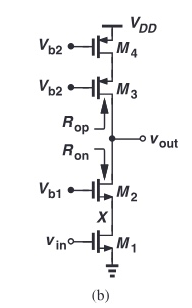

# 연습문제 9.11 — 바이어스 전류를 줄이면 출력 임피던스가 커지는 이유와 0.25 mA에서의 값 (예제 9.11 이어서)

## 원문
위의 예제에서 왜 바이어스 전류를 감소시킬수록 출력 임피던스가 더 증가하는지 설명하라. 드레인 전류가 $0.25\ \text{mA}$일 경우 출력 임피던스를 계산하라.

## 조건
- 예제 9.11의 회로와 소자 파라미터: Fig 9.20(b), $(W/L)_{1,2} = 30$, $(W/L)_{3,4} = 40$, $\mu_n C_{ox} = 100\ \mu\text{A}/\text{V}^2$, $\mu_p C_{ox} = 50\ \mu\text{A}/\text{V}^2$, $\lambda_n = 0.1\ \text{V}^{-1}$, $\lambda_p = 0.15\ \text{V}^{-1}$
- 바뀐 점: 드레인 전류 $0.25\ \text{mA}$ (예제는 $0.5\ \text{mA}$), 네 트랜지스터 모두 같은 전류 (원문에 없음, 예제의 $I_{D1} = \cdots = I_{D4}$를 이어받음)
- 출력 임피던스 = 출력 노드에서 본 $R_{on} \parallel R_{op}$ (원문에 없음)

## 구할 것
- (1) 예제에서 바이어스 전류를 줄일수록 출력 임피던스가 더 커지는 이유 설명
- (2) 드레인 전류가 $0.25\ \text{mA}$일 때 출력 임피던스 계산

## 상속·참조
- 예제 9.11 (E9.11): $0.5\ \text{mA}$에서 $g_{m1,2} = (577\ \Omega)^{-1}$, $g_{m3,4} = (707\ \Omega)^{-1}$, $r_{O1,2} = 20\ \text{k}\Omega$, $r_{O3,4} = 13.3\ \text{k}\Omega$, $R_{on} \approx 693\ \text{k}\Omega$, $R_{op} \approx 250\ \text{k}\Omega$, $A_v \approx -318$
- 식 (9.70)–(9.71): $R_{on} \approx g_{m2} r_{O2} r_{O1}$, $\quad R_{op} \approx g_{m3} r_{O3} r_{O4}$
- $g_m = \sqrt{2 \mu C_{ox} (W/L) I_D}$, $r_O = (\lambda I_D)^{-1}$

## 회로 — Fig 9.20(b)
```spice
M4  n2    Vb2  VDD  pmos
M3  vout  Vb2  n2   pmos    ; M4, M3 게이트 라벨이 둘 다 V_b2로 인쇄됨 (점 단자 두 개, 그림에서 서로 이어져 있지 않음)
M2  vout  Vb1  X    nmos
M1  X     vin  0    nmos
```
- 단자: VDD = 전원, 값 미지정 (T 전원 기호) / Vb2 = 이상적 DC 바이어스, 값 미지정 (점 단자, M4 게이트와 M3 게이트에 하나씩 모두 V_b2로 인쇄) / Vb1 = 이상적 DC 바이어스, 값 미지정 (점 단자) / vin = 소신호 입력 (개방 원) / vout = 출력 (개방 원)
- 표시: 노드 라벨 VDD (T 기호 오른쪽), V_b2 (M4 게이트 점 단자 왼쪽), V_b2 (M3 게이트 점 단자 왼쪽), V_b1 (점 단자 왼쪽), X (M2–M1 연결선 왼쪽, 두 트랜지스터 사이), v_in (입력 원 왼쪽), v_out (출력 원 오른쪽) / 소자 라벨 M4, M3, M2, M1 (각 트랜지스터 오른쪽) / 부호 없음 / 화살표 "R_op": vout 노드에서 위(M3, M4 쪽)를 들여다봄, 위 방향, 도선 옆 별도 화살표 (L자를 좌우 반전: M3 게이트 판과 드레인 세로선 사이(드레인선 바로 왼쪽, M3 채널 바로 아래 x)에 세로선, 아래 끝에서 짧은 가로선이 왼쪽 R_op 글자 쪽으로, 가로선은 vout 접속점보다 약간 위, 화살촉은 위 끝, M3 드레인 바로 아래 높이); "R_on": vout 노드에서 아래(M2, M1 쪽)를 들여다봄, 아래 방향, 도선 옆 별도 화살표 (┌ 꺾임을 좌우 반전: M2 게이트 판과 드레인 세로선 사이(드레인선 바로 왼쪽, M2 채널 바로 위 x)에 세로선, 위 끝에서 짧은 가로선이 왼쪽 R_on 글자 쪽으로, 화살촉은 아래 끝, M2 드레인 바로 위 높이) / 수치·면적 라벨 없음
- 배치: 한 세로줄 위→아래 VDD T 기호, M4, M3, vout 접속점, M2, X, M1, 접지 / M4, M3 PMOS (게이트 왼쪽, 소스가 위·소스 화살표가 채널 쪽으로 들어감, 드레인 아래) / M2, M1 NMOS 보통 방향(게이트 왼쪽, 드레인 위, 소스 아래·화살표 바깥) / M4 소스에서 세로선이 위로 VDD T 기호 / M4 드레인에서 곧은 세로선이 M3 소스로 (n2, 라벨 없음) / M3 드레인 → 세로선 → vout 접속점 → 세로선 → M2 드레인 / vout 접속점에서 가로선이 오른쪽으로 뻗어 v_out 원 / M2 소스에서 곧은 세로선이 M1 드레인으로 = X / M1 소스 아래 접지 / 점 단자들과 v_in 원 → 가로선 → 각 게이트 / R_op, R_on 화살표의 세로선은 게이트 판과 드레인 세로선 사이(드레인선 바로 왼쪽), R_op·R_on 글자는 그 왼쪽(R_op는 M3 게이트 선 아래, R_on은 M2 게이트 선 위), R_op는 vout 접속점 위, R_on은 그 아래 / 접속점 (세 갈래 이상, 1곳): vout = 위 M3 드레인 + 아래 M2 드레인 + 오른쪽 v_out 선 (점) / 교차: 없음


> 참고: (b)의 두 V_b2 라벨 중 하나(M4 쪽)는 원문 오식일 수 있으나 인쇄된 대로 적음
