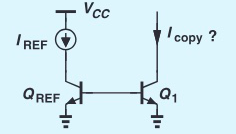

# 연습문제 9.12 — 베이스–컬렉터를 잇지 않은 Q_REF의 동작 영역 (예제 9.12 이어서)

## 원문
$Q_{REF}$의 동작 영역은 무엇인가?

## 조건
- 예제 9.12의 회로: Fig 9.25 ($Q_{REF}$의 베이스와 컬렉터가 연결되지 않은 전류 거울)

## 구할 것
- $Q_{REF}$의 동작 영역

## 상속·참조
- 예제 9.12 (E9.12) 풀이: 베이스 전류가 흐를 경로가 없고 $V_{BE}$가 정해지지 않음, 베이스 전류가 없으므로 $I_{copy} = 0$

## 회로 — Fig 9.25
```spice
IREF  VCC  n1
QREF  n1   n2  0  npn
Q1    out  n2  0  npn
```
- 단자: VCC = 전원, 값 미지정 (T 전원 기호) / out = Q1 컬렉터, I_copy가 들어가는 단자 (선 끝)
- 표시: 노드 라벨 VCC (T 기호 오른쪽) / 소자 라벨 I_REF (전류원 왼쪽), Q_REF (Q_REF 왼쪽, 이미터 높이), Q1 (Q1 오른쪽, 이미터 옆) / 부호 없음 / 화살표 "I_copy ?": out, 아래 방향(Q1 컬렉터로 들어감), 도선 위, 글자는 화살표 오른쪽이고 물음표까지 인쇄됨 / 수치·면적 라벨 없음
- 배치: 왼쪽 세로줄 위→아래 VCC T 기호, I_REF 전류원, Q_REF, 접지 / Q_REF 좌우 반전(베이스 막대 오른쪽, I_REF에서 내려온 세로선이 비스듬히 막대 위쪽 = 컬렉터, 이미터는 막대 아래쪽에서 왼쪽 아래로 나가 접지) / Q1은 오른쪽, 보통 방향(베이스 왼쪽) / 베이스 높이의 한 가로선이 Q_REF 베이스와 Q1 베이스를 곧장 이음 / Q_REF의 컬렉터와 베이스 사이에 연결선 없음 (다이오드 연결이 빠짐) / Q1 컬렉터에서 세로선이 위로 올라가 선 끝, 그 선 위에 I_copy 화살표 / Q1 이미터 아래 접지 / 접속점: 없음 (세 갈래 이상 선이 만나는 곳 없음) / 교차: 없음


