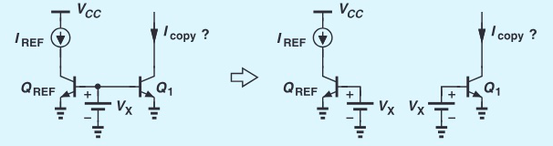

# 연습문제 9.13 — V_X가 필요한 값보다 약간 클 때 Q_REF의 동작 영역 (예제 9.13 이어서)

## 원문
$V_X$가 필요한 값 $V_T \ln(I_{REF}/I_{S,REF})$보다 약간 크다고 가정하자. $Q_{REF}$는 어떤 영역에서 동작하는가?

## 조건
- 예제 9.13의 회로: Fig 9.26 (배터리 $V_X$가 $Q_{REF}$, $Q_1$의 베이스를 구동, $Q_{REF}$ 베이스–컬렉터는 연결되지 않음, $Q_{REF}$ 컬렉터에 $I_{REF}$)
- $V_X$가 필요한 값 $V_T \ln(I_{REF}/I_{S,REF})$보다 약간 큼

## 구할 것
- $Q_{REF}$의 동작 영역

## 상속·참조
- 예제 9.13 (E9.13) 풀이: $Q_1$의 전류는 $I_{copy} = I_{S1} \exp(V_X/V_T)$ (식 9.92)로 $V_X$만으로 정해짐. $V_X$가 $\ln(I_{REF}/I_{S,REF})$에 비례하려면 다이오드 연결 소자가 필요
- 식 (9.88): 다이오드 연결된 $Q_{REF}$라면 $V_1 = V_T \ln (I_{REF}/I_{S,REF})$ — $Q_{REF}$가 정확히 $I_{REF}$를 흘리는 데 필요한 $V_{BE}$

## 회로 — Fig 9.26
```spice
IREF  VCC  n1
QREF  n1   n2  0  npn
Q1    out  n2  0  npn
VX    n2   0   {V_X}
```
- 단자: VCC = 전원, 값 미지정 (T 전원 기호) / out = Q1 컬렉터, I_copy가 들어가는 단자 (선 끝)
- 표시: 노드 라벨 VCC (T 기호 오른쪽) / 소자 라벨 I_REF (전류원 왼쪽), Q_REF (Q_REF 왼쪽, 이미터 높이), Q1 (Q1 오른쪽, 이미터 옆), V_X (배터리 오른쪽) / 부호 배터리 V_X의 + (위 긴 판 왼쪽 위), − (아래 짧은 판 왼쪽 아래) / 화살표 "I_copy ?": out, 아래 방향(Q1 컬렉터로 들어감), 도선 위, 글자는 화살표 오른쪽이고 물음표까지 인쇄됨 / 수치·면적 라벨 없음
- 배치: Fig 9.25와 같은 모양(왼쪽 VCC–I_REF–Q_REF(좌우 반전)–접지, 오른쪽 Q1 보통 방향, 베이스 높이 가로선이 두 베이스를 이음, Q_REF 컬렉터–베이스 연결선 없음)에 배터리 추가 / 베이스 가로선 가운데 접속점에서 세로선이 아래로 내려가 배터리 V_X(위 긴 판, 아래 짧은 판), 그 아래 접지 / Q1 컬렉터 위로 선 끝 + I_copy 화살표, 이미터 아래 접지 / 접속점 (세 갈래 이상, 1곳): 베이스 가로선 가운데 = 왼쪽 Q_REF 베이스 + 오른쪽 Q1 베이스 + 아래 V_X (점) / 교차: 없음

## 회로 — Fig 9.26(eq)
```spice
IREF  VCC  n1
QREF  n1   n2  0  npn
VX1   n2   0   {V_X}
Q1    out  n3  0  npn
VX2   n3   0   {V_X}
```
- 단자: VCC = 전원, 값 미지정 (T 전원 기호) / out = Q1 컬렉터, I_copy가 들어가는 단자 (선 끝)
- 표시: 노드 라벨 VCC (T 기호 오른쪽) / 소자 라벨 I_REF (전류원 왼쪽), Q_REF (Q_REF 왼쪽), Q1 (Q1 오른쪽), V_X (왼쪽 배터리 오른쪽), V_X (오른쪽 배터리 왼쪽) / 부호 왼쪽 배터리 + (위 판 왼쪽 위), − (왼쪽 아래); 오른쪽 배터리 + (위 판 오른쪽 위), − (오른쪽 아래) / 화살표 "I_copy ?": out, 아래 방향(Q1 컬렉터로 들어감), 도선 위, 글자는 화살표 오른쪽 / 수치·면적 라벨 없음
- 배치: 왼쪽 회로 오른쪽에 속이 빈 오른쪽 방향 굵은 화살표(⇒) 다음에 그려짐 / 베이스 선이 끊겨 서로 이어지지 않은 두 부분 / 왼쪽 부분: VCC T 기호–I_REF–Q_REF(좌우 반전)–접지, Q_REF 베이스에서 가로선이 오른쪽으로 가 모서리에서 아래로 꺾여 배터리 V_X, 그 아래 접지 / 오른쪽 부분: Q1(보통 방향) 베이스에서 가로선이 왼쪽으로 가 모서리에서 아래로 꺾여 배터리 V_X, 그 아래 접지, Q1 컬렉터 위로 선 끝 + I_copy 화살표, 이미터 아래 접지 / 두 V_X 라벨은 두 배터리 사이에 나란히 놓임 / 접속점: 없음 / 교차: 없음


> 참고: 오른쪽 (eq)는 원문 그림 안에서 ⇒로 이어진 회로로, V_X가 두 트랜지스터에 따로 걸린 것과 같음을 보임

## 힌트
### $Q_{REF}$가 끌 전류와 $I_{REF}$ 비교
- $V_X$가 크면 활성 영역의 $Q_{REF}$는 $I_{REF}$보다 큰 전류를 끌어내리려 한다
- 이상적 전류원은 $I_{REF}$만 대므로, 컬렉터 노드 전압이 어느 쪽으로 움직여야 두 전류가 맞는지 본다

## 풀이
### 활성 영역이라면 끌어야 할 전류
- $V_X$를 필요한 값 $V_T \ln(I_{REF}/I_{S,REF})$보다 $\Delta V$만큼 크게 두면 활성 영역의 $Q_{REF}$는 $I_{S,REF} \exp(V_X/V_T) = I_{REF} \exp(\Delta V/V_T) > I_{REF}$를 끌어내리려 한다
- 이상적 전류원은 $I_{REF}$만 대므로 컬렉터 노드에서 나가는 전류가 들어오는 전류보다 크다
### 컬렉터 전압의 이동
- 모자란 전류만큼 컬렉터 노드의 전하가 빠져 컬렉터 전압이 내려간다
- 컬렉터 전압이 베이스 전압 $V_X$ 아래로 내려가면 BC 접합이 순방향이 되고, 베이스에서 컬렉터로 들어오는 전류가 생겨 $Q_{REF}$의 컬렉터 전류가 $I_{REF}$로 줄어든다
### 두 접합의 바이어스
- BE 접합은 $V_X$로 순방향, BC 접합도 순방향이다
- $V_X$가 약간만 크므로 BC 순방향 바이어스는 작다(약한 포화)
### 답
- 포화 영역: 활성이라면 $I_{REF}$보다 큰 전류를 끌어야 하므로 컬렉터 전압이 $V_X$ 아래로 내려가 BC 접합까지 순방향이 된다 ($V_X$가 약간만 크므로 약한 포화)
