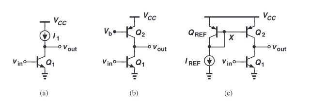

# 연습문제 9.17 — 전압 이득 100에 필요한 얼리 전압 (예제 9.17 이어서)

## 원문
전압 이득이 100일 경우 필요한 얼리 전압은 얼마인가?

## 조건
- 예제 9.17의 회로: Fig 9.34(c) (pnp 전류 거울 부하를 쓰는 npn CE 단)
- 목표 전압 이득 크기 $100$
- npn과 pnp의 얼리 전압이 같다고 보고 하나의 $V_A$를 구함 (원문에 없음, 어느 얼리 전압을 바꾸는지 원문에 명시 없음)

## 구할 것
- 전압 이득이 100이 되는 데 필요한 얼리 전압

## 상속·참조
- 예제 9.17 (E9.17): $V_{A,npn} = 5\ \text{V}$, $V_{A,pnp} = 4\ \text{V}$이면 이득이 바이어스 전류와 무관하게 $-85.5$로 정해져 100을 얻을 수 없음 (풀이의 가정: $g_m = I_C/V_T$, $r_O = V_A/I_C$)
  - 상온 $V_T \approx 26\ \text{mV}$: 원문 풀이에 인쇄 안 됨, $-85.5$에서 역산한 값 (원문에 없음)
- 식 (9.119): $A_v = -g_{m1}(r_{O1} \parallel r_{O2}) = -\dfrac{1}{V_T} \cdot \dfrac{V_{A,npn} V_{A,pnp}}{V_{A,npn} + V_{A,pnp}}$

## 회로 — Fig 9.34(c)
```spice
QREF  X     X    VCC  pnp
IREF  X     0
Q2    vout  X    VCC  pnp
Q1    vout  vin  0    npn
```
- 단자: VCC = 전원, 그림에는 값 없음 (가로 레일) / vin = 소신호 입력 (개방 원) / vout = 출력 (개방 원)
- 표시: 노드 라벨 VCC (레일 오른쪽 끝), X (베이스 공통선 아래, X 접속점 오른쪽), v_in (입력 원 왼쪽), v_out (출력 원 오른쪽) / 소자 라벨 Q_REF (Q_REF 왼쪽, 베이스 높이), Q2 (Q2 오른쪽), I_REF (전류원 왼쪽), Q1 (Q1 오른쪽, 이미터 옆) / 부호 없음 / 화살표 없음 / 수치·면적 라벨 없음
- 배치: 맨 위 굵은 가로 레일 VCC가 Q_REF 이미터 선보다 조금 왼쪽에서 Q2 이미터 선보다 조금 오른쪽까지 뻗음, 두 이미터 선이 매달림 / 왼쪽 Q_REF: pnp 좌우 반전(베이스 막대 오른쪽, 이미터는 막대 위쪽에서 왼쪽 위로 나가 수직으로 레일, 화살표 막대 쪽으로 들어감, 컬렉터는 막대 아래쪽에서 왼쪽 아래로 나가 수직으로 내려감) / 오른쪽 Q2: pnp 보통 방향(베이스 왼쪽, 이미터 오른쪽 위로 레일, 컬렉터 오른쪽 아래) / 베이스 공통선: 베이스 높이 가로선이 Q_REF 베이스에서 X 접속점을 지나 Q2 베이스까지 한 직선 / 다이오드 연결: Q_REF 컬렉터 아래 접속점에서 가로선이 오른쪽으로 가다 위로 꺾여 X 접속점 / 왼쪽 세로줄: 컬렉터 접속점 아래로 I_REF 전류원(화살표 아래), 그 아래 접지 / 오른쪽 세로줄: Q2 컬렉터 → vout 접속점 → Q1 컬렉터, Q1 이미터 아래 접지 (I_REF 접지와 같은 높이), 접속점에서 가로선이 오른쪽 v_out 원 / Q1 npn 보통 방향, v_in 원 → 가로선 → 베이스 (v_in 원은 Q_REF 세로줄과 Q2 세로줄 사이) / 접속점 (세 갈래 이상, 3곳): ① X = 왼쪽 Q_REF 베이스 + 오른쪽 Q2 베이스로 가는 선 + 아래 다이오드 연결 선 (점) ② Q_REF 컬렉터 = 위 Q_REF 컬렉터 + 아래 I_REF + 오른쪽 다이오드 연결 선 (점) ③ vout = 위 Q2 컬렉터 + 아래 Q1 컬렉터 + 오른쪽 v_out 선 (점) / 교차: 없음


> 참고: 크롭 이미지의 (a), (b)는 본문 그림(전류원 부하 CE 단, pnp 전류원 부하)이라 이 문제와 무관
