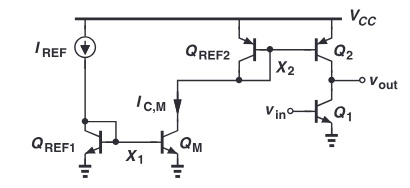

# 연습문제 9.18 — β = 50일 때 I_C2의 정확한 값 (예제 9.18 이어서)

## 원문
모든 트랜지스터에서 $\beta = 50$일 때 $I_{C2}$의 정확한 값을 계산하라.

## 조건
- 예제 9.18의 회로와 설계: Fig 9.35, $I_{REF} = 25\ \mu\text{A}$, 목표 $|I_{C2}| = 1\ \text{mA}$
- 모든 트랜지스터의 $\beta = 50$
- 스케일링은 예제에서 트랜지스터 수가 최소인 선택 $I_{C,M} = 8 I_{REF}$, $|I_{C2}| = 5 I_{C,M}$을 씀 (원문에 없음, 어느 선택인지 원문에 명시 없음)
- 얼리 효과는 무시하고 베이스 전류만 고려 (원문에 없음)

## 구할 것
- 베이스 전류를 고려한 $I_{C2}$의 정확한 값

## 상속·참조
- 예제 9.18 (E9.18): 베이스 전류를 무시하고 전체 스케일링 인수 $40$을 두 거울에 나눔. 최소 단위(15단위) 선택: $Q_M$ 면적 = $Q_{REF1}$의 8배, $Q_2$ 면적 = $Q_{REF2}$의 5배
- 본문 (교재 479쪽): $I_{REF}$가 $I_{C,M}$으로 복사되고 $I_{C,M}$이 $I_{C2}$로 복사되면서 베이스 전류가 누적 오차를 만듦
- 식 (9.101) (본문 Fig 9.31, 교재 475쪽): 면적 $A_E$인 다이오드 연결 $Q_{REF}$와 면적 $nA_E$인 $Q_1$로 된 거울에서 베이스 전류를 고려하면 $I_{copy} = \dfrac{n I_{REF}}{1 + (n+1)/\beta}$ (pnp 거울도 같은 꼴)

## 회로 — Fig 9.35
```spice
IREF   VCC   X1
QREF1  X1    X1   0    npn
QM     X2    X1   0    npn
QREF2  X2    X2   VCC  pnp
Q2     vout  X2   VCC  pnp
Q1     vout  vin  0    npn
```
- 단자: VCC = 전원, 값 미지정 (가로 레일) / vin = 소신호 입력 (개방 원) / vout = 출력 (개방 원)
- 표시: 노드 라벨 VCC (레일 오른쪽 끝), X1 (아래 베이스 공통선 아래, X1 접속점 오른쪽), X2 (위 베이스 공통선 아래, X2 접속점 오른쪽 아래), v_in (입력 원 왼쪽), v_out (출력 원 오른쪽) / 소자 라벨 I_REF (전류원 왼쪽), Q_REF1 (Q_REF1 왼쪽), Q_M (Q_M 오른쪽, 이미터 옆), Q_REF2 (Q_REF2 왼쪽), Q2 (Q2 오른쪽), Q1 (Q1 오른쪽, 이미터 옆) / 부호 없음 / 화살표 "I_C,M": Q_M 컬렉터에서 위로 올라가는 세로 도선, 아래 방향(Q_M 컬렉터로 들어감), 도선 위, 글자는 화살표 왼쪽 / 수치·면적 라벨 없음
- 배치: 맨 위 굵은 가로 레일 VCC가 I_REF 윗선보다 조금 왼쪽에서 Q2 이미터 선보다 조금 오른쪽까지 뻗음, 왼쪽 끝 근처에 I_REF, 오른쪽 부분에 Q_REF2 이미터 선과 Q2 이미터 선이 매달림 / 왼쪽 세로줄: 레일 바로 아래 I_REF 전류원(화살표 아래)에서 긴 세로선이 그림 아래쪽까지 내려와 Q_REF1 컬렉터 접속점 / Q_REF1: npn 좌우 반전(베이스 막대 오른쪽, 컬렉터는 접속점에서 수직으로 내려와 비스듬히 막대 위쪽, 이미터는 막대 아래쪽에서 왼쪽 아래로 나가 접지) / 다이오드 연결 1: Q_REF1 컬렉터 접속점에서 가로선이 오른쪽으로 가다 아래로 꺾여 X1 접속점 / 아래 베이스 공통선: Q_REF1 베이스 → X1 접속점 → 오른쪽 Q_M 베이스 한 직선 / Q_M: npn 보통 방향(베이스 왼쪽), 이미터 아래 접지 (Q_REF1 접지와 같은 높이), 컬렉터에서 세로선이 위로 올라가(I_C,M 화살표) Q_REF2 컬렉터 접속점 높이에서 오른쪽으로 꺾여 그 접속점 / Q_REF2: pnp 좌우 반전(베이스 막대 오른쪽, 이미터는 막대 위쪽에서 왼쪽 위로 레일, 화살표 막대 쪽으로 들어감, 컬렉터는 막대 아래쪽에서 왼쪽 아래로 내려가 접속점) / 다이오드 연결 2: Q_REF2 컬렉터 접속점에서 가로선이 오른쪽으로 가다 위로 꺾여 X2 접속점 / 위 베이스 공통선(레일 바로 아래 높이): Q_REF2 베이스 → X2 접속점 → Q2 베이스 한 직선 / 오른쪽 세로줄: Q2(pnp 보통 방향, 이미터 레일) 컬렉터 → vout 접속점 → Q1(npn 보통 방향) 컬렉터, Q1 이미터 아래 접지, vout 접속점에서 가로선이 오른쪽 v_out 원, v_in 원 → 가로선 → Q1 베이스 / 접속점 (세 갈래 이상, 5곳): ① Q_REF1 컬렉터 = 위 I_REF 선 + 아래 Q_REF1 컬렉터 + 오른쪽 다이오드 연결 선 (점) ② X1 = 왼쪽 Q_REF1 베이스 + 위 다이오드 연결 선 + 오른쪽 Q_M 베이스로 가는 선 (점) ③ Q_REF2 컬렉터 = 위 Q_REF2 컬렉터 + 왼쪽 Q_M 컬렉터 선 + 오른쪽 다이오드 연결 선 (점) ④ X2 = 왼쪽 Q_REF2 베이스 + 아래 다이오드 연결 선 + 오른쪽 Q2 베이스로 가는 선 (점) ⑤ vout = 위 Q2 컬렉터 + 아래 Q1 컬렉터 + 오른쪽 v_out 선 (점) / 교차: 없음



## 풀이
### 베이스 전류를 넣은 거울 식
- 다이오드 연결 기준(면적 $A_E$)과 출력(면적 $nA_E$)의 거울에서 기준 쪽 노드 KCL: $I_{in} = I_{C,REF} + (I_{C,REF} + nI_{C,REF})/\beta$, 출력 $I_{out} = nI_{C,REF}$
- 따라서 $I_{out} = \dfrac{n I_{in}}{1 + (n+1)/\beta}$ (pnp 거울도 같은 꼴)
### npn 거울: $I_{C,M}$
- $n = 8$: $I_{C,M} = \dfrac{8 \cdot 25\ \mu\text{A}}{1 + 9/50} = \dfrac{200\ \mu\text{A}}{1.18} = 169.5\ \mu\text{A}$
### pnp 거울: $I_{C2}$
- $Q_M$ 컬렉터가 다이오드 연결 $Q_{REF2}$를 바로 구동하므로 pnp 거울의 입력 전류는 $I_{C,M}$이다
- $n = 5$: $|I_{C2}| = \dfrac{5 I_{C,M}}{1 + 6/50} = \dfrac{5 \cdot 169.5\ \mu\text{A}}{1.12} = 757\ \mu\text{A}$
- 목표 $1\ \text{mA}$보다 약 $24\%$ 작다: 두 거울에서 베이스 전류 오차가 곱으로 쌓인다
### 답
- $|I_{C2}| = \dfrac{40 I_{REF}}{(1 + 9/\beta)(1 + 6/\beta)} \approx 757\ \mu\text{A}$ (목표 $1\ \text{mA}$보다 약 $24\%$ 작음)
