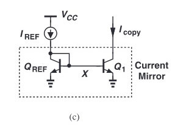

# 연습문제 9.19 — 컬렉터 전류 30% 부정합을 만드는 I_S 부정합 (예제 9.19 이어서)

## 원문
얼마의 $I_S$ 부정합이 30%의 컬렉터 전류 부정합을 일으키는가?

## 조건
- 예제 9.19의 상황: 명목상 같은 개별 바이폴라 트랜지스터 2개로 Fig 9.24(c) 전류 거울을 구성
- 컬렉터 전류 부정합 30% ($I_{copy}$가 $I_{REF}$보다 30% 큼)
- 베이스 전류와 얼리 효과는 무시 (원문에 없음)

## 구할 것
- 30%의 컬렉터 전류 부정합을 일으키는 $I_S$ 부정합

## 상속·참조
- 예제 9.19 (E9.19) 풀이: 다른 배치에서 만든 두 트랜지스터는 공정 변동으로 $I_S$가 크게 어긋날 수 있음
- 식 (9.91) (본문, 교재 470쪽): 두 트랜지스터의 $V_{BE}$가 같으므로 $I_{copy} = \dfrac{I_{S1}}{I_{S,REF}} I_{REF}$

## 회로 — Fig 9.24(c)
```spice
IREF  VCC  X
QREF  X    X  0  npn
Q1    out  X  0  npn
```
- 단자: VCC = 전원, 값 미지정 (T 전원 기호) / out = Q1 컬렉터, I_copy가 들어가는 단자 (선 끝)
- 표시: 노드 라벨 VCC (T 기호 오른쪽), X (베이스 공통선 아래, 두 트랜지스터 사이) / 소자 라벨 I_REF (전류원 왼쪽), Q_REF (Q_REF 왼쪽, 베이스 높이), Q1 (Q1 오른쪽, 이미터 옆), 점선 상자 라벨 "Current Mirror" (상자 오른쪽 바깥, 두 줄 Current / Mirror) / 부호 없음 / 화살표 "I_copy": out, 아래 방향(Q1 컬렉터로 들어감), 도선 위, 글자는 화살표 오른쪽 / 수치·면적 라벨 없음
- 배치: 왼쪽 세로줄 위→아래 VCC T 기호, I_REF 전류원(화살표 아래), Q_REF 컬렉터 접속점, Q_REF, 접지 / Q_REF 좌우 반전(베이스 막대 오른쪽, 컬렉터는 접속점에서 수직으로 내려와 비스듬히 막대 위쪽, 이미터는 막대 아래쪽에서 왼쪽 아래로 나가 접지) / 다이오드 연결: 컬렉터 접속점에서 가로선이 오른쪽으로 가다 아래로 꺾여 Q_REF 베이스 바로 오른쪽의 X 접속점 / 베이스 공통선: 베이스 높이 가로선이 Q_REF 베이스 → X 접속점 → Q1 베이스 한 직선 / Q1 보통 방향(베이스 왼쪽), 컬렉터 세로선이 위로 올라가 I_copy 화살표를 지나 선 끝 (끝은 VCC T 기호와 비슷한 높이), 이미터 아래 접지 (Q_REF 접지와 같은 높이) / 점선 사각형이 Q_REF, 다이오드 연결, Q1, 두 접지를 둘러쌈 (I_REF와 I_copy 화살표는 상자 위 바깥), 상자 윗변은 I_REF 바로 아래·컬렉터 접속점 바로 위 높이 / 접속점 (세 갈래 이상, 2곳): ① Q_REF 컬렉터 = 위 I_REF 선 + 아래 Q_REF 컬렉터 + 오른쪽 다이오드 연결 선 (점) ② X = 왼쪽 Q_REF 베이스 + 위 다이오드 연결 선 + 오른쪽 Q1 베이스로 가는 선 (점) / 교차: 없음 (점선 상자 윗변이 I_REF 선과 Q1 컬렉터 선을 지나는 곳은 상자 경계일 뿐 도선 교차가 아님)


