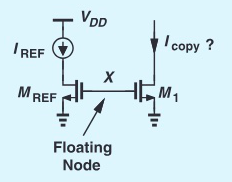

# 연습문제 9.20 — 떠 있는 게이트 거울에서 M_REF는 항상 차단인가 (예제 9.20 이어서)

## 원문
이 회로에서 $M_{REF}$는 항상 차단 상태인가?

## 조건
- 예제 9.20의 회로: Fig 9.37 ($M_{REF}$가 다이오드 연결되지 않고 두 게이트의 공통 노드 X가 떠 있는 MOS 거울)

## 구할 것
- 이 회로에서 $M_{REF}$는 항상 차단 상태인가

## 상속·참조
- 예제 9.20 (E9.20) 풀이: $M_{REF}$와 $M_1$의 게이트가 떠 있으므로 X는 임의의 전압(예: 전원을 켤 때 X에 생긴 초기 상태)을 가지고, $I_{copy}$는 매우 불완전하게 정의됨. 다이오드 연결이 없으므로 전류 거울이 아님

## 회로 — Fig 9.37
```spice
IREF  VDD  n1
MREF  n1   X  0  nmos
M1    out  X  0  nmos
```
- 단자: VDD = 전원, 값 미지정 (T 전원 기호) / out = M1 드레인, I_copy가 들어가는 단자 (선 끝)
- 표시: 노드 라벨 VDD (T 기호 오른쪽), X (게이트 공통선 위, 가운데) / 소자 라벨 I_REF (전류원 왼쪽), M_REF (M_REF 왼쪽, 소스 높이), M1 (M1 오른쪽, 소스 옆) / 부호 없음 / 화살표 "I_copy ?": out, 아래 방향(M1 드레인으로 들어감), 도선 위, 글자는 화살표 오른쪽이고 물음표까지 인쇄됨; "Floating Node": X 게이트 공통선을 가리킴, 아래 글자에서 오른쪽 위로 향해 화살촉이 게이트 공통선 가운데 바로 아래에서 끝남, 도선 옆 별도 화살표 (직선), 글자는 게이트 공통선 아래 두 줄 Floating / Node / 수치·면적 라벨 없음
- 배치: 왼쪽 세로줄 위→아래 VDD T 기호, I_REF 전류원(화살표 아래), M_REF, 접지 / M_REF NMOS 좌우 반전(게이트 오른쪽, 드레인 왼쪽 위로 I_REF, 소스 왼쪽 아래·화살표 바깥, 접지) / M1 NMOS 보통 방향(게이트 왼쪽, 드레인 위, 소스 아래·화살표 바깥, 접지) / 게이트 높이의 한 가로선이 M_REF 게이트와 M1 게이트를 곧장 이음 = X / M_REF의 드레인과 게이트 사이에 연결선 없음 (다이오드 연결 없음), X는 두 게이트 말고 어디에도 연결되지 않음 / M1 드레인에서 세로선이 위로 올라가 선 끝, 그 선 위에 I_copy 화살표 / 두 소스 아래 각자 접지 (같은 높이) / 접속점: 없음 (세 갈래 이상 선이 만나는 곳 없음) / 교차: 없음



## 풀이
### X의 전압은 정해지지 않는다
- X에는 $M_{REF}$와 $M_1$의 게이트만 달려 있고 $M_{REF}$는 다이오드 연결이 아니므로, X의 전압 $V_X$를 정하는 경로가 없다
- $V_X$는 전원을 켤 때의 초기 전하나 누설 전류가 정하는 임의의 값이다
### $V_X$에 따른 $M_{REF}$의 상태
- $V_X < V_{TH}$: $M_{REF}$는 차단이다. $I_{REF}$가 갈 곳이 없어 $M_{REF}$ 드레인 전압이 $V_{DD}$ 쪽으로 올라간다
- $V_X > V_{TH}$: $M_{REF}$는 켜진다. $V_X$가 커서 포화 전류가 $I_{REF}$보다 크면 드레인 전압이 내려가 트라이오드 영역에서 $I_{REF}$를 흘린다
- $V_X$가 우연히 $V_{TH} + \sqrt{2I_{REF}/[\mu_n C_{ox}(W/L)_{REF}]}$ 근처일 때만 포화 영역에서 $I_{REF}$를 흘린다
### 답
- 아니다. $M_{REF}$의 상태는 떠 있는 X의 전압에 달려 있어, $V_X < V_{TH}$이면 차단이지만 $V_X > V_{TH}$이면 켜진다(대개 트라이오드). 어느 경우든 $I_{copy}$는 $I_{REF}$와 무관하게 $V_X$로 정해지므로 전류 거울로 쓸 수 없다.
