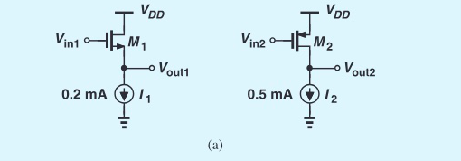

# 연습문제 9.21 — I_REF = 0.8 mA로 다시 설계 (예제 9.21 변형)

## 원문
$I_{REF} = 0.8\ \text{mA}$일 때 위의 예제를 다시 풀어라.

## 조건
- 예제 9.21과 같은 설계 문제: Fig 9.38(a)의 소스 폴로어($M_1$)와 공통 소스 단($M_2$)에 필요한 $I_1 = 0.2\ \text{mA}$, $I_2 = 0.5\ \text{mA}$를 전류 거울로 만듦
- 바뀐 점: 기준 전류 $I_{REF} = 0.8\ \text{mA}$ (예제는 $0.3\ \text{mA}$)

## 구할 것
- $I_{REF} = 0.8\ \text{mA}$로 $I_1$과 $I_2$를 만드는 전류 거울 설계

## 상속·참조
- 예제 9.21 (E9.21): $I_{REF} = 0.3\ \text{mA}$에서의 설계
  - 풀이: 다이오드 연결 기준 NMOS $M_{REF}$에 $3(W/L)$, $I_1$을 흘리는 NMOS $M_{I1}$에 $2(W/L)$, $I_2$를 흘리는 NMOS $M_{I2}$에 $5(W/L)$
  - 결과 회로 Fig 9.38(b): $I_{REF}$(VDD → $M_{REF}$ 드레인), $M_{REF}$는 게이트–드레인 연결, $M_{I1}$·$M_{I2}$의 게이트가 $M_{REF}$ 게이트에, 소스가 접지에 연결되고, $M_{I1}$ 드레인은 $M_1$ 소스(Vout1)에, $M_{I2}$ 드레인은 $M_2$ 드레인(Vout2)에 연결되어 Fig 9.38(a)의 전류원 $I_1$, $I_2$를 대신함
- 식 (9.129) (문턱 전압이 같고 채널 길이 변조 무시): $I_{copy} = \dfrac{(W/L)_1}{(W/L)_{REF}} I_{REF}$

## 회로 — Fig 9.38(a)
```spice
M1  VDD    Vin1  Vout1  nmos
I1  Vout1  0     0.2mA
M2  Vout2  Vin2  VDD    pmos
I2  Vout2  0     0.5mA
```
- 단자: VDD = 전원, 값 미지정 (T 전원 기호, 두 회로에 각각) / Vin1, Vin2 = 입력 (개방 원) / Vout1, Vout2 = 출력 (개방 원)
- 표시: 노드 라벨 VDD (각 T 기호 오른쪽), V_in1, V_in2 (각 입력 원 왼쪽), V_out1, V_out2 (각 출력 원 오른쪽) / 소자 라벨 M1 (M1 오른쪽, 소스 옆), M2 (M2 오른쪽, 드레인 옆), I_1 (왼쪽 전류원 오른쪽), I_2 (오른쪽 전류원 오른쪽) / 부호 없음 / 화살표 없음 / 수치·면적 라벨 "0.2 mA" (I_1 전류원 왼쪽), "0.5 mA" (I_2 전류원 왼쪽)
- 배치: 두 회로가 좌우로 나란히, 같은 높이 / 왼쪽(소스 폴로어): 세로줄 위→아래 VDD T 기호, M1, 출력 접속점, I_1 전류원(화살표 아래), 접지 / M1 NMOS 보통 방향(게이트 왼쪽, 드레인 위로 VDD, 소스 아래·화살표 바깥) / V_in1 원 → 가로선 → M1 게이트 / 오른쪽(공통 소스 단): 세로줄 위→아래 VDD T 기호, M2, 출력 접속점, I_2 전류원(화살표 아래), 접지 / M2 PMOS 보통 방향(게이트 왼쪽, 소스 위로 VDD·화살표 채널 쪽으로 들어감, 드레인 아래) / V_in2 원 → 가로선 → M2 게이트 / 각 출력 접속점에서 가로선이 오른쪽 V_out 원 / 접속점 (세 갈래 이상, 2곳): ① Vout1 = 위 M1 소스 + 아래 I_1 + 오른쪽 V_out1 선 (점) ② Vout2 = 위 M2 드레인 + 아래 I_2 + 오른쪽 V_out2 선 (점) / 교차: 없음



## 풀이
### 거울이 할 일
- $M_1$ 소스와 $M_2$ 드레인은 아래 전류원으로 전류를 내보내므로 $I_1$, $I_2$는 접지 쪽 NMOS 거울이 끌어당기는 전류로 만든다
- $I_{REF} = 0.8\ \text{mA}$를 다이오드 연결 NMOS $M_{REF}$에 흘리고, 그 게이트에 복사 NMOS $M_{I1}$($I_1$ 쪽), $M_{I2}$($I_2$ 쪽)의 게이트를 잇는다
### 필요한 크기 비
- $\lambda$와 문턱 전압 차를 무시하면 $I_{copy} = \dfrac{(W/L)_{copy}}{(W/L)_{REF}} I_{REF}$
- $I_1/I_{REF} = 0.2/0.8 = 1/4$, $I_2/I_{REF} = 0.5/0.8 = 5/8$
### 단위 소자로 나누기
- 분모 8을 맞추려고 $(W/L)$을 단위로 한 소자를 기준 쪽에 8개 병렬: $(W/L)_{REF} = 8(W/L)$
- 그러면 $M_{I1} = 2(W/L)$, $M_{I2} = 5(W/L)$
- 확인: $I_1 = \tfrac{2}{8}(0.8\ \text{mA}) = 0.200\ \text{mA}$, $I_2 = \tfrac{5}{8}(0.8\ \text{mA}) = 0.500\ \text{mA}$
### 답
- $0.8\ \text{mA}$를 흘리는 다이오드 연결 NMOS $M_{REF}$를 $8(W/L)$로 만들고, 같은 게이트에 $M_1$ 소스 아래 $M_{I1}$($2(W/L)$)과 $M_2$ 드레인 아래 $M_{I2}$($5(W/L)$)를 달아 $I_1 = 0.2\ \text{mA}$, $I_2 = 0.5\ \text{mA}$를 얻는다
