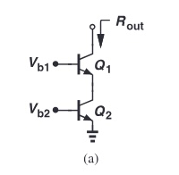

# 예제 9.1 — 바이폴라 캐스코드 전류원의 출력 저항

## 원문
그림 9.2(a)의 $Q_1$과 $Q_2$가 $1\ \text{mA}$의 컬렉터 전류로 바이어스되었을 때 출력 저항을 결정하라. 두 트랜지스터 모두 $\beta = 100$, $V_A = 5\ \text{V}$라고 가정하라.

## 조건
- 회로: Fig 9.2(a) 바이폴라 캐스코드 전류원
- $Q_1$, $Q_2$ 모두 컬렉터 전류 $I_C = 1\ \text{mA}$로 바이어스
- 두 트랜지스터 모두 $\beta = 100$, $V_A = 5\ \text{V}$

## 구할 것
- 출력 저항 $R_{out}$

## 상속·참조
- 식 (9.7): $R_{out} \approx g_{m1} r_{O1} \left( r_{O2} \parallel r_{\pi 1} \right)$

## 회로 — Fig 9.2(a)
```spice
Q1  out  Vb1  n1  npn
Q2  n1   Vb2  0   npn
```
- 단자: Vb1, Vb2 = 이상적 DC 바이어스, 값 미지정 (점 단자) / out = 출력, R_out 측정 단자 (개방 원)
- 표시: 노드 라벨 Vb1, Vb2 (각 점 단자 왼쪽) / 소자 라벨 Q1, Q2 (각 트랜지스터 오른쪽, 이미터 옆) / 부호 없음 / 화살표 "R_out": out 노드를 회로 쪽(아래)으로 들여다봄, 아래 방향, 도선 옆 별도 화살표 (┌ 꺾임: out 도선 오른쪽에 세로선을 두고 그 위 끝에서 짧은 가로선이 오른쪽 R_out 글자 쪽으로 뻗음, 화살촉은 아래 끝), 화살촉은 Q1 컬렉터 대각선 바로 위 높이에서 끝남 / 수치·면적 라벨 없음
- 배치: 한 세로줄 위→아래 out 원, Q1, Q2, 접지 / Q1, Q2 모두 보통 방향(베이스 막대 왼쪽, 컬렉터 오른쪽 위, 이미터 오른쪽 아래) / Vb1, Vb2 점 단자에서 가로선이 오른쪽으로 곧장 각 베이스 / Q1 컬렉터에서 세로선이 위로 올라가 out 원에서 끝남 / Q1 이미터에서 곧은 세로선이 Q2 컬렉터로 이어짐(n1, 라벨 없음) / Q2 이미터 아래 접지 기호 / 접속점: 없음 (세 갈래 이상 선이 만나는 곳 없음) / 교차: 없음



## 답 (검증용)
- $R_{out} \approx 328.9\ \text{k}\Omega$ ($V_T \approx 26\ \text{mV}$, 식 9.10)

## 풀이
### 소신호 파라미터
- 두 트랜지스터가 같아 $g_m$, $r_\pi$, $r_O$를 함께 쓴다 ($V_T = 26\ \text{mV}$)
- $g_m = I_C/V_T = 1\ \text{mA}/26\ \text{mV} = 38.5\ \text{mS}$
- $r_\pi = \beta/g_m = 100/38.5\ \text{mS} = 2.60\ \text{k}\Omega$, $r_O = V_A/I_C = 5\ \text{V}/1\ \text{mA} = 5.00\ \text{k}\Omega$
### $Q_1$ 이미터에 달린 저항
- $Q_2$는 베이스가 DC 바이어스(교류 접지)라 $v_{be2} = 0$이고, $Q_1$ 이미터에서 보면 $r_{O2}$ 하나다
- $Q_1$의 $r_{\pi 1}$과 병렬로 걸려 $r_{O2} \parallel r_{\pi 1} = 5\ \text{k}\Omega \parallel 2.6\ \text{k}\Omega = 1.71\ \text{k}\Omega$
### 출력 저항
- $Q_1$은 $r_{O2}$로 이미터 축퇴된 트랜지스터이고 $g_{m1}(r_{O2} \parallel r_{\pi 1}) \gg 1$이므로 $R_{out} \approx g_{m1} r_{O1} (r_{O2} \parallel r_{\pi 1})$
- $R_{out} = 38.5\ \text{mS} \times 5\ \text{k}\Omega \times 1.71\ \text{k}\Omega = 65.8 \times 5\ \text{k}\Omega = 329\ \text{k}\Omega$
### 답
- $R_{out} \approx 329\ \text{k}\Omega$
