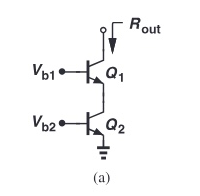
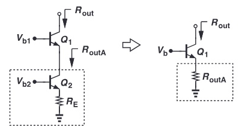

# 예제 9.3 — Q2 이미터 축퇴로 캐스코드 출력 저항을 2배로 만들기

## 원문
그림 9.2(a)의 바이폴라 캐스코드의 출력 저항을 $Q_2$의 이미터에 저항성 축퇴를 사용하여 2배만큼 증가시키고자 한다. $Q_1$과 $Q_2$가 같을 때 요구되는 축퇴 저항의 값을 결정하라.

## 조건
- 회로: Fig 9.2(a) 바이폴라 캐스코드
- $Q_2$의 이미터에 축퇴 저항 $R_E$를 넣어(이미터와 접지 사이) 출력 저항을 2배로 늘리려 함
- $Q_1$과 $Q_2$는 같음
- "같다"는 같은 소자 파라미터·같은 바이어스로 해석 (원문에 없음)
- 소자 값은 주어지지 않음 (답은 소신호 파라미터 기호로) (원문에 없음)

## 구할 것
- 필요한 축퇴 저항 $R_E$의 값

## 상속·참조
- 식 (9.1): 이미터 축퇴된 트랜지스터의 컬렉터 쪽 출력 저항 $R_{out} = \left[1 + g_m (R_E \parallel r_\pi)\right] r_O + R_E \parallel r_\pi$
- 식 (9.7): 축퇴 없는 캐스코드 $R_{out} \approx g_{m1} r_{O1} \left( r_{O2} \parallel r_{\pi 1} \right)$

## 회로 — Fig 9.2(a)
```spice
Q1  out  Vb1  n1  npn
Q2  n1   Vb2  0   npn
```
- 단자: Vb1, Vb2 = 이상적 DC 바이어스, 값 미지정 (점 단자) / out = 출력, R_out 측정 단자 (개방 원)
- 표시: 노드 라벨 Vb1, Vb2 (각 점 단자 왼쪽) / 소자 라벨 Q1, Q2 (각 트랜지스터 오른쪽, 이미터 옆) / 부호 없음 / 화살표 "R_out": out 노드를 회로 쪽(아래)으로 들여다봄, 아래 방향, 도선 옆 별도 화살표 (┌ 꺾임: out 도선 오른쪽에 세로선을 두고 그 위 끝에서 짧은 가로선이 오른쪽 R_out 글자 쪽으로 뻗음, 화살촉은 아래 끝), 화살촉은 Q1 컬렉터 대각선 바로 위 높이에서 끝남 / 수치·면적 라벨 없음
- 배치: 한 세로줄 위→아래 out 원, Q1, Q2, 접지 / Q1, Q2 모두 보통 방향(베이스 막대 왼쪽, 컬렉터 오른쪽 위, 이미터 오른쪽 아래) / Vb1, Vb2 점 단자에서 가로선이 오른쪽으로 곧장 각 베이스 / Q1 컬렉터에서 세로선이 위로 올라가 out 원에서 끝남 / Q1 이미터에서 곧은 세로선이 Q2 컬렉터로 이어짐(n1, 라벨 없음) / Q2 이미터 아래 접지 기호 / 접속점: 없음 (세 갈래 이상 선이 만나는 곳 없음) / 교차: 없음



## 답 (검증용)
- $Q_2$와 $R_E$를 등가 저항 $R_{outA} = [1 + g_{m2}(R_E \parallel r_{\pi 2})] r_{O2} + R_E \parallel r_{\pi 2}$로 바꾸면 $R_{out} \approx g_{m1} r_{O1} (R_{outA} \parallel r_{\pi 1})$ (식 9.15–9.16)
- 2배 조건 $R_{outA} \parallel r_{\pi 1} = 2(r_{O2} \parallel r_{\pi 1})$ → $R_{outA} = \dfrac{2 r_{O2} r_{\pi 1}}{r_{\pi 1} - r_{O2}}$ (식 9.17–9.18). 보통 $r_{\pi 1} < r_{O2}$라 양의 해가 없음 → 이미터 축퇴로 2배는 불가능

### 정답 회로 — Fig 9.4
```spice
Q1  out  Vb1  n1  npn
Q2  n1   Vb2  n2  npn
RE  n2   0    {R_E}
```
- 단자: Vb1, Vb2 = 이상적 DC 바이어스, 값 미지정 (점 단자) / out = 출력, R_out 측정 단자 (개방 원)
- 표시: 노드 라벨 Vb1, Vb2 (각 점 단자 왼쪽) / 소자 라벨 Q1, Q2 (각 트랜지스터 오른쪽, 이미터 옆), R_E (세로 저항 오른쪽) / 부호 없음 / 화살표 "R_out": out 노드를 아래로 들여다봄, 아래 방향, 도선 옆 별도 화살표 (┌ 꺾임, out 도선 오른쪽, 화살촉은 아래 끝); "R_outA": n1(Q1 이미터–Q2 컬렉터 선)에서 아래 Q2 쪽을 들여다봄, 아래 방향, 도선 옆 별도 화살표 (┌ 꺾임, 세로선이 연결선 오른쪽 조금 떨어진 곳, 화살촉은 점선 상자 윗변 바로 위에서 끝남) / 수치·면적 라벨 없음
- 배치: 한 세로줄 위→아래 out 원, Q1, 긴 세로 연결선(n1), Q2, R_E, 접지 / Q1, Q2 보통 방향(베이스 왼쪽) / Vb1, Vb2 점 단자 → 가로선 → 각 베이스 / Q2 이미터에서 세로로 R_E, 그 아래 접지 / 점선 사각형이 Vb2 점 단자, Q2, R_E, 접지를 둘러쌈(Q1과 out은 상자 밖) / 접속점: 없음 / 교차: 없음

### 정답 회로 — Fig 9.4(eq)
```spice
Q1     out  Vb  n1  npn
ROUTA  n1   0   {R_outA}
```
- 단자: Vb = 이상적 DC 바이어스, 값 미지정 (점 단자) / out = 출력, R_out 측정 단자 (개방 원)
- 표시: 노드 라벨 Vb (점 단자 왼쪽) / 소자 라벨 Q1 (트랜지스터 오른쪽, 이미터 옆), R_outA (세로 저항 오른쪽) / 부호 없음 / 화살표 "R_out": out 노드를 아래로 들여다봄, 아래 방향, 도선 옆 별도 화살표 (┌ 꺾임, 화살촉은 아래 끝) / 수치·면적 라벨 없음
- 배치: 왼쪽 회로 오른쪽에 속이 빈 오른쪽 방향 굵은 화살표(⇒) 뒤에 그려짐 / 한 세로줄 위→아래 out 원, Q1, R_outA, 접지 / Q1 보통 방향 / Vb 점 단자 → 가로선 → 베이스 / 점선 사각형이 R_outA와 접지를 둘러쌈 / 접속점: 없음 / 교차: 없음



## 힌트
### $Q_1$ 이미터 쪽 상한은 $r_{\pi 1}$
- $Q_2$와 $R_E$를 한 저항으로 묶어 아무리 키워도, $Q_1$ 이미터에서는 그 저항이 $r_{\pi 1}$과 병렬로 보여서 $r_{\pi 1}$을 넘을 수 없다
- 축퇴가 없을 때의 값이 이미 그 상한에 얼마나 가까운지부터 본다

## 풀이
### 축퇴된 $Q_2$를 저항 하나로
- 소신호 파라미터 $g_m$, $r_\pi$, $r_O$의 첨자는 트랜지스터 번호다
- $Q_2$ 베이스는 교류 접지, 이미터에 $R_E$ → $Q_1$ 이미터에서 $Q_2$ 쪽을 본 저항 $R_X \approx [1 + g_{m2}(R_E \parallel r_{\pi 2})]\, r_{O2}$
- $R_E = 0$이면 $R_X = r_{O2}$로 원래 캐스코드
### 캐스코드의 출력 저항
- $Q_1$은 $R_X$로 이미터 축퇴: $R_{out} \approx [1 + g_{m1}(R_X \parallel r_{\pi 1})]\, r_{O1}$
- $g_{m1}(R_X \parallel r_{\pi 1}) \gg 1$이므로 $R_{out}$은 $R_X \parallel r_{\pi 1}$에 비례
### 2배 조건
- $R_X \parallel r_{\pi 1} = 2\,(r_{O2} \parallel r_{\pi 1})$
- $R_X$에 대해 풀면 $R_X = \dfrac{2 r_{O2} r_{\pi 1}}{r_{\pi 1} - r_{O2}}$
### 실현 가능성
- $R_X \parallel r_{\pi 1}$은 $R_X$를 아무리 키워도 $r_{\pi 1}$보다 작다 (병렬 저항은 작은 쪽보다 작음)
- 보통 $r_{O2} > r_{\pi 1}$ ($V_A > \beta V_T$)이면 목표 $2(r_{O2} \parallel r_{\pi 1})$이 이미 상한 $r_{\pi 1}$보다 크다 → 닿을 수 없다
- 식으로도 $r_{O2} > r_{\pi 1}$이면 $R_X < 0$이 되어 이를 만족하는 $R_E$가 없다
### 답
- 필요한 $R_X = 2 r_{O2} r_{\pi 1}/(r_{\pi 1} - r_{O2})$가 보통의 $r_{O2} > r_{\pi 1}$에서 음수이므로, 그런 $R_E$ 값은 없다. $Q_1$ 이미터 쪽 저항이 $r_{\pi 1}$에 막혀 이미터 축퇴로는 출력 저항을 2배로 만들 수 없다.
