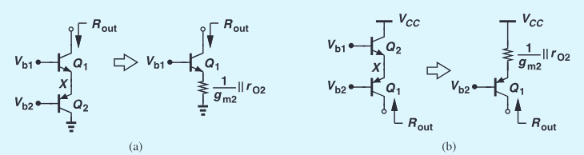

# 예제 9.4 — 이미터끼리 연결한 토폴로지가 캐스코드가 아닌 이유

## 원문
그림 9.7의 토폴로지가 왜 캐스코드가 아닌지 설명하라.

## 조건
- 회로: Fig 9.7 (a), (b) — 두 트랜지스터의 이미터끼리 연결된 구조와 그 등가회로
- 소자 값은 주어지지 않음

## 구할 것
- Fig 9.7의 토폴로지가 왜 캐스코드가 아닌지 설명

## 상속·참조
- 본문 Fig 9.2(a) 바이폴라 캐스코드 (교재 451쪽, 크롭 파일 fig9-02.png의 (a)): $Q_1$의 이미터가 $Q_2$의 **컬렉터**에 연결되어, $Q_1$ 이미터에서 본 저항이 $r_{O2}$
  - `Q1: C = out, B = Vb1, E = n1`
  - `Q2: C = n1, B = Vb2, E = 0`
- 식 (9.1): 이미터 쪽 저항 $R_E$로 축퇴된 트랜지스터의 컬렉터 쪽 출력 저항 $R_{out} = \left[1 + g_m (R_E \parallel r_\pi)\right] r_O + R_E \parallel r_\pi$

## 회로 — Fig 9.7(a)
```spice
Q1  out  Vb1  X  npn
Q2  0    Vb2  X  pnp
```
- 단자: Vb1, Vb2 = 이상적 DC 바이어스, 값 미지정 (점 단자) / out = 출력, R_out 측정 단자 (개방 원)
- 표시: 노드 라벨 Vb1, Vb2 (각 점 단자 왼쪽), X (Q1–Q2 연결선 왼쪽, 두 트랜지스터 사이) / 소자 라벨 Q1 (Q1 오른쪽, 이미터 옆), Q2 (Q2 오른쪽) / 부호 없음 / 화살표 "R_out": out 노드를 아래로 들여다봄, 아래 방향, 도선 옆 별도 화살표 (┌ 꺾임: out 도선 오른쪽에 세로선, 위 끝에서 가로선이 오른쪽 R_out 글자 쪽으로, 화살촉은 아래 끝, Q1 컬렉터 대각선 바로 위 높이) / 수치·면적 라벨 없음
- 배치: 한 세로줄 위→아래 out 원, Q1, X, Q2, 접지 / Q1 npn 보통 방향(베이스 왼쪽, 컬렉터 오른쪽 위, 이미터 오른쪽 아래·화살표 바깥) / Q2 pnp, 이미터가 위(오른쪽 위, 화살표가 막대 쪽으로 들어감), 컬렉터가 아래(오른쪽 아래) / Q1 이미터에서 짧은 세로선이 곧장 Q2 이미터로 이어짐 = 노드 X (이미터끼리 연결) / Q2 컬렉터 아래 접지 기호 / Vb1, Vb2 점 단자 → 가로선 → 각 베이스 / 접속점: 없음 / 교차: 없음

## 회로 — Fig 9.7(a-eq)
```spice
Q1   out  Vb1  n1  npn
REQ  n1   0    {1/g_m2||r_O2}
```
- 단자: Vb1 = 이상적 DC 바이어스, 값 미지정 (점 단자) / out = 출력, R_out 측정 단자 (개방 원)
- 표시: 노드 라벨 Vb1 (점 단자 왼쪽) / 소자 라벨 Q1 (Q1 오른쪽, 이미터 옆), 저항 라벨 "1/g_m2 || r_O2" (세로 저항 오른쪽, 분수 1/g_m2 뒤에 ||r_O2) / 부호 없음 / 화살표 "R_out": out 노드를 아래로 들여다봄, 아래 방향, 도선 옆 별도 화살표 (┌ 꺾임, 화살촉은 아래 끝) / 수치·면적 라벨 없음
- 배치: (a) 왼쪽 회로 오른쪽에 속이 빈 오른쪽 방향 굵은 화살표(⇒) 다음에 그려짐 / 한 세로줄 위→아래 out 원, Q1, 세로 저항, 접지 / Q1 보통 방향 / Vb1 점 단자 → 가로선 → 베이스 / 접속점: 없음 / 교차: 없음

## 회로 — Fig 9.7(b)
```spice
Q2  VCC  Vb1  X  npn
Q1  out  Vb2  X  pnp
```
- 단자: VCC = 전원, 값 미지정 (T 전원 기호) / Vb1, Vb2 = 이상적 DC 바이어스, 값 미지정 (점 단자) / out = 출력, R_out 측정 단자 (개방 원)
- 표시: 노드 라벨 VCC (T 기호 오른쪽), Vb1, Vb2 (각 점 단자 왼쪽), X (Q2–Q1 연결선 왼쪽, 두 트랜지스터 사이) / 소자 라벨 Q2 (위 트랜지스터 오른쪽), Q1 (아래 트랜지스터 오른쪽) / 부호 없음 / 화살표 "R_out": out 노드를 위로(회로 쪽) 들여다봄, 위 방향, 도선 옆 별도 화살표 (L자: out 도선 오른쪽에 세로선, 아래 끝에서 가로선이 오른쪽 R_out 글자 쪽으로, 화살촉은 위 끝, Q1 컬렉터 대각선 바로 아래 높이) / 수치·면적 라벨 없음
- 배치: 한 세로줄 위→아래 VCC T 기호, Q2, X, Q1, out 원 / 위가 Q2(npn 보통 방향, 컬렉터 위로 VCC, 이미터 아래·화살표 바깥), 아래가 Q1(pnp, 이미터 위·화살표 막대 쪽으로 들어감, 컬렉터 아래) / Q2 이미터에서 짧은 세로선이 곧장 Q1 이미터로 = 노드 X (이미터끼리 연결) / Q1 컬렉터에서 세로선이 아래로 내려가 out 원에서 끝남 / Vb1 → 위 Q2 베이스, Vb2 → 아래 Q1 베이스 (라벨 번호와 트랜지스터 번호가 엇갈림에 주의) / 접속점: 없음 / 교차: 없음

## 회로 — Fig 9.7(b-eq)
```spice
REQ  VCC  n1   {1/g_m2||r_O2}
Q1   out  Vb2  n1  pnp
```
- 단자: VCC = 전원, 값 미지정 (T 전원 기호) / Vb2 = 이상적 DC 바이어스, 값 미지정 (점 단자) / out = 출력, R_out 측정 단자 (개방 원)
- 표시: 노드 라벨 VCC (T 기호 오른쪽), Vb2 (점 단자 왼쪽) / 소자 라벨 Q1 (Q1 오른쪽), 저항 라벨 "1/g_m2 || r_O2" (세로 저항 오른쪽) / 부호 없음 / 화살표 "R_out": out 노드를 위로 들여다봄, 위 방향, 도선 옆 별도 화살표 (L자, 화살촉은 위 끝) / 수치·면적 라벨 없음
- 배치: (b) 왼쪽 회로 오른쪽에 속이 빈 오른쪽 방향 굵은 화살표(⇒) 다음에 그려짐 / 한 세로줄 위→아래 VCC T 기호, 세로 저항, Q1, out 원 / Q1 pnp(이미터 위로 저항, 컬렉터 아래로 out) / Vb2 점 단자 → 가로선 → 베이스 / 접속점: 없음 / 교차: 없음


> 참고: 크롭 이미지 아래 가운데 "(a)", "(b)"는 각각 왼쪽 두 회로, 오른쪽 두 회로 묶음의 패널 이름

## 답 (검증용)
- $Q_1$ 이미터가 $Q_2$ **이미터**에 연결되어 $Q_2$가 전류원이 아닌 다이오드 연결 소자처럼 동작 → 노드 X의 임피던스가 $r_{O2}$ 대신 $(1/g_{m2}) \parallel r_{O2}$
- $R_{out} = \left[1 + g_{m1}\left(\tfrac{1}{g_{m2}} \parallel r_{O2} \parallel r_{\pi 1}\right)\right] r_{O1} + \tfrac{1}{g_{m2}} \parallel r_{O2} \parallel r_{\pi 1} \approx \left(1 + \tfrac{g_{m1}}{g_{m2}}\right) r_{O1} + \tfrac{1}{g_{m2}} \approx 2 r_{O1}$ (식 9.19–9.21, $1/g_{m2} \ll r_{O2}, r_{\pi 1}$, $g_{m1} \approx g_{m2}$). (b)도 같은 방식

## 힌트
### $X$의 저항을 캐스코드와 비교
- 캐스코드에서는 $Q_1$ 이미터에 큰 $r_{O2}$가 달려 $r_{O1}$이 크게 곱해진다
- 여기서 $X$에 달린 저항이 $1/g_m$급이면 $r_{O1}$에 곱해지는 배수가 얼마나 될지 본다

## 풀이
### 노드 $X$에서 $Q_2$ 쪽을 본 저항
- 소신호 파라미터 $g_m$, $r_\pi$, $r_O$의 첨자는 트랜지스터 번호다
- (a)에서 $X$는 $Q_2$의 **이미터**이고 베이스는 교류 접지 → 이미터를 들여다보는 셈이라 $R_X = (1/g_{m2}) \parallel r_{O2}$ ($Q_2$가 다이오드 연결 소자처럼 보임)
- 캐스코드라면 $Q_1$ 이미터가 $Q_2$의 **컬렉터**에 붙어 $R_X = r_{O2}$로 크다
### 출력 저항
- $Q_1$은 $R_X$로 이미터 축퇴: $R_{out} \approx [1 + g_{m1}(R_X \parallel r_{\pi 1})]\, r_{O1}$
- $1/g_{m2} \ll r_{O2}, r_{\pi 1}$이므로 $R_X \parallel r_{\pi 1} \approx 1/g_{m2}$ → $R_{out} \approx (1 + g_{m1}/g_{m2})\, r_{O1}$
- 두 트랜지스터에 같은 전류가 흘러 $g_{m1} \approx g_{m2}$ → $R_{out} \approx 2 r_{O1}$
### 캐스코드와 비교
- 캐스코드는 $r_{O1}$에 $g_{m1}(r_{O2} \parallel r_{\pi 1})$ (수십 배 이상)이 곱해지지만 여기서는 $g_{m1}(R_X \parallel r_{\pi 1}) \approx 1$이라 앞의 1을 뺄 수 없고 2배뿐
- (b)도 $X$에서 $Q_2$(베이스 교류 접지, 컬렉터 $V_{CC}$)의 이미터를 보므로 $R_X$가 같고 $R_{out} \approx 2 r_{O1}$
### 답
- $Q_1$ 이미터가 $Q_2$의 컬렉터가 아니라 이미터에 붙어, $X$에서 본 저항이 $r_{O2}$가 아닌 $(1/g_{m2}) \parallel r_{O2} \approx 1/g_{m2}$로 작다. 그래서 $R_{out} \approx (1 + g_{m1}/g_{m2})\, r_{O1} \approx 2 r_{O1}$에 그쳐 캐스코드처럼 출력 저항을 크게 키우지 못한다.
