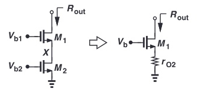

# 예제 9.5 — 출력 임피던스 500 kΩ, 전류 0.5 mA인 NMOS 캐스코드 설계

## 원문
출력 임피던스가 $500\ \text{k}\Omega$이고 전류가 $0.5\ \text{mA}$인 NMOS 캐스코드를 설계하라. 단순화를 위해 그림 9.8에서 $M_1$과 $M_2$가 같다고 가정하라(같을 필요는 없다). $\mu_n C_{ox} = 100\ \mu\text{A}/\text{V}^2$, $\lambda = 0.1\ \text{V}^{-1}$이라고 가정하라.

## 조건
- 회로: Fig 9.8 NMOS 캐스코드 전류원
- 목표: 출력 임피던스 $R_{out} = 500\ \text{k}\Omega$, 전류 $I_D = 0.5\ \text{mA}$
- 단순화를 위해 $M_1$과 $M_2$가 같다고 가정 (같을 필요는 없음)
- $\mu_n C_{ox} = 100\ \mu\text{A}/\text{V}^2$, $\lambda = 0.1\ \text{V}^{-1}$

## 구할 것
- 트랜지스터의 $W/L$ (설계)

## 상속·참조
- 식 (9.23): MOS 캐스코드 $R_{out} \approx g_{m1} r_{O1} r_{O2}$ (식 9.22 $R_{out} = (1 + g_{m1} r_{O2}) r_{O1} + r_{O2}$에서 $g_{m1} r_{O1} r_{O2} \gg r_{O1}, r_{O2}$로 근사)
- $r_O = (\lambda I_D)^{-1}$, $g_m = \sqrt{2 \mu_n C_{ox} (W/L) I_D}$

## 회로 — Fig 9.8
```spice
M1  out  Vb1  X  nmos
M2  X    Vb2  0  nmos
```
- 단자: Vb1, Vb2 = 이상적 DC 바이어스, 값 미지정 (점 단자) / out = 출력, R_out 측정 단자 (개방 원)
- 표시: 노드 라벨 Vb1, Vb2 (각 점 단자 왼쪽), X (M1–M2 연결선 왼쪽, 두 트랜지스터 사이) / 소자 라벨 M1, M2 (각 트랜지스터 오른쪽, 소스 옆) / 부호 없음 / 화살표 "R_out": out 노드를 아래로 들여다봄, 아래 방향, 도선 옆 별도 화살표 (┌ 꺾임: out 도선 오른쪽에 세로선, 위 끝에서 가로선이 오른쪽 R_out 글자 쪽으로, 화살촉은 아래 끝, M1 드레인 바로 위 높이) / 수치·면적 라벨 없음
- 배치: 한 세로줄 위→아래 out 원, M1, X, M2, 접지 / M1, M2 모두 NMOS 보통 방향(게이트 왼쪽, 드레인 위, 소스 아래·소스 화살표 바깥) / Vb1, Vb2 점 단자 → 가로선 → 각 게이트 / M1 드레인에서 세로선이 위로 out 원 / M1 소스에서 곧은 세로선이 M2 드레인으로 = X / M2 소스 아래 접지 / 접속점: 없음 / 교차: 없음

## 회로 — Fig 9.8(eq)
```spice
M1   out  Vb  n1  nmos
RO2  n1   0   {r_O2}
```
- 단자: Vb = 이상적 DC 바이어스, 값 미지정 (점 단자) / out = 출력, R_out 측정 단자 (개방 원)
- 표시: 노드 라벨 Vb (점 단자 왼쪽) / 소자 라벨 M1 (트랜지스터 오른쪽), r_O2 (세로 저항 오른쪽) / 부호 없음 / 화살표 "R_out": out 노드를 아래로 들여다봄, 아래 방향, 도선 옆 별도 화살표 (┌ 꺾임, 화살촉은 아래 끝) / 수치·면적 라벨 없음
- 배치: 왼쪽 회로 오른쪽에 속이 빈 오른쪽 방향 굵은 화살표(⇒) 다음에 그려짐 / 한 세로줄 위→아래 out 원, M1, 세로 저항 r_O2, 접지 / Vb 점 단자 → 가로선 → 게이트 / 접속점: 없음 / 교차: 없음


> 참고: Fig 9.8은 예제 상자 밖의 본문 그림(제목 "MOS 캐스코드 전류원과 등가 회로")이고, 오른쪽 등가회로는 본문 식 9.22–9.23 설명용

## 답 (검증용)
- $g_{m1} r_{O1} r_{O2} = 500\ \text{k}\Omega$, $r_{O1} = r_{O2} = 20\ \text{k}\Omega$ → $g_{m1} = (800\ \Omega)^{-1}$ → $W/L = 15.6$ (식 9.24–9.26)
- $g_{m1} r_{O1} = 25 \gg 1$

## 풀이
### 목표 식과 소자 저항
- 입력 바이어스를 AC 접지하면 아래 $M_2$는 $r_{o2}$로 보인다. 위 $M_1$의 캐스코드 주항 $R_{out}\approx g_{m1}r_{o1}r_{o2}$로 역산한다 ($g_{m1}r_{o1},g_{m1}r_{o2}\gg1$).
- $100\ \mu\mathrm{A/V^2}=0.1\ \mathrm{mA/V^2}$, $r_{o1}=r_{o2}=1/(\lambda I_D)=1/[0.1(0.5)]=20\ \mathrm{k\Omega}$.
### 필요한 트랜스컨덕턴스
- $g_{m1}=500\ \mathrm{k\Omega}/(20\ \mathrm{k\Omega})^2=5/4\ \mathrm{mS}$.
### 두 소자의 크기
- $W/L=g_{m1}^2/(2\mu_nC_{ox}I_D)=(25/16)/[2(0.1)(0.5)]=15.625$.
- $g_{m1}r_o=25\gg1$이며 재대입하면 $R_{out}\approx(5/4)(20)^2=500\ \mathrm{k\Omega}$. 같은 소자이므로 두 크기를 같게 둔다.
### 답
- $M_1,M_2$ 모두 $W/L=15.625\approx15.6$ (주항 근사 설계).
