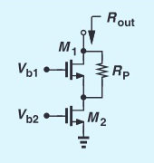

# 예제 9.6 — 기생 저항 R_P가 생긴 MOS 캐스코드의 출력 저항

## 원문
제조하는 동안 큰 기생 저항 $R_P$가 그림 9.11과 같이 캐스코드에 나타났다. 출력 저항을 결정하라.

## 조건
- 제조 중 큰 기생 저항 $R_P$가 MOS 캐스코드에 생김, 위치는 Fig 9.11 ($M_1$의 드레인과 소스 사이)
- 소자 값은 주어지지 않음 (답은 $g_m$, $r_O$, $R_P$ 기호로) (원문에 없음)

## 구할 것
- 출력 저항 $R_{out}$

## 상속·참조
- 식 (9.22)–(9.23): $R_P$가 없는 MOS 캐스코드(Fig 9.8) $R_{out} = (1 + g_{m1} r_{O2}) r_{O1} + r_{O2} \approx g_{m1} r_{O1} r_{O2}$ ($g_{m1} r_{O1} r_{O2} \gg r_{O1}, r_{O2}$ 가정)

## 회로 — Fig 9.11
```spice
M1  out  Vb1  n1  nmos
M2  n1   Vb2  0   nmos
RP  out  n1   {R_P}     ; M1 드레인 ↔ M1 소스
```
- 단자: Vb1, Vb2 = 이상적 DC 바이어스, 값 미지정 (점 단자) / out = 출력, R_out 측정 단자 (개방 원)
- 표시: 노드 라벨 Vb1, Vb2 (각 점 단자 왼쪽) / 소자 라벨 M1 (M1 드레인 위 접속점의 왼쪽, 게이트보다 위), M2 (M2 오른쪽, 소스 옆), R_P (세로 저항 오른쪽) / 부호 없음 / 화살표 "R_out": out 노드를 아래로 들여다봄, 아래 방향, 도선 옆 별도 화살표 (┌ 꺾임: out 도선 오른쪽, out 도선과 R_P 가지 사이에 세로선, 위 끝에서 가로선이 오른쪽 R_out 글자 쪽으로, 화살촉은 위 접속점 바로 위 높이) / 수치·면적 라벨 없음
- 배치: 한 세로줄 위→아래 out 원, 위 접속점, M1, 아래 접속점, M2, 접지 / M1, M2 모두 NMOS 보통 방향(게이트 왼쪽, 드레인 위, 소스 아래·화살표 바깥) / 위 접속점(M1 드레인 바로 위)에서 가로선이 오른쪽으로 나가 모서리에서 아래로 꺾여 M1 오른쪽에 세로로 놓인 R_P(M1 높이)를 지나 아래 모서리에서 왼쪽으로 꺾여 아래 접속점(M1 소스–M2 드레인 선, M2 바로 위)에 닿음 / Vb1, Vb2 점 단자 → 가로선 → 각 게이트 / M2 소스 아래 접지 / 접속점 (세 갈래 이상, 2곳): 위 = 위 out 원 + 아래 M1 드레인 + 오른쪽 R_P 가지 (점), 아래 n1 = 위 M1 소스 + 아래 M2 드레인 + 오른쪽 R_P 가지 (점) / 교차: 없음



## 답 (검증용)
- $R_P$가 $r_{O1}$과 병렬 → $R_{out} = g_{m1} (r_{O1} \parallel R_P) r_{O2}$ (식 9.27)
- $g_{m1}(r_{O1} \parallel R_P)$가 1보다 훨씬 크지 않으면 식 9.22로 돌아가 $R_{out} = (1 + g_{m1} r_{O2})(r_{O1} \parallel R_P) + r_{O2}$ (식 9.28)

## 힌트
### $R_P$는 $r_{O1}$과 병렬
- $R_P$의 두 끝은 $M_1$의 드레인과 소스라서, 소신호 모델의 $r_{O1}$과 같은 두 노드 사이에 놓인다
- $R_P$가 없는 캐스코드 식(근사식이든 정확식이든)에서 $r_{O1}$ 자리만 바꿔 생각하면 된다

## 풀이
### $R_P$의 위치
- $M_1$, $M_2$의 소신호 파라미터를 $g_{m1}$, $r_{O1}$, $r_{O2}$로 쓴다
- $R_P$의 두 끝은 $M_1$의 드레인과 소스 → 소신호 모델에서 $r_{O1}$과 같은 두 노드 사이라 병렬: $r_{O1} \parallel R_P$
### $M_1$ 소스에 달린 저항
- $M_2$ 게이트는 교류 접지라 $M_1$ 소스에서 본 $M_2$는 $r_{O2}$ 하나 → $M_1$은 $r_{O2}$로 소스 축퇴
### 출력 저항
- 축퇴 식의 $r_O$는 드레인–소스 사이 저항이므로 그 자리에 $r_{O1} \parallel R_P$를 넣는다
- $R_{out} \approx (1 + g_{m1} r_{O2})(r_{O1} \parallel R_P)$
- $R_P \to \infty$이면 원래 캐스코드 $(1 + g_{m1} r_{O2})\, r_{O1}$. $R_P$가 $r_{O1}$ 정도로 작아지면 출력 저항도 그만큼 줄어든다
### 답
- $R_{out} \approx (1 + g_{m1} r_{O2})(r_{O1} \parallel R_P)$ ($g_{m1} r_{O2} \gg 1$이면 $\approx g_{m1} r_{O2} (r_{O1} \parallel R_P)$)
