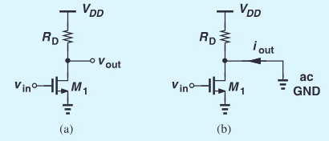

# 예제 9.7 — CS 단의 트랜스컨덕턴스

## 조건
- 회로: Fig 9.13(a) CS 단 ($M_1$, 드레인 저항 $R_D$)
- 소자 값은 주어지지 않음 (답은 소신호 파라미터 기호로) (원문에 없음)

## 구할 것
- 회로의 트랜스컨덕턴스 $G_m$

## 상속·참조
- 식 (9.29) (본문 Fig 9.12, 교재 458쪽, 크롭 안 함): 회로의 단락 회로 트랜스컨덕턴스 $G_m = \left.\dfrac{i_{out}}{v_{in}}\right|_{v_{out} = 0}$ — 출력 노드를 교류 접지에 단락했을 때 입력 전압 대비 출력 전류
  - Fig 9.12: $v_{in}$ 전압원이 "Circuit" 상자의 입력을 구동, 상자 출력이 교류 접지(ac GND)에 단락되고 그 선에 $i_{out}$ 화살표

## 회로 — Fig 9.13(a)
```spice
RD  VDD  vout  {R_D}
M1  vout vin   0  nmos
```
- 단자: VDD = 전원, 값 미지정 (T 전원 기호) / vin = 소신호 입력 (개방 원) / vout = 출력 (개방 원)
- 표시: 노드 라벨 VDD (T 기호 오른쪽), v_in (입력 원 왼쪽), v_out (출력 원 오른쪽) / 소자 라벨 R_D (저항 왼쪽), M1 (M1 오른쪽, 소스 옆) / 부호 없음 / 화살표 없음 / 수치·면적 라벨 없음
- 배치: 한 세로줄 위→아래 VDD T 기호, R_D, 드레인 접속점, M1, 접지 / M1 NMOS 보통 방향(게이트 왼쪽, 소스 아래·화살표 바깥) / v_in 원 → 가로선 → 게이트 / 드레인 접속점에서 가로선이 오른쪽으로 뻗어 v_out 원에서 끝남 / M1 소스 아래 접지 / 접속점 (세 갈래 이상, 1곳): 드레인 = 위 R_D + 아래 M1 드레인 + 오른쪽 v_out 선 (점) / 교차: 없음


> 참고: 크롭 이미지 오른쪽의 (b)는 예제 풀이 그림 (답 절 참고)

## 답 (검증용)
- 출력 노드를 교류 접지로 단락 (Fig 9.13(b)), $R_D$에는 소신호 전류가 흐르지 않음 → $G_m = i_{out}/v_{in} = i_{D1}/v_{GS1} = g_{m1}$ (식 9.30–9.32). 회로의 트랜스컨덕턴스 = 트랜지스터의 트랜스컨덕턴스

### 정답 회로 — Fig 9.13(b)
```spice
RD   VDD  n1   {R_D}
M1   n1   vin  0  nmos
VAC  n1   0    0      ; ac GND 단락선 (그림은 도선 + 접지 기호, 전압원 기호 없음). i_out은 접지 → n1 방향
```
- 단자: VDD = 전원, 값 미지정 (T 전원 기호) / vin = 소신호 입력 (개방 원) / 출력 쪽은 개방 단자 없이 도선이 접지 기호로 이어짐
- 표시: 노드 라벨 VDD (T 기호 오른쪽), v_in (입력 원 왼쪽), "ac GND" (오른쪽 접지 기호 오른쪽, 두 줄 ac / GND) / 소자 라벨 R_D (저항 왼쪽), M1 (M1 오른쪽) / 부호 없음 / 화살표 "i_out": 드레인 접속점과 오른쪽 모서리 사이 가로 도선, 왼쪽 방향(교류 접지 쪽에서 드레인 접속점으로), 도선 위, 글자는 화살표 위 / 수치·면적 라벨 없음
- 배치: (a)와 같은 VDD–R_D–M1–접지 세로줄 / 드레인 접속점에서 가로선이 오른쪽으로 가다 모서리에서 아래로 꺾여 접지 기호(ac GND) / 접속점 (세 갈래 이상, 1곳): 드레인 = 위 R_D + 아래 M1 드레인 + 오른쪽 단락선 (점) / 교차: 없음


