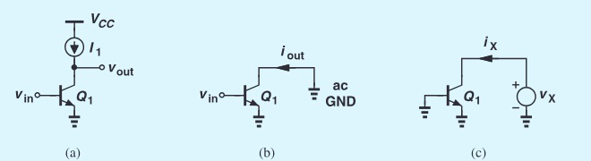

# 예제 9.8 — 전류원 부하 공통 이미터 단의 전압 이득

## 원문
그림 9.15(a)에 나와 있는 공통 이미터 단의 전압 이득을 결정하라.

## 조건
- 회로: Fig 9.15(a) 공통 이미터 단 ($Q_1$, 부하는 전류원 $I_1$)
- 소자 값은 주어지지 않음 (답은 소신호 파라미터 기호로) (원문에 없음)
- $I_1$은 이상적 전류원, $Q_1$의 출력 저항 $r_{O1}$(Early 효과)은 고려함 (원문에 없음, 풀이가 $r_{O1}$을 씀)

## 구할 것
- 전압 이득 $A_v = v_{out}/v_{in}$

## 상속·참조
- 식 (9.29): 단락 회로 트랜스컨덕턴스 $G_m = \left.\dfrac{i_{out}}{v_{in}}\right|_{v_{out} = 0}$ — 출력 노드를 교류 접지에 단락했을 때 입력 전압 대비 출력 전류
- 식 (9.33) (본문 보조 정리, 교재 459쪽; 노턴 등가 회로로 증명, 식 9.34–9.36): 선형 회로의 전압 이득 $A_v = -G_m R_{out}$ ($R_{out}$은 입력 전압을 0으로 놓을 때 회로의 출력 저항)

## 회로 — Fig 9.15(a)
```spice
I1  VCC   vout
Q1  vout  vin  0  npn
```
- 단자: VCC = 전원, 값 미지정 (T 전원 기호) / vin = 소신호 입력 (개방 원) / vout = 출력 (개방 원)
- 표시: 노드 라벨 VCC (T 기호 오른쪽), v_in (입력 원 왼쪽), v_out (출력 원 오른쪽) / 소자 라벨 I_1 (전류원 오른쪽), Q1 (Q1 오른쪽, 이미터 옆) / 부호 없음 / 화살표 없음 / 수치·면적 라벨 없음
- 배치: 한 세로줄 위→아래 VCC T 기호, I_1 전류원, 컬렉터 접속점, Q1, 접지 / Q1 npn 보통 방향(베이스 왼쪽, 컬렉터 오른쪽 위, 이미터 오른쪽 아래·화살표 바깥) / v_in 원 → 가로선 → 베이스 / 컬렉터 접속점에서 가로선이 오른쪽으로 뻗어 v_out 원에서 끝남 / Q1 이미터 아래 접지 / 접속점 (세 갈래 이상, 1곳): 컬렉터 = 위 I_1 + 아래 Q1 컬렉터 + 오른쪽 v_out 선 (점) / 교차: 없음


> 참고: 크롭 이미지 가운데 (b)와 오른쪽 (c)는 예제 풀이 그림 (답 절 참고)

## 답 (검증용)
- 출력을 교류 접지로 단락 (Fig 9.15(b)): $i_{out}$은 $Q_1$의 컬렉터 전류 $g_{m1} v_{in}$, $r_O$에는 전류가 흐르지 않음 → $G_m = g_{m1}$ (식 9.37–9.38)
- 입력을 접지하고 출력에 $v_X$를 걸면 (Fig 9.15(c)) $R_{out} = v_X/i_X = r_{O1}$ (식 9.39–9.40) → $A_v = -G_m R_{out} = -g_{m1} r_{O1}$ (식 9.41–9.42)

### 정답 회로 — Fig 9.15(b)
```spice
Q1   n1  vin  0  npn
* VAC는 그림에 없는 소자: ac GND 단락선(그림은 도선 + 접지 기호)을 적기 위한 0 V 전압원. 소신호(교류) 단락만 의미 (DC에서 컬렉터를 접지에 붙인다는 뜻이 아님)
* 노드 순서 0 → n1: I(VAC)의 +방향(+ 노드 → 전원 → − 노드)이 그림의 i_out(접지 → 컬렉터 n1)과 같음
VAC  0   n1   0
```
- 단자: vin = 소신호 입력 (개방 원) / 출력 쪽은 개방 단자 없이 도선이 접지 기호로 이어짐
- 표시: 노드 라벨 v_in (입력 원 왼쪽), "ac GND" (오른쪽 접지 기호 오른쪽, 두 줄 ac / GND) / 소자 라벨 Q1 (Q1 오른쪽, 이미터 옆) / 부호 없음 / 화살표 "i_out": Q1 컬렉터 위의 가로 도선, 왼쪽 방향(ac GND 쪽에서 Q1 컬렉터 쪽으로), 도선 위, 글자는 화살표 위 / 수치·면적 라벨 없음
- 배치: I_1과 VCC 없이 Q1만 / Q1 npn 보통 방향, v_in 원 → 가로선 → 베이스, 이미터 아래 접지 / Q1 컬렉터에서 세로선이 위로 올라가 모서리에서 오른쪽으로 꺾여 가로선, 오른쪽 모서리에서 아래로 꺾여 접지 기호(ac GND) / 접속점: 없음 / 교차: 없음

### 정답 회로 — Fig 9.15(c)
```spice
Q1  n1  0  0  npn      ; 베이스는 접지 기호로 (입력을 0으로 둠)
VX  n1  0  {v_X}       ; i_X는 VX + 단자 쪽에서 n1(컬렉터) 쪽으로
```
- 단자: 개방 단자 없음 (베이스는 접지 기호, 출력 쪽은 시험 전압원 v_X)
- 표시: 노드 라벨 없음 / 소자 라벨 Q1 (Q1 오른쪽, 이미터 옆), v_X (전압원 원 오른쪽) / 부호 + (전압원 원 왼쪽 위), − (전압원 원 왼쪽 아래) / 화살표 "i_X": Q1 컬렉터 위의 가로 도선, 왼쪽 방향(v_X 쪽에서 Q1 컬렉터 쪽으로), 도선 위, 글자는 화살표 위 / 수치·면적 라벨 없음
- 배치: 왼쪽 Q1, 오른쪽 세로로 놓인 원형 전압원 v_X / Q1 npn 보통 방향, 베이스에서 가로선이 왼쪽으로 가 모서리에서 아래로 꺾여 접지 기호, 이미터 아래 접지 / Q1 컬렉터에서 세로선이 위로 올라가 모서리에서 오른쪽으로 꺾여 가로선, 오른쪽 모서리에서 아래로 꺾여 v_X의 + 단자(위), v_X 아래 단자는 접지 / 접속점: 없음 / 교차: 없음


