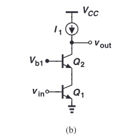

# 예제 9.9 — 이상적 전류원 부하 바이폴라 캐스코드 증폭기의 전압 이득

## 원문
그림 9.16(b)의 바이폴라 캐스코드는 $1\ \text{mA}$의 전류로 바이어스되어 있다. 두 트랜지스터 모두 $V_A = 5\ \text{V}$이고 $\beta = 100$일 때 전압 이득을 결정하라. 부하는 이상적인 전류원이라고 가정하라.

## 조건
- 회로: Fig 9.16(b) 바이폴라 캐스코드 증폭기 ($Q_1$ 입력, $Q_2$ 캐스코드, 부하 $I_1$)
- 바이어스 전류 $1\ \text{mA}$
- 두 트랜지스터 모두 $V_A = 5\ \text{V}$, $\beta = 100$
- 부하 $I_1$은 이상적인 전류원

## 구할 것
- 전압 이득 $A_v$

## 상속·참조
- 식 (9.53): $Q_1$, $Q_2$가 같은 바이어스 전류를 흘려 $g_{m1} \approx g_{m2}$, $r_{O1} \approx r_{O2}$일 때 $A_v \approx -g_{m1} r_{O1}\, g_{m1} (r_{O1} \parallel r_{\pi 2})$ (식 9.49–9.52: 식 9.33과 9.5로부터 — 보조 정리 식 9.33 $A_v = -G_m R_{out}$, $G_m \approx g_{m1}$, 식 9.5(바이폴라 캐스코드 출력 저항, 첨자를 이 회로에 맞춤)의 $R_{out} = [1 + g_{m2}(r_{O1} \parallel r_{\pi 2})] r_{O2} + r_{O1} \parallel r_{\pi 2}$에서 유도)
- 비교 기준 식 (9.43): 이상적 전류원 부하 CE 단(Fig 9.16(a)) $A_v = -g_{m1} r_{O1}$

## 회로 — Fig 9.16(b)
```spice
I1  VCC   vout
Q2  vout  Vb1  n1  npn
Q1  n1    vin  0   npn
```
- 단자: VCC = 전원, 값 미지정 (T 전원 기호) / Vb1 = 이상적 DC 바이어스, 값 미지정 (점 단자) / vin = 소신호 입력 (개방 원) / vout = 출력 (개방 원)
- 표시: 노드 라벨 VCC (T 기호 오른쪽), v_out (출력 원 오른쪽), V_b1 (점 단자 왼쪽), v_in (입력 원 왼쪽) / 소자 라벨 I_1 (전류원 왼쪽), Q2, Q1 (각 트랜지스터 오른쪽, 이미터 옆) / 부호 없음 / 화살표 없음 / 수치·면적 라벨 없음
- 배치: 한 세로줄 위→아래 VCC T 기호, I_1 전류원, 컬렉터 접속점, Q2, Q1, 접지 / Q2, Q1 npn 보통 방향(베이스 왼쪽, 컬렉터 오른쪽 위, 이미터 오른쪽 아래) / 접속점에서 가로선이 오른쪽으로 뻗어 v_out 원 / V_b1 점 단자 → 가로선 → Q2 베이스, v_in 원 → 가로선 → Q1 베이스 / Q2 이미터에서 곧은 세로선이 Q1 컬렉터로 (n1, 라벨 없음) / Q1 이미터 아래 접지 / 접속점 (세 갈래 이상, 1곳): Q2 컬렉터 위 = 위 I_1 + 아래 Q2 컬렉터 + 오른쪽 v_out 선 (점) / 교차: 없음



## 답 (검증용)
- $g_{m1} = (26\ \Omega)^{-1}$, $r_{\pi 1} \approx r_{\pi 2} \approx 2600\ \Omega$, $r_{O1} \approx r_{O2} = 5\ \text{k}\Omega$ → $g_{m1}(r_{O1} \parallel r_{\pi 2}) = 65.8$ (식 9.54)
- 식 9.53에서 $|A_v| = 12{,}654$ (식 9.55). 캐스코딩이 전압 이득을 65.8배 높임

## 풀이
### 소신호 파라미터
- 두 트랜지스터 모두 $1\ \text{mA}$라 같은 값 ($V_T = 26\ \text{mV}$): $g_m = 1\ \text{mA}/26\ \text{mV} = 38.5\ \text{mS}$
- $r_\pi = \beta/g_m = 2.60\ \text{k}\Omega$, $r_O = V_A/I_C = 5.00\ \text{k}\Omega$ (첨자는 트랜지스터 번호)
### 단락 회로 트랜스컨덕턴스
- 출력을 교류 접지에 단락하면 $Q_1$ 컬렉터 전류 $g_{m1} v_{in}$이 공통 베이스 $Q_2$를 지나 출력으로 나온다 ($Q_2$ 이미터 쪽 저항 $\approx 1/g_{m2} \ll r_{O1}$이라 거의 전부)
- $G_m \approx g_{m1} = 38.5\ \text{mS}$
### 출력 저항
- 입력을 0으로 두면 $Q_1$은 $r_{O1}$뿐 → $Q_2$가 $r_{O1}$로 이미터 축퇴, 이상적 $I_1$은 개방
- $r_{O1} \parallel r_{\pi 2} = 1.71\ \text{k}\Omega$, $g_{m2}(r_{O1} \parallel r_{\pi 2}) = 65.8 \gg 1$이므로 출력에서 아래를 본 저항 $R_{out} \approx g_{m2} r_{O2} (r_{O1} \parallel r_{\pi 2}) = 65.8 \times 5\ \text{k}\Omega = 329\ \text{k}\Omega$
### 전압 이득
- $A_v = -G_m R_{out} = -38.5\ \text{mS} \times 329\ \text{k}\Omega = -1.27 \times 10^4$
- 이상적 전류원 부하 CE 단의 $g_{m1} r_{O1} = 192$보다 약 65.8배 크다
### 답
- $A_v \approx -1.27 \times 10^4$
