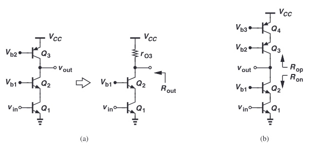

# 예제 9.10 — pnp 캐스코드 부하를 단 바이폴라 캐스코드 증폭기의 전압 이득

## 조건
- 예제 9.9의 회로(Fig 9.16(b) 바이폴라 캐스코드, npn $Q_1$, $Q_2$, 바이어스 전류 $1\ \text{mA}$, $V_A = 5\ \text{V}$, $\beta = 100$)에서 이상적 전류원 부하 대신 pnp 트랜지스터로 만든 캐스코드 부하를 사용
- pnp 트랜지스터: $V_A = 4\ \text{V}$, $\beta = 50$
- 회로 그림: Fig 9.19(b) (원문에 없음, 예제 문장은 그림 번호를 적지 않음. 풀이의 $Q_3$, $Q_4$ 표기와 식 9.58–9.61이 Fig 9.19(b)를 따름)
- 부하 트랜지스터 $Q_3$, $Q_4$도 약 $1\ \text{mA}$의 컬렉터 전류를 흘림 (원문에 없음, 풀이 첫 줄의 가정)

## 구할 것
- 전압 이득 $A_v$

## 상속·참조
- 예제 9.9 (E9.09): npn 쪽 $g_{m1} = (26\ \Omega)^{-1}$, $r_{\pi 1} \approx r_{\pi 2} \approx 2600\ \Omega$, $r_{O1} \approx r_{O2} = 5\ \text{k}\Omega$, 이상적 전류원 부하일 때 $|A_v| = 12{,}654$ (풀이의 가정: 상온 $V_T \approx 26\ \text{mV}$, $g_m = I_C/V_T$, $r_O = V_A/I_C$, $r_\pi = \beta V_T/I_C$)
- 식 (9.58)–(9.59) (식 9.7을 npn, pnp 캐스코드에 각각 적용): $R_{on} \approx g_{m2} r_{O2} (r_{O1} \parallel r_{\pi 2})$, $\quad R_{op} \approx g_{m3} r_{O3} (r_{O4} \parallel r_{\pi 3})$
- 식 (9.60)–(9.61): 단락 회로 트랜스컨덕턴스 $G_m \approx g_{m1}$이므로 $A_v = -g_{m1} (R_{on} \parallel R_{op})$

## 회로 — Fig 9.19(b)
```spice
Q4  n2    Vb3  VCC  pnp
Q3  vout  Vb2  n2   pnp
Q2  vout  Vb1  n1   npn
Q1  n1    vin  0    npn
```
- 단자: VCC = 전원, 값 미지정 (T 전원 기호) / Vb3, Vb2, Vb1 = 이상적 DC 바이어스, 값 미지정 (점 단자) / vin = 소신호 입력 (개방 원) / vout = 출력 (개방 원)
- 표시: 노드 라벨 VCC (T 기호 오른쪽), V_b3, V_b2, V_b1 (각 점 단자 왼쪽), v_out (출력 원 왼쪽), v_in (입력 원 왼쪽) / 소자 라벨 Q4, Q3, Q2, Q1 (각 트랜지스터 오른쪽) / 부호 없음 / 화살표 "R_op": vout 노드에서 위(Q3, Q4 쪽)를 들여다봄, 위 방향, 도선 옆 별도 화살표 (L자: 트랜지스터 줄 오른쪽에 세로선, 아래 끝에서 짧은 가로선이 오른쪽 R_op 글자 쪽으로, 화살촉은 위 끝, Q3 컬렉터 대각선 바로 아래 높이); "R_on": vout 노드에서 아래(Q2, Q1 쪽)를 들여다봄, 아래 방향, 도선 옆 별도 화살표 (┌ 꺾임: 위 끝에서 짧은 가로선이 오른쪽 R_on 글자 쪽으로, 화살촉은 아래 끝, Q2 컬렉터 대각선 바로 위 높이) / 수치·면적 라벨 없음
- 배치: 한 세로줄 위→아래 VCC T 기호, Q4, Q3, vout 접속점, Q2, Q1, 접지 / Q4, Q3 pnp (베이스 왼쪽, 이미터가 위·화살표가 막대 쪽으로 들어감, 컬렉터 아래) / Q2, Q1 npn 보통 방향(베이스 왼쪽, 컬렉터 위, 이미터 아래·화살표 바깥) / Q4 이미터에서 세로선이 위로 VCC T 기호 / Q4 컬렉터에서 곧은 세로선이 Q3 이미터로 (n2, 라벨 없음) / Q3 컬렉터 → 세로선 → vout 접속점 → 세로선 → Q2 컬렉터 / vout 접속점에서 가로선이 왼쪽으로 뻗어 v_out 원 (원은 점 단자들과 비슷한 x) / Q2 이미터에서 곧은 세로선이 Q1 컬렉터로 (n1, 라벨 없음) / Q1 이미터 아래 접지 / V_b3, V_b2, V_b1 점 단자와 v_in 원 → 가로선 → 각 베이스 / R_op 화살표는 vout 접속점 위, R_on 화살표는 그 아래, 둘 다 트랜지스터 줄 오른쪽 / 접속점 (세 갈래 이상, 1곳): vout = 위 Q3 컬렉터 + 아래 Q2 컬렉터 + 왼쪽 v_out 선 (점) / 교차: 없음


> 참고: 크롭 이미지 왼쪽의 (a)는 본문 그림(간단한 pnp 전류원 부하 캐스코드와 그 등가회로)이라 이 문제와 무관

## 답 (검증용)
- $R_{op} = g_{m3} r_{O3} (r_{O4} \parallel r_{\pi 3}) = 151\ \text{k}\Omega$ (식 9.62–9.63), $R_{on} = 329\ \text{k}\Omega$ (식 9.64)
- $|A_v| = g_{m1} (R_{on} \parallel R_{op}) = 3{,}981$ (식 9.65–9.66). 이상적 전류원 부하보다 약 3배 작음 (pnp의 Early 전압과 $\beta$ 영향)
