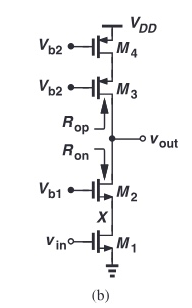

# 예제 9.11 — PMOS 캐스코드 부하를 단 CMOS 캐스코드 증폭기의 전압 이득

## 원문
그림 9.20(b)의 캐스코드 증폭기가 다음과 같은 소자 파라미터를 갖는다: $(W/L)_{1,2} = 30$, $(W/L)_{3,4} = 40$, $I_{D1} = \cdots = I_{D4} = 0.5\ \text{mA}$. $\mu_n C_{ox} = 100\ \mu\text{A}/\text{V}^2$, $\mu_p C_{ox} = 50\ \mu\text{A}/\text{V}^2$, $\lambda_n = 0.1\ \text{V}^{-1}$, $\lambda_p = 0.15\ \text{V}^{-1}$일 때 전압 이득을 결정하라.

## 조건
- 회로: Fig 9.20(b) CMOS 캐스코드 증폭기 (NMOS $M_1$, $M_2$ 캐스코드 + PMOS $M_3$, $M_4$ 캐스코드 부하)
- $(W/L)_{1,2} = 30$, $(W/L)_{3,4} = 40$
- $I_{D1} = \cdots = I_{D4} = 0.5\ \text{mA}$
- $\mu_n C_{ox} = 100\ \mu\text{A}/\text{V}^2$, $\mu_p C_{ox} = 50\ \mu\text{A}/\text{V}^2$
- $\lambda_n = 0.1\ \text{V}^{-1}$, $\lambda_p = 0.15\ \text{V}^{-1}$

## 구할 것
- 전압 이득 $A_v$

## 상속·참조
- 식 (9.70)–(9.71): $R_{on} \approx g_{m2} r_{O2} r_{O1}$, $\quad R_{op} \approx g_{m3} r_{O3} r_{O4}$
- 식 (9.72): $1/g_{m2} \ll r_{O1}$이면 $G_m \approx g_{m1}$이므로 $A_v \approx -g_{m1} \left[ (g_{m2} r_{O2} r_{O1}) \parallel (g_{m3} r_{O3} r_{O4}) \right]$
- $g_m = \sqrt{2 \mu C_{ox} (W/L) I_D}$, $r_O = (\lambda I_D)^{-1}$

## 회로 — Fig 9.20(b)
```spice
M4  n2    Vb2  VDD  pmos
M3  vout  Vb2  n2   pmos    ; M4, M3 게이트 라벨이 둘 다 V_b2로 인쇄됨 (점 단자 두 개, 그림에서 서로 이어져 있지 않음)
M2  vout  Vb1  X    nmos
M1  X     vin  0    nmos
```
- 단자: VDD = 전원, 값 미지정 (T 전원 기호) / Vb2 = 이상적 DC 바이어스, 값 미지정 (점 단자, M4 게이트와 M3 게이트에 하나씩 모두 V_b2로 인쇄) / Vb1 = 이상적 DC 바이어스, 값 미지정 (점 단자) / vin = 소신호 입력 (개방 원) / vout = 출력 (개방 원)
- 표시: 노드 라벨 VDD (T 기호 오른쪽), V_b2 (M4 게이트 점 단자 왼쪽), V_b2 (M3 게이트 점 단자 왼쪽), V_b1 (점 단자 왼쪽), X (M2–M1 연결선 왼쪽, 두 트랜지스터 사이), v_in (입력 원 왼쪽), v_out (출력 원 오른쪽) / 소자 라벨 M4, M3, M2, M1 (각 트랜지스터 오른쪽) / 부호 없음 / 화살표 "R_op": vout 노드에서 위(M3, M4 쪽)를 들여다봄, 위 방향, 도선 옆 별도 화살표 (L자를 좌우 반전: M3 게이트 판과 드레인 세로선 사이(드레인선 바로 왼쪽, M3 채널 바로 아래 x)에 세로선, 아래 끝에서 짧은 가로선이 왼쪽 R_op 글자 쪽으로, 가로선은 vout 접속점보다 약간 위, 화살촉은 위 끝, M3 드레인 바로 아래 높이); "R_on": vout 노드에서 아래(M2, M1 쪽)를 들여다봄, 아래 방향, 도선 옆 별도 화살표 (┌ 꺾임을 좌우 반전: M2 게이트 판과 드레인 세로선 사이(드레인선 바로 왼쪽, M2 채널 바로 위 x)에 세로선, 위 끝에서 짧은 가로선이 왼쪽 R_on 글자 쪽으로, 화살촉은 아래 끝, M2 드레인 바로 위 높이) / 수치·면적 라벨 없음
- 배치: 한 세로줄 위→아래 VDD T 기호, M4, M3, vout 접속점, M2, X, M1, 접지 / M4, M3 PMOS (게이트 왼쪽, 소스가 위·소스 화살표가 채널 쪽으로 들어감, 드레인 아래) / M2, M1 NMOS 보통 방향(게이트 왼쪽, 드레인 위, 소스 아래·화살표 바깥) / M4 소스에서 세로선이 위로 VDD T 기호 / M4 드레인에서 곧은 세로선이 M3 소스로 (n2, 라벨 없음) / M3 드레인 → 세로선 → vout 접속점 → 세로선 → M2 드레인 / vout 접속점에서 가로선이 오른쪽으로 뻗어 v_out 원 / M2 소스에서 곧은 세로선이 M1 드레인으로 = X / M1 소스 아래 접지 / 점 단자들과 v_in 원 → 가로선 → 각 게이트 / R_op, R_on 화살표의 세로선은 게이트 판과 드레인 세로선 사이(드레인선 바로 왼쪽), R_op·R_on 글자는 그 왼쪽(R_op는 M3 게이트 선 아래, R_on은 M2 게이트 선 위), R_op는 vout 접속점 위, R_on은 그 아래 / 접속점 (세 갈래 이상, 1곳): vout = 위 M3 드레인 + 아래 M2 드레인 + 오른쪽 v_out 선 (점) / 교차: 없음


> 참고: (b)의 두 V_b2 라벨 중 하나(M4 쪽)는 원문 오식일 수 있으나 인쇄된 대로 적음

## 답 (검증용)
- $g_{m1,2} = (577\ \Omega)^{-1}$, $g_{m3,4} = (707\ \Omega)^{-1}$, $r_{O1,2} = 20\ \text{k}\Omega$, $r_{O3,4} = 13.3\ \text{k}\Omega$ (식 9.73–9.78) → $R_{on} \approx 693\ \text{k}\Omega$, $R_{op} \approx 250\ \text{k}\Omega$ (식 9.79–9.80)
- $A_v = -g_{m1} (R_{on} \parallel R_{op}) \approx -318$ (식 9.81–9.82)

## 풀이
### 소신호 파라미터
- $100,50\ \mu\mathrm{A/V^2}=0.1,0.05\ \mathrm{mA/V^2}$이므로 $g_{m1,2}=\sqrt{2(0.1)(30)(0.5)}=\sqrt3\ \mathrm{mS}$.
- $g_{m3,4}=\sqrt{2(0.05)(40)(0.5)}=\sqrt2\ \mathrm{mS}$.
- $r_{o1,2}=1/[0.1(0.5)]=20\ \mathrm{k\Omega}$.
- $r_{o3,4}=1/[0.15(0.5)]=40/3\ \mathrm{k\Omega}$.
### 출력 위아래 저항
- 입력 영점에서는 $M_1,M_4$의 제어전류가 0이므로 각각 $r_o$로 보인다. 두 가지의 반대쪽은 같은 AC 접지여서 병렬이다.
- 캐스코드 곱 항이 지배할 때 $R_{on}\approx g_{m2}r_{o2}r_{o1}=692.820323\ldots\ \mathrm{k\Omega}$.
- $R_{op}\approx g_{m3}r_{o3}r_{o4}=251.415744\ldots\ \mathrm{k\Omega}$.
- $R_{out}=R_{on}\parallel R_{op}\approx184.472870\ \mathrm{k\Omega}$.
### 전류 생성과 이득
- 별도의 출력 단락에서 $1/g_{m2}\ll r_{o1}$이므로 $G_m\approx g_{m1}$다. PMOS는 이 단락 측정에서 구동 소신호가 없어 기여하지 않지만 출력저항에는 기여한다.
- $A_v=-G_mR_{out}\approx-\sqrt3(184.472870)=-319.516383\ldots$; $g_{m2}r_{o1}=34.641\ldots$, $g_{m3}r_{o4}=18.856\ldots$로 주항 조건을 확인한다.
### 답
- $A_v\approx-319.516\ \mathrm{V/V}\approx-320\ \mathrm{V/V}$. 교재의 $-318$은 중간값 반올림 차이다.
