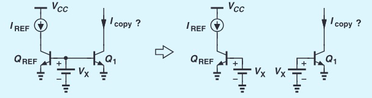

# 예제 9.13 — 배터리 V_X로 베이스 전압을 정한 전류 거울

## 원문
위의 회로에서 잘못된 점을 고치기 위해 배터리 $V_X$가 베이스 전류를 공급하고 $Q_{REF}$와 $Q_1$의 이미터-베이스 전압을 규정하기를 희망하면서 그림 9.26과 같이 수정하였다. 어떤 일이 일어나는지 설명하라.

## 조건
- 예제 9.12 회로(Fig 9.25)의 잘못을 고치려고, 배터리 $V_X$가 베이스 전류를 공급하고 $Q_{REF}$와 $Q_1$의 베이스–이미터 전압을 정해 주기를 기대하며 Fig 9.26처럼 수정함 ($V_X$를 두 베이스 공통 노드와 접지 사이에 연결)
- 소자 값은 주어지지 않음 (원문에 없음)

## 구할 것
- 어떤 일이 일어나는지 설명

## 상속·참조
- 예제 9.12 (E9.12): Fig 9.25 ($Q_{REF}$ 베이스–컬렉터 연결 누락)에서는 베이스 전류 경로가 없고 $V_{BE}$가 정해지지 않아 $I_{copy} = 0$
- 본문 Fig 9.22(a) (교재 468쪽, 크롭 안 함): 저항 분배기 $R_1$, $R_2$로 $V_{CC}$를 나눠 $Q_1$의 $V_{BE}$를 직접 정하는 비현실적 바이어싱. $\dfrac{R_2}{R_1 + R_2} V_{CC} = V_T \ln \dfrac{I_1}{I_S}$ (식 9.83), $V_T$와 $I_S$가 온도에 따라 변하므로 $V_{BE}$가 일정해도 $I_1$은 일정하지 않음
- 식 (9.87): 전류 거울의 블랙박스는 $V_X = V_T \ln (I_{REF}/I_{S1})$를 만들어야 함 (입력 전류의 자연 대수에 비례하는 전압, 다이오드 연결 소자가 이를 만족)

## 회로 — Fig 9.26
```spice
IREF  VCC  n1
QREF  n1   n2  0  npn
Q1    out  n2  0  npn
VX    n2   0   {V_X}
```
- 단자: VCC = 전원, 값 미지정 (T 전원 기호) / out = Q1 컬렉터, I_copy가 들어가는 단자 (선 끝)
- 표시: 노드 라벨 VCC (T 기호 오른쪽) / 소자 라벨 I_REF (전류원 왼쪽), Q_REF (Q_REF 왼쪽, 이미터 높이), Q1 (Q1 오른쪽, 이미터 옆), V_X (배터리 오른쪽) / 부호 배터리 V_X의 + (위 긴 판 왼쪽 위), − (아래 짧은 판 왼쪽 아래) / 화살표 "I_copy ?": out, 아래 방향(Q1 컬렉터로 들어감), 도선 위, 글자는 화살표 오른쪽이고 물음표까지 인쇄됨 / 수치·면적 라벨 없음
- 배치: Fig 9.25와 같은 모양(왼쪽 VCC–I_REF–Q_REF(좌우 반전)–접지, 오른쪽 Q1 보통 방향, 베이스 높이 가로선이 두 베이스를 이음, Q_REF 컬렉터–베이스 연결선 없음)에 배터리 추가 / 베이스 가로선 가운데 접속점에서 세로선이 아래로 내려가 배터리 V_X(위 긴 판, 아래 짧은 판), 그 아래 접지 / Q1 컬렉터 위로 선 끝 + I_copy 화살표, 이미터 아래 접지 / 접속점 (세 갈래 이상, 1곳): 베이스 가로선 가운데 = 왼쪽 Q_REF 베이스 + 오른쪽 Q1 베이스 + 아래 V_X (점) / 교차: 없음

## 회로 — Fig 9.26(eq)
```spice
IREF  VCC  n1
QREF  n1   n2  0  npn
VX1   n2   0   {V_X}
Q1    out  n3  0  npn
VX2   n3   0   {V_X}
```
- 단자: VCC = 전원, 값 미지정 (T 전원 기호) / out = Q1 컬렉터, I_copy가 들어가는 단자 (선 끝)
- 표시: 노드 라벨 VCC (T 기호 오른쪽) / 소자 라벨 I_REF (전류원 왼쪽), Q_REF (Q_REF 왼쪽), Q1 (Q1 오른쪽), V_X (왼쪽 배터리 오른쪽), V_X (오른쪽 배터리 왼쪽) / 부호 왼쪽 배터리 + (위 판 왼쪽 위), − (왼쪽 아래); 오른쪽 배터리 + (위 판 오른쪽 위), − (오른쪽 아래) / 화살표 "I_copy ?": out, 아래 방향(Q1 컬렉터로 들어감), 도선 위, 글자는 화살표 오른쪽 / 수치·면적 라벨 없음
- 배치: 왼쪽 회로 오른쪽에 속이 빈 오른쪽 방향 굵은 화살표(⇒) 다음에 그려짐 / 베이스 선이 끊겨 서로 이어지지 않은 두 부분 / 왼쪽 부분: VCC T 기호–I_REF–Q_REF(좌우 반전)–접지, Q_REF 베이스에서 가로선이 오른쪽으로 가 모서리에서 아래로 꺾여 배터리 V_X, 그 아래 접지 / 오른쪽 부분: Q1(보통 방향) 베이스에서 가로선이 왼쪽으로 가 모서리에서 아래로 꺾여 배터리 V_X, 그 아래 접지, Q1 컬렉터 위로 선 끝 + I_copy 화살표, 이미터 아래 접지 / 두 V_X 라벨은 두 배터리 사이에 나란히 놓임 / 접속점: 없음 / 교차: 없음


> 참고: 오른쪽 (eq)는 원문 그림 안에서 ⇒로 이어진 회로로, V_X가 두 트랜지스터에 따로 걸린 것과 같음을 보임

## 답 (검증용)
- $Q_1$에 유한한 전류가 흐르는 한 $Q_1$의 바이어싱은 Fig 9.22와 다르지 않음: $I_{copy} = I_{S1} \exp(V_X/V_T)$ (식 9.92) → $V_X$가 일정하면 $I_{copy}$는 온도의 함수이고 $I_{REF}$와 무관
- 학생은 $V_X$가 $\ln(I_{REF}/I_{S,REF})$에 비례하려면 다이오드 연결 소자가 필요하다는 것을 잊음
