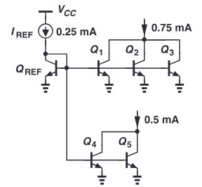

# 예제 9.14 — 0.25 mA 기준 전류로 0.75 mA와 0.5 mA 전류원 설계

## 원문
다단 증폭기가 $0.75\ \text{mA}$와 $0.5\ \text{mA}$ 두 전류원을 포함하고 있다. $0.25\ \text{mA}$의 밴드갭 기준 전류를 사용하여 필요한 전류원을 설계하라. 베이스 전류 효과는 무시하라.

## 조건
- 다단 증폭기에 전류원 두 개가 필요: $0.75\ \text{mA}$와 $0.5\ \text{mA}$
- 기준 전류: $0.25\ \text{mA}$의 밴드갭 기준 전류
- 베이스 전류 효과는 무시

## 구할 것
- 필요한 두 전류원을 만드는 전류 거울 회로 설계

## 상속·참조
- 식 (9.94): 기준 트랜지스터 $Q_{REF}$와 $V_{BE}$를 공유하는 $Q_j$의 복사 전류 $I_{copy,j} = \dfrac{I_{S,j}}{I_{S,REF}} I_{REF}$ ($I_S$는 이미터 면적에 비례)
- 본문 Fig 9.27(c) (교재 472쪽, 크롭 안 함): $Q_{REF}$와 같은 트랜지스터 $Q_1$–$Q_3$의 컬렉터를 한데 묶으면 $I_{copy} = 3 I_{REF}$ ($n$개 병렬 = 면적 $n$배)

## 회로 — 없음 (설계 문제, 그림은 풀이에만 있음)

## 답 (검증용)
- 모든 트랜지스터를 $Q_{REF}$와 같게 두고, $Q_1$–$Q_3$ 세 개의 컬렉터를 묶어 $3 \times 0.25 = 0.75\ \text{mA}$, $Q_4$–$Q_5$ 두 개의 컬렉터를 묶어 $2 \times 0.25 = 0.5\ \text{mA}$ (Fig 9.28)

### 정답 회로 — Fig 9.28
```spice
IREF  VCC   n1  0.25mA
QREF  n1    n1  0  npn
Q1    out1  n1  0  npn
Q2    out1  n1  0  npn
Q3    out1  n1  0  npn
Q4    out2  n1  0  npn
Q5    out2  n1  0  npn
```
- 단자: VCC = 전원, 값 미지정 (T 전원 기호) / out1 = Q1–Q3 공통 컬렉터, 0.75 mA가 들어가는 단자 (선 끝) / out2 = Q4, Q5 공통 컬렉터, 0.5 mA가 들어가는 단자 (선 끝)
- 표시: 노드 라벨 VCC (T 기호 오른쪽) / 소자 라벨 I_REF (전류원 왼쪽), Q_REF (Q_REF 왼쪽), Q1, Q2, Q3 (각 막대 위, 컬렉터 선 왼쪽), Q4, Q5 (각 막대 위, 컬렉터 선 왼쪽) / 부호 없음 / 화살표 out1 전류 (라벨 없음, 옆에 수치 "0.75 mA"만 인쇄): out1, 아래 방향(Q2 컬렉터 위 접속점으로 들어감), 도선 위; out2 전류 (라벨 없음, 옆에 수치 "0.5 mA"만 인쇄): out2, 아래 방향(Q5 컬렉터 위 접속점으로 들어감), 도선 위 / 수치·면적 라벨 "0.25 mA" (전류원 오른쪽), "0.75 mA" (위 화살표 오른쪽), "0.5 mA" (아래 화살표 오른쪽)
- 배치: 왼쪽 위 VCC T 기호에서 세로로 I_REF 전류원이 내려와 Q_REF 컬렉터 접속점 / Q_REF 좌우 반전(베이스 막대 오른쪽, 컬렉터 인출선은 접속점에서 수직으로 내려오다 비스듬히 막대 위쪽으로, 이미터는 막대 아래쪽에서 왼쪽 아래로 나가 접지) / 다이오드 연결: Q_REF 컬렉터 접속점에서 가로선이 오른쪽으로 가 모서리에서 아래로 꺾여 베이스 공통선 접속점에 닿음 / 베이스 공통선: 베이스 높이 가로선, Q_REF 막대 오른쪽에서 시작해 그 접속점을 지나 Q1, Q2 막대를 가로질러 Q3 베이스에서 끝남 / 위 줄 Q1, Q2, Q3 가로로 등간격, 모두 보통 방향, 이미터 아래 각자 접지 / 위 컬렉터 공통선: 트랜지스터들보다 위 높이의 가로선, Q1 컬렉터 세로선 위 모서리에서 Q3 컬렉터 세로선 위 모서리까지, Q2 컬렉터는 가운데 접속점에 닿고 그 위에서 0.75 mA 화살표 도선이 내려옴 / 베이스 공통선 접속점에서 세로선이 아래로 길게 내려가 Q4 베이스 높이에서 모서리로 오른쪽 꺾여 Q4 막대, 가로질러 Q5 베이스까지 (아래 줄 베이스선) / 아래 줄 Q4는 Q1 아래, Q5는 Q2 아래쯤(둘 다 약간 왼쪽), 보통 방향, 이미터 아래 각자 접지 / 아래 컬렉터 공통선: Q4 컬렉터 세로선 위 모서리에서 오른쪽으로 Q5 컬렉터 위 접속점까지, 그 위에서 0.5 mA 화살표 도선이 내려옴 / 접속점 (세 갈래 이상): ① Q_REF 컬렉터 = 위 I_REF + 아래 컬렉터 인출선 + 오른쪽 다이오드 연결선 (점) ② 베이스 공통선 = 위 다이오드 연결선 + 왼쪽 Q_REF 베이스 + 오른쪽 Q1 쪽 베이스선 + 아래 Q4 쪽 세로선, 네 갈래 (점) ③ Q2 컬렉터 위 = 왼쪽 Q1 쪽 + 오른쪽 Q3 쪽 + 아래 Q2 컬렉터 + 위 0.75 mA 도선, 네 갈래 (점) ④ Q5 컬렉터 위 = 왼쪽 Q4 쪽 + 아래 Q5 컬렉터 + 위 0.5 mA 도선 (점) ⑤ 베이스선이 Q1, Q2 막대와 Q4 막대를 가로지르는 곳, 왼쪽 선 + 오른쪽 선 + 베이스 (각각 점 없음) / 교차: 없음 (위 컬렉터 공통선은 Q1, Q3 컬렉터 세로선 위 끝에서 꺾일 뿐 교차하지 않음)



## 풀이
### 필요한 배율
- 베이스 전류를 무시하면 $I_{copy,j} = (I_{S,j}/I_{S,REF}) I_{REF}$이고 $I_S$는 이미터 면적에 비례한다
- $0.75\ \text{mA}/0.25\ \text{mA} = 3$, $\quad 0.5\ \text{mA}/0.25\ \text{mA} = 2$
### 단위 트랜지스터로 배율 만들기
- $Q_{REF}$를 다이오드 연결하고, 출력 트랜지스터를 모두 $Q_{REF}$와 같은 단위 소자로 두어 베이스를 $Q_{REF}$의 베이스–컬렉터 노드에 잇는다 (같은 소자를 병렬로 묶으면 면적이 그 개수배)
- $0.75\ \text{mA}$: 단위 트랜지스터 3개($Q_1$–$Q_3$)의 컬렉터를 묶는다 → $3 \times 0.25\ \text{mA} = 0.75\ \text{mA}$
- $0.5\ \text{mA}$: 단위 트랜지스터 2개($Q_4$, $Q_5$)의 컬렉터를 묶는다 → $2 \times 0.25\ \text{mA} = 0.5\ \text{mA}$
### 답
- $0.25\ \text{mA}$를 흘리는 다이오드 연결 $Q_{REF}$와 같은 트랜지스터를 베이스 공통으로 두고, 3개의 컬렉터를 묶어 $0.75\ \text{mA}$, 2개의 컬렉터를 묶어 $0.5\ \text{mA}$ 전류원을 만든다 (단위 소자 모두 6개)
