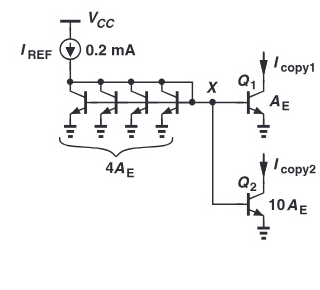

# 예제 9.15 — 200 μA 기준 전류로 50 μA와 500 μA를 만드는 전류 거울 설계

## 원문
$200\ \mu\text{A}$의 기준 전류로부터 $50\ \mu\text{A}$와 $500\ \mu\text{A}$의 두 전류를 생성하고자 한다. 전류 거울 회로를 설계하라.

## 조건
- 기준 전류 $I_{REF} = 200\ \mu\text{A}$
- 이 기준 전류 하나로 두 전류 $50\ \mu\text{A}$와 $500\ \mu\text{A}$를 만들어야 함

## 구할 것
- 위 두 전류를 만드는 전류 거울 회로 설계

## 회로 — 없음 (설계 문제, 그림은 풀이에만 있음)

## 답 (검증용)
- 기준 쪽($Q_{REF}$)을 각각 $50\ \mu\text{A}$를 흘리는 단위 트랜지스터 4개(총 $4A_E$)로 만들고, $Q_1 = A_E$ → $50\ \mu\text{A}$, $Q_2 = 10A_E$(단위 트랜지스터 10개) → $500\ \mu\text{A}$ (Fig 9.30)

### 정답 회로 — Fig 9.30
```spice
IREF  VCC   X  0.2mA
QR1   X     X  0  npn  area=1
QR2   X     X  0  npn  area=1
QR3   X     X  0  npn  area=1
QR4   X     X  0  npn  area=1
Q1    out1  X  0  npn  area=1
Q2    out2  X  0  npn  area=10
```
- 단자: VCC = 전원, 값 미지정 (T 전원 기호) / out1, out2 = Q1, Q2 컬렉터, 복사 전류 I_copy1, I_copy2가 들어가는 단자 (선 끝)
- 표시: 노드 라벨 VCC (T 기호 오른쪽), X (X 접속점 바로 위) / 소자 라벨 I_REF (전류원 왼쪽), Q1 (Q1 막대 위, 컬렉터 선 왼쪽), Q2 (Q2 막대 위, 컬렉터 선 왼쪽), QR1–QR4 (라벨 없음) / 부호 없음 / 화살표 "I_copy1": out1, 아래 방향(Q1 컬렉터로 들어감), 도선 위, 글자는 화살표 오른쪽; "I_copy2": out2, 아래 방향(Q2 컬렉터로 들어감), 도선 위, 글자는 화살표 오른쪽 / 수치·면적 라벨 "0.2 mA" (전류원 오른쪽), "4A_E" (기준 트랜지스터 4개의 접지 기호 아래에 가로로 걸친 중괄호 밑), "A_E" (Q1 오른쪽, 베이스 높이), "10A_E" (Q2 오른쪽, 베이스 높이)
- 배치: 왼쪽 위 VCC T 기호에서 세로로 I_REF 전류원이 내려와 컬렉터 공통선 왼쪽 끝에 닿음 / 기준 트랜지스터 4개(QR1–QR4)가 왼쪽에 가로로 등간격, 모두 좌우 반전(베이스 막대가 오른쪽, 컬렉터 인출선은 컬렉터 공통선에서 수직으로 내려오다 비스듬히 막대 위쪽으로, 이미터는 막대 아래쪽에서 왼쪽 아래로 나가 수직으로 내려가 각자의 접지 기호) / 컬렉터 공통선: 트랜지스터들보다 위 높이의 가로선, 넷째 컬렉터 오른쪽으로 더 가서 모서리에서 아래로 꺾여 베이스 공통선에 닿음 = 다이오드 연결 / 베이스 공통선: 베이스 높이의 가로선, 첫째 막대 오른쪽에서 시작해 둘째~넷째 막대를 가로질러 지나 다이오드 연결 접속점, 그 바로 오른쪽 X 접속점을 지나 Q1 베이스까지 한 직선 / Q1은 X 오른쪽, 베이스가 베이스 공통선 높이, 보통 방향 / X 접속점에서 세로선이 아래로 내려가 Q2 베이스 높이에서 모서리로 오른쪽 꺾여 Q2 베이스 / Q2는 Q1 바로 아래 같은 x 위치, 보통 방향 / Q1, Q2 컬렉터는 세로선으로 위로 올라가 선 끝, 이미터 아래 각자 접지 기호 / 접속점 (세 갈래 이상, 7곳): ① 컬렉터 공통선 왼쪽 끝 = I_REF 선 + 컬렉터 공통선 + 첫째 컬렉터 인출선 (점) ②③④ 컬렉터 공통선이 둘째·셋째·넷째 컬렉터 인출선과 만나는 곳 (각각 점) ⑤ 다이오드 연결 = 위에서 내려온 선 + 왼쪽 베이스 공통선 + 오른쪽으로 X 가는 선 (점) ⑥ X = 왼쪽 베이스 공통선 + 오른쪽 Q1 베이스 + 아래 Q2로 가는 세로선 (점) ⑦ 베이스 공통선이 둘째~넷째 막대를 가로지르는 곳, 왼쪽 선 + 오른쪽 선 + 베이스 (각각 점 없음) / 교차: 없음 (베이스 공통선은 둘째~넷째 트랜지스터의 컬렉터·이미터 인출선 사이로 막대에 닿으므로 인출선과 겹치지 않음)



## 힌트
### 기준 쪽도 단위 소자 여러 개로
- 출력 하나가 기준 전류보다 작아서, 기준 트랜지스터를 한 개로 두면 그보다 작은 트랜지스터가 필요해진다
- 가장 작은 전류를 흘리는 단위 트랜지스터를 먼저 정하고, 기준 전류도 그 단위 몇 개가 나눠 흘리게 한다

## 풀이
### 단위 트랜지스터 정하기
- 기준 트랜지스터를 한 개로 두면 $50\ \mu\text{A}$ 출력에는 그 $1/4$ 면적의 트랜지스터가 필요한데, 단위 소자를 쪼갤 수는 없다
- 그래서 가장 작은 전류 $50\ \mu\text{A}$를 흘리는 트랜지스터(면적 $A_E$)를 단위로 정한다
### 기준 쪽과 출력 쪽의 면적
- 기준 쪽: $200\ \mu\text{A}/50\ \mu\text{A} = 4$ → 단위 소자 4개를 병렬로 다이오드 연결 (총 $4A_E$)
- $Q_1$: $50\ \mu\text{A}/50\ \mu\text{A} = 1$ → 면적 $A_E$
- $Q_2$: $500\ \mu\text{A}/50\ \mu\text{A} = 10$ → 면적 $10A_E$ (단위 소자 10개)
- 베이스를 무시하면 $I_{copy} = (A_{E,j}/4A_E) \cdot 200\ \mu\text{A}$이므로 원하는 두 전류가 나온다
### 답
- 기준 쪽을 단위 소자 4개($4A_E$)로 다이오드 연결하고, 같은 베이스에 $Q_1$(면적 $A_E$)과 $Q_2$(면적 $10A_E$)를 달아 $I_{copy1} = 50\ \mu\text{A}$, $I_{copy2} = 500\ \mu\text{A}$를 얻는다
