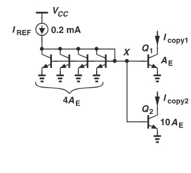

# 예제 9.16 — 베이스 전류에 의한 복사 전류 오차와 이미터 폴로어

## 조건
- 회로: Fig 9.30 (예제 9.15의 설계 결과)
  - $I_{REF} = 0.2\ \text{mA}$
  - 기준 쪽: 단위 트랜지스터 4개 병렬, 총 면적 $4A_E$ (다이오드 연결)
  - $Q_1$ 면적 $A_E$ → 이상적이면 $I_{copy1} = 50\ \mu\text{A}$
  - $Q_2$ 면적 $10A_E$ → 이상적이면 $I_{copy2} = 500\ \mu\text{A}$
- 베이스 전류를 무시하지 않음: 모든 트랜지스터가 같은 유한한 $\beta$
- "폴로어를 붙인다" = 본문 Fig 9.32의 방법. 기준 트랜지스터들의 컬렉터 노드와 공통 베이스 노드 사이에 이미터 폴로어를 넣어 베이스 전류가 $I_{REF}$에서 빠지는 양을 줄임

## 구할 것
- 폴로어를 붙이기 전: $I_{copy1}$, $I_{copy2}$ 각각의 오차 — 이상값 $50\ \mu\text{A}$, $500\ \mu\text{A}$에서 베이스 전류 때문에 벗어나는 정도
- 폴로어를 붙인 후: 같은 두 전류의 오차 (붙이기 전과 비교)

## 상속·참조
- 예제 9.15 (E9.15): 200 μA 기준 전류로 50 μA와 500 μA 두 전류를 만드는 전류 거울 설계. 기준 쪽을 50 μA 단위 트랜지스터 4개로 만들고 $Q_1 = A_E$, $Q_2 = 10A_E$로 둔 결과가 Fig 9.30

## 회로 — Fig 9.30
```spice
IREF  VCC   X  0.2mA
QR1   X     X  0  npn  area=1
QR2   X     X  0  npn  area=1
QR3   X     X  0  npn  area=1
QR4   X     X  0  npn  area=1
Q1    out1  X  0  npn  area=1
Q2    out2  X  0  npn  area=10
```
- 단자: VCC = 전원 레일(값 미지정) / out1, out2 = 개방 컬렉터 단자(복사 전류 출력)
- 표시: 전류원 옆 "I_REF", "0.2 mA" / 기준 트랜지스터 4개 아래 중괄호 "4A_E" (개별 이름 라벨 없음) / 노드 라벨 VCC, X / Q1 옆 "A_E", Q2 옆 "10A_E" / I_copy1 = out1로 들어가는 아래 화살표, I_copy2 = out2로 들어가는 아래 화살표
- 배치: 왼쪽 위 VCC에서 I_REF(아래 방향)가 곧장 내려와 컬렉터 공통선의 맨 왼쪽 점(첫째 기준 트랜지스터의 컬렉터가 매달린 점)에 접속 / 기준 트랜지스터 4개가 왼쪽에 가로로 나란히, 좌우 반전으로 그려짐(베이스 막대가 오른쪽, 컬렉터·이미터가 왼쪽) / 컬렉터 공통선(각 컬렉터에 점)이 넷째 트랜지스터 오른쪽에서 아래로 꺾여 베이스 공통선에 점으로 접속(다이오드 연결), 그 바로 오른쪽 점이 X / X 오른쪽에 Q1 / X에서 아래로 내려간 선이 오른쪽으로 꺾여 Q2 베이스로, Q2는 Q1 아래 / 모든 이미터 아래 접지



## 답 (검증용)
- 폴로어 전 (식 9.109–9.110): $I_{copy1} = \dfrac{I_{REF}}{4 + 15/\beta}$, $\quad I_{copy2} = \dfrac{10\, I_{REF}}{4 + 15/\beta}$
- 폴로어 후 (식 9.116–9.117): $I_{copy1} = \dfrac{I_{REF}}{4 + 15/\beta^2}$, $\quad I_{copy2} = \dfrac{10\, I_{REF}}{4 + 15/\beta^2}$ — 오차가 약 $\beta$배 줄어듦

### 정답 회로 — Fig 9.33
```spice
IREF  VCC   P  0.2mA
QF    VCC   P  X  npn
QR1   P     X  0  npn  area=1
QR2   P     X  0  npn  area=1
QR3   P     X  0  npn  area=1
QR4   P     X  0  npn  area=1
Q1    out1  X  0  npn  area=1
Q2    out2  X  0  npn  area=10
```
- 단자: VCC = 전원 레일(맨 위 가로선) / out1, out2 = 개방 컬렉터 단자
- 표시: 노드 라벨 VCC, P, X / Q_F 라벨 / 전류원 옆 "I_REF", "0.2 mA"(전류원 안 화살표 아래 방향) / "4A_E"(중괄호), "A_E", "10A_E" / I_copy1, I_copy2 아래 화살표
- 배치: 맨 위 VCC 가로 레일에서 I_REF가 P로 내려옴 / P = 기준 트랜지스터 4개(Fig 9.30과 같이 좌우 반전) 컬렉터 공통선, 오른쪽으로 이어져 Q_F 베이스까지 / Q_F는 그 오른쪽, 컬렉터가 레일에 연결, 베이스가 P, 이미터가 아래로 X / X = 기준 트랜지스터 4개 베이스 공통선, 오른쪽으로 Q1 베이스, 아래로 Q2 베이스


