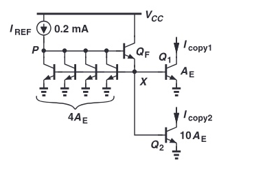

# 예제 9.16 — 베이스 전류에 의한 복사 전류 오차와 이미터 폴로어

## 원문
그림 9.30에서 폴로어를 붙이기 전후의 $I_{copy1}$과 $I_{copy2}$에서의 오차를 계산하라.

## 조건
- 회로: Fig 9.30 (예제 9.15의 설계 결과)
  - $I_{REF} = 0.2\ \text{mA}$
  - 기준 쪽: 단위 트랜지스터 4개 병렬, 총 면적 $4A_E$ (다이오드 연결)
  - $Q_1$ 면적 $A_E$ → 이상적이면 $I_{copy1} = 50\ \mu\text{A}$
  - $Q_2$ 면적 $10A_E$ → 이상적이면 $I_{copy2} = 500\ \mu\text{A}$
- 오차의 원인은 베이스 전류 (본문 "베이스 전류의 효과")
- 모든 트랜지스터의 $\beta$가 같음 (원문에 없음)
- 참고 회로 (본문 Fig 9.32): "폴로어를 붙인다"는 기준 트랜지스터 컬렉터 노드 P가 폴로어 $Q_F$의 베이스를 구동하고, $Q_F$의 이미터가 모든 거울 트랜지스터의 공통 베이스 노드 X를 구동하는 구조. $Q_F$ 컬렉터는 $V_{CC}$ (원문에 없음)

## 구할 것
- 폴로어를 붙이기 전: $I_{copy1}$, $I_{copy2}$ 각각의 오차 — 이상값 $50\ \mu\text{A}$, $500\ \mu\text{A}$에서 베이스 전류 때문에 벗어나는 정도
- 폴로어를 붙인 후: 같은 두 전류의 오차 (붙이기 전과 비교)

## 상속·참조
- 예제 9.15 (E9.15): $200\ \mu\text{A}$ 기준 전류로 $50\ \mu\text{A}$와 $500\ \mu\text{A}$ 두 전류를 만드는 전류 거울 설계. 기준 쪽을 $50\ \mu\text{A}$ 단위 트랜지스터 4개로 만들고 $Q_1 = A_E$, $Q_2 = 10A_E$로 둔 결과가 Fig 9.30. 그 풀이는 단위 트랜지스터 하나(면적 $A_E$)가 $50\ \mu\text{A}$를 흘린다고 보고 전류를 면적 배수로 나눔
- 본문 Fig 9.32 (교재 475쪽, 크롭 안 함): "폴로어를 붙인다"의 뜻. 노드 P(기준 트랜지스터 컬렉터)에서 베이스 전류를 직접 빼 가지 않도록, P가 $Q_F$의 베이스를 구동하고 $Q_F$의 이미터가 공통 베이스 노드 X를 구동하는 구조. 그 결과 $I_{REF}$에서 새는 전류가 약 $\beta$분의 1로 줄어듦
  - `I_REF: VCC → P`
  - `Q_F: C = VCC, B = P, E = X`
  - `Q_REF: C = P, B = X, E = 0` (면적 $A_E$)
  - `Q1: C = out, B = X, E = 0` (면적 $nA_E$, $I_{copy}$가 컬렉터로 들어감)

## 회로 — Fig 9.30
```spice
IREF  VCC   X  0.2mA
QR1   X     X  0  npn  area=1
QR2   X     X  0  npn  area=1
QR3   X     X  0  npn  area=1
QR4   X     X  0  npn  area=1
Q1    out1  X  0  npn  area=1
Q2    out2  X  0  npn  area=10
```
- 단자: VCC = 전원, 값 미지정 (T 전원 기호) / out1, out2 = Q1, Q2 컬렉터, 복사 전류 I_copy1, I_copy2가 들어가는 단자 (선 끝)
- 표시: 노드 라벨 VCC (T 기호 오른쪽), X (X 접속점 바로 위) / 소자 라벨 I_REF (전류원 왼쪽), Q1 (Q1 막대 위, 컬렉터 선 왼쪽), Q2 (Q2 막대 위, 컬렉터 선 왼쪽), QR1–QR4 (라벨 없음) / 부호 없음 / 화살표 "I_copy1": out1, 아래 방향(Q1 컬렉터로 들어감), 도선 위, 글자는 화살표 오른쪽; "I_copy2": out2, 아래 방향(Q2 컬렉터로 들어감), 도선 위, 글자는 화살표 오른쪽 / 수치·면적 라벨 "0.2 mA" (전류원 오른쪽), "4A_E" (기준 트랜지스터 4개의 접지 기호 아래에 가로로 걸친 중괄호 밑), "A_E" (Q1 오른쪽, 베이스 높이), "10A_E" (Q2 오른쪽, 베이스 높이)
- 배치: 왼쪽 위 VCC T 기호에서 세로로 I_REF 전류원이 내려와 컬렉터 공통선 왼쪽 끝에 닿음 / 기준 트랜지스터 4개(QR1–QR4)가 왼쪽에 가로로 등간격, 모두 좌우 반전(베이스 막대가 오른쪽, 컬렉터 인출선은 컬렉터 공통선에서 수직으로 내려오다 비스듬히 막대 위쪽으로, 이미터는 막대 아래쪽에서 왼쪽 아래로 나가 수직으로 내려가 각자의 접지 기호) / 컬렉터 공통선: 트랜지스터들보다 위 높이의 가로선, 넷째 컬렉터 오른쪽으로 더 가서 모서리에서 아래로 꺾여 베이스 공통선에 닿음 = 다이오드 연결 / 베이스 공통선: 베이스 높이의 가로선, 첫째 막대 오른쪽에서 시작해 둘째~넷째 막대를 가로질러 지나 다이오드 연결 접속점, 그 바로 오른쪽 X 접속점을 지나 Q1 베이스까지 한 직선 / Q1은 X 오른쪽, 베이스가 베이스 공통선 높이, 보통 방향 / X 접속점에서 세로선이 아래로 내려가 Q2 베이스 높이에서 모서리로 오른쪽 꺾여 Q2 베이스 / Q2는 Q1 바로 아래 같은 x 위치, 보통 방향 / Q1, Q2 컬렉터는 세로선으로 위로 올라가 선 끝, 이미터 아래 각자 접지 기호 / 접속점 (세 갈래 이상, 7곳): ① 컬렉터 공통선 왼쪽 끝 = I_REF 선 + 컬렉터 공통선 + 첫째 컬렉터 인출선 (점) ②③④ 컬렉터 공통선이 둘째·셋째·넷째 컬렉터 인출선과 만나는 곳 (각각 점) ⑤ 다이오드 연결 = 위에서 내려온 선 + 왼쪽 베이스 공통선 + 오른쪽으로 X 가는 선 (점) ⑥ X = 왼쪽 베이스 공통선 + 오른쪽 Q1 베이스 + 아래 Q2로 가는 세로선 (점) ⑦ 베이스 공통선이 둘째~넷째 막대를 가로지르는 곳, 왼쪽 선 + 오른쪽 선 + 베이스 (각각 점 없음) / 교차: 없음 (베이스 공통선은 둘째~넷째 트랜지스터의 컬렉터·이미터 인출선 사이로 막대에 닿으므로 인출선과 겹치지 않음)


## 답 (검증용)
- 폴로어 전 (식 9.109–9.110): $I_{copy1} = \dfrac{I_{REF}}{4 + 15/\beta}$, $\quad I_{copy2} = \dfrac{10\, I_{REF}}{4 + 15/\beta}$
- 폴로어 후 (식 9.116–9.117): $I_{copy1} = \dfrac{I_{REF}}{4 + 15/\beta^2}$, $\quad I_{copy2} = \dfrac{10\, I_{REF}}{4 + 15/\beta^2}$ — 오차가 약 $\beta$배 줄어듦

### 정답 회로 — Fig 9.33
```spice
IREF  VCC   P  0.2mA
QF    VCC   P  X  npn
QR1   P     X  0  npn  area=1
QR2   P     X  0  npn  area=1
QR3   P     X  0  npn  area=1
QR4   P     X  0  npn  area=1
Q1    out1  X  0  npn  area=1
Q2    out2  X  0  npn  area=10
```
- 단자: VCC = 전원, 값 미지정 (가로 레일) / out1, out2 = Q1, Q2 컬렉터, 복사 전류 단자 (선 끝)
- 표시: 노드 라벨 VCC (레일 오른쪽 끝), P (P 접속점 왼쪽), X (X 접속점 오른쪽 아래) / 소자 라벨 I_REF (전류원 왼쪽), Q_F (Q_F 오른쪽), Q1 (Q1 막대 위, 컬렉터 선 왼쪽), Q2 (Q2 막대 아래 왼쪽), QR1–QR4 (라벨 없음) / 부호 없음 / 화살표 "I_copy1": out1, 아래 방향(Q1 컬렉터로 들어감), 도선 위, 글자는 화살표 오른쪽; "I_copy2": out2, 아래 방향(Q2 컬렉터로 들어감), 도선 위, 글자는 화살표 오른쪽 / 수치·면적 라벨 "0.2 mA" (전류원 오른쪽), "4A_E" (기준 트랜지스터 4개의 접지 기호 아래 중괄호 밑), "A_E" (Q1 오른쪽), "10A_E" (Q2 오른쪽)
- 배치: 맨 위 굵은 가로 레일 VCC가 I_REF 윗선보다 조금 왼쪽에서 Q_F 컬렉터 선보다 조금 오른쪽까지 뻗음, 왼쪽 끝 근처에 I_REF 윗선, 오른쪽 끝 근처에 Q_F 컬렉터 선이 매달림 / I_REF가 세로로 내려와 P 접속점 / P = 첫째 기준 트랜지스터 컬렉터, 여기서 컬렉터 공통선이 오른쪽으로 가로로 뻗어 둘째·셋째·넷째 컬렉터 접속점을 지나 Q_F 베이스에 곧장 닿음(컬렉터 공통선 높이 = Q_F 베이스 높이) / 기준 트랜지스터 4개: 가로로 등간격, 모두 좌우 반전(베이스 막대 오른쪽, 컬렉터 인출선은 접속점에서 수직으로 내려오다 비스듬히 막대 위쪽으로, 이미터는 막대 아래쪽에서 왼쪽 아래로 나가 수직으로 각자의 접지 기호) / 베이스 공통선: 베이스 높이 가로선, 첫째 막대 오른쪽에서 시작해 둘째~넷째 막대를 가로질러 X 접속점까지, 이어서 오른쪽 Q1 베이스까지 한 직선 / Q_F: 넷째 트랜지스터 오른쪽 위, 보통 방향(베이스 왼쪽), 컬렉터는 수직으로 올라가 레일, 이미터는 수직으로 내려와 X 접속점 / X에서 세로선이 내려가 Q2 베이스 높이에서 모서리로 오른쪽 꺾여 Q2 베이스 / Q1은 X 오른쪽 베이스 공통선 높이, Q2는 Q1 바로 아래 같은 x, 둘 다 보통 방향, 컬렉터 위로 선 끝, 이미터 아래 각자 접지 / Fig 9.30과 달리 컬렉터 공통선에서 베이스 공통선으로 내려가는 다이오드 연결 선이 없음 / 접속점 (세 갈래 이상, 6곳): ① P = 위 I_REF + 오른쪽 컬렉터 공통선 + 아래 첫째 컬렉터 인출선 (점) ②③④ 컬렉터 공통선이 둘째·셋째·넷째 컬렉터 인출선과 만나는 곳 (각각 점) ⑤ X = 위 Q_F 이미터 + 왼쪽 기준 베이스 공통선 + 오른쪽 Q1 베이스 + 아래 Q2로 가는 세로선, 네 갈래 (점) ⑥ 베이스 공통선이 둘째~넷째 막대를 가로지르는 곳, 왼쪽 선 + 오른쪽 선 + 베이스 (각각 점 없음) / 교차: 없음



## 힌트
### 베이스 전류는 폴로어 이미터가 댄다
- 폴로어를 붙이면 X에 달린 모든 베이스(기준 쪽 4개 포함)의 전류 합이 $Q_F$의 이미터 전류가 되고, 그 대부분은 $Q_F$ 컬렉터를 거쳐 $V_{CC}$에서 온다
- 그래서 $I_{REF}$에서 새는 것은 $Q_F$의 베이스 전류뿐이다. 붙이기 전처럼 X에서 쓰던 KCL을 이제 P에서 쓴다

## 풀이
### 폴로어 전: X에서 KCL
- 면적 비대로 기준 쪽 4개의 컬렉터 전류 합 $I_{C,REF} = 4 I_{copy1}$, $I_{copy2} = 10 I_{copy1}$
- $I_{REF} = I_{C,REF} + (I_{C,REF} + I_{copy1} + I_{copy2})/\beta = 4 I_{copy1} + 15 I_{copy1}/\beta$
- $I_{copy1} = I_{REF}/(4 + 15/\beta)$, $\quad I_{copy2} = 10 I_{copy1}$ (상대 오차 약 $-15/(4\beta)$)
### 폴로어 후: 폴로어의 베이스 전류
- 기준 쪽 컬렉터 노드 P와 X 사이의 다이오드 연결을 폴로어 $Q_F$(베이스 P, 이미터 X, 컬렉터 $V_{CC}$)로 바꾼다
- X의 베이스 전류는 $Q_F$가 $V_{CC}$에서 끌어와 댄다: $I_{C,F} \approx 15 I_{copy1}/\beta$
- $I_{REF}$에서 새는 것은 $I_{B,F} = I_{C,F}/\beta = 15 I_{copy1}/\beta^2$뿐
### 폴로어 후: P에서 KCL
- $I_{REF} = I_{B,F} + I_{C,REF} = 15 I_{copy1}/\beta^2 + 4 I_{copy1}$
- $I_{copy1} = I_{REF}/(4 + 15/\beta^2)$, $\quad I_{copy2} = 10 I_{copy1}$ (상대 오차 약 $-15/(4\beta^2)$, 약 $\beta$배 감소)
### 답
- 전: $I_{copy1} = I_{REF}/(4 + 15/\beta)$, $I_{copy2} = 10 I_{REF}/(4 + 15/\beta)$, 상대 오차 약 $-15/(4\beta)$
- 후: $I_{copy1} = I_{REF}/(4 + 15/\beta^2)$, $I_{copy2} = 10 I_{REF}/(4 + 15/\beta^2)$, 상대 오차 약 $-15/(4\beta^2)$ (약 $\beta$배 감소)
