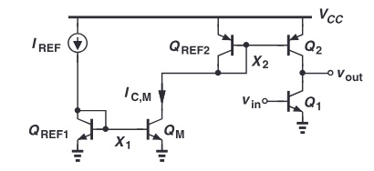

# 예제 9.18 — npn·pnp 거울을 이어 25 μA로 1 mA 만들기, 트랜지스터 수 최소화

## 조건
- 회로: Fig 9.35 (npn 거울 $Q_{REF1}$–$Q_M$과 pnp 거울 $Q_{REF2}$–$Q_2$를 이어 $Q_2$, $Q_1$을 바이어스)
- $I_{REF} = 25\ \mu\text{A}$
- 목표: $Q_1$과 $Q_2$의 컬렉터 전류 $1\ \text{mA}$
- 트랜지스터(단위 소자) 수가 최소가 되도록 함

## 구할 것
- 회로의 스케일링 인수 ($I_{C,M}/I_{REF}$, $|I_{C2}|/I_{C,M}$) 선택

## 상속·참조
- 본문 (교재 478–479쪽): Fig 9.34(c)에서는 전류가 X에서 접지로 흐르지만, Fig 9.24(c)형 거울은 $V_{CC}$에서 노드 X로 전류가 흐른다고 가정함. 전자로부터 후자를 만들려고 Fig 9.35처럼 npn과 pnp 거울을 조합
  - 단순화를 위해 $Q_{REF1}$, $Q_M$, $Q_{REF2}$, $Q_2$가 모두 같고 베이스 전류를 무시하면, $Q_M$이 $Q_{REF2}$로부터 $I_{REF}$를 끌어내고 그 결과 $Q_2$와 $Q_1$에도 같은 전류가 흐름
  - $Q_{REF1}$과 $Q_M$ 사이, $Q_{REF2}$와 $Q_2$ 사이에 각각 스케일링을 줄 수 있음 (이미터 면적 비 = 전류 비). $I_{REF}$가 $I_{C,M}$으로, $I_{C,M}$이 $I_{C2}$로 복사되면서 베이스 전류 오차가 누적됨
- 이 예제에서 베이스 전류는 무시 (원문에 없음, 본문의 단순화 가정을 이어받음)

## 회로 — Fig 9.35
```spice
IREF   VCC   X1
QREF1  X1    X1   0    npn
QM     X2    X1   0    npn
QREF2  X2    X2   VCC  pnp
Q2     vout  X2   VCC  pnp
Q1     vout  vin  0    npn
```
- 단자: VCC = 전원, 값 미지정 (가로 레일) / vin = 소신호 입력 (개방 원) / vout = 출력 (개방 원)
- 표시: 노드 라벨 VCC (레일 오른쪽 끝), X1 (아래 베이스 공통선 아래, X1 접속점 오른쪽), X2 (위 베이스 공통선 아래, X2 접속점 오른쪽 아래), v_in (입력 원 왼쪽), v_out (출력 원 오른쪽) / 소자 라벨 I_REF (전류원 왼쪽), Q_REF1 (Q_REF1 왼쪽), Q_M (Q_M 오른쪽, 이미터 옆), Q_REF2 (Q_REF2 왼쪽), Q2 (Q2 오른쪽), Q1 (Q1 오른쪽, 이미터 옆) / 부호 없음 / 화살표 "I_C,M": Q_M 컬렉터에서 위로 올라가는 세로 도선, 아래 방향(Q_M 컬렉터로 들어감), 도선 위, 글자는 화살표 왼쪽 / 수치·면적 라벨 없음
- 배치: 맨 위 굵은 가로 레일 VCC가 I_REF 윗선보다 조금 왼쪽에서 Q2 이미터 선보다 조금 오른쪽까지 뻗음, 왼쪽 끝 근처에 I_REF, 오른쪽 부분에 Q_REF2 이미터 선과 Q2 이미터 선이 매달림 / 왼쪽 세로줄: 레일 바로 아래 I_REF 전류원(화살표 아래)에서 긴 세로선이 그림 아래쪽까지 내려와 Q_REF1 컬렉터 접속점 / Q_REF1: npn 좌우 반전(베이스 막대 오른쪽, 컬렉터는 접속점에서 수직으로 내려와 비스듬히 막대 위쪽, 이미터는 막대 아래쪽에서 왼쪽 아래로 나가 접지) / 다이오드 연결 1: Q_REF1 컬렉터 접속점에서 가로선이 오른쪽으로 가다 아래로 꺾여 X1 접속점 / 아래 베이스 공통선: Q_REF1 베이스 → X1 접속점 → 오른쪽 Q_M 베이스 한 직선 / Q_M: npn 보통 방향(베이스 왼쪽), 이미터 아래 접지 (Q_REF1 접지와 같은 높이), 컬렉터에서 세로선이 위로 올라가(I_C,M 화살표) Q_REF2 컬렉터 접속점 높이에서 오른쪽으로 꺾여 그 접속점 / Q_REF2: pnp 좌우 반전(베이스 막대 오른쪽, 이미터는 막대 위쪽에서 왼쪽 위로 레일, 화살표 막대 쪽으로 들어감, 컬렉터는 막대 아래쪽에서 왼쪽 아래로 내려가 접속점) / 다이오드 연결 2: Q_REF2 컬렉터 접속점에서 가로선이 오른쪽으로 가다 위로 꺾여 X2 접속점 / 위 베이스 공통선(레일 바로 아래 높이): Q_REF2 베이스 → X2 접속점 → Q2 베이스 한 직선 / 오른쪽 세로줄: Q2(pnp 보통 방향, 이미터 레일) 컬렉터 → vout 접속점 → Q1(npn 보통 방향) 컬렉터, Q1 이미터 아래 접지, vout 접속점에서 가로선이 오른쪽 v_out 원, v_in 원 → 가로선 → Q1 베이스 / 접속점 (세 갈래 이상, 5곳): ① Q_REF1 컬렉터 = 위 I_REF 선 + 아래 Q_REF1 컬렉터 + 오른쪽 다이오드 연결 선 (점) ② X1 = 왼쪽 Q_REF1 베이스 + 위 다이오드 연결 선 + 오른쪽 Q_M 베이스로 가는 선 (점) ③ Q_REF2 컬렉터 = 위 Q_REF2 컬렉터 + 왼쪽 Q_M 컬렉터 선 + 오른쪽 다이오드 연결 선 (점) ④ X2 = 왼쪽 Q_REF2 베이스 + 아래 다이오드 연결 선 + 오른쪽 Q2 베이스로 가는 선 (점) ⑤ vout = 위 Q2 컬렉터 + 아래 Q1 컬렉터 + 오른쪽 v_out 선 (점) / 교차: 없음



## 답 (검증용)
- 전체 스케일링 인수 $1\ \text{mA}/25\ \mu\text{A} = 40$ → $I_{C,M} = 8 I_{REF}$, $|I_{C2}| = 5 I_{C,M}$ (식 9.121–9.122) 또는 $I_{C,M} = 10 I_{REF}$, $|I_{C2}| = 4 I_{C,M}$ (식 9.123–9.124) (각 경우 npn과 pnp 인수는 서로 바꿔도 됨)
- 거울의 트랜지스터 4개가 전자는 15단위($1+8+1+5$), 후자는 16단위 → 전자가 최소. $I_{C,M} = 40 I_{C,REF1}$, $I_{C2} = I_{C,REF2}$는 43단위라 버림
