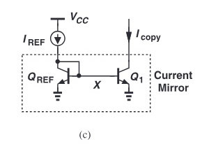

# 예제 9.19 — 개별 트랜지스터 두 개로 만든 거울에서 I_copy가 30% 큰 이유

## 원문
전기공학과 학생이 2개의 명목상 같은 개별 바이폴라 트랜지스터를 구입하고 그림 9.24(c)와 같은 전류 거울을 구성하였다. 안타깝게도 $I_{copy}$가 $I_{REF}$보다 30% 컸다. 이유를 설명하라.

## 조건
- 전기공학과 학생이 명목상 같은 개별(discrete) 바이폴라 트랜지스터 2개를 사서 Fig 9.24(c)와 같은 전류 거울을 구성
- 측정해 보니 $I_{copy}$가 $I_{REF}$보다 30% 큼
- 소자 값은 주어지지 않음 (원문에 없음)

## 구할 것
- 그 이유 설명

## 상속·참조
- 식 (9.91) (본문, 교재 470쪽): 베이스 전류를 무시하면 $I_{copy} = \dfrac{I_{S1}}{I_{S,REF}} I_{REF}$ — $Q_{REF}$와 $Q_1$이 같으면 $I_{copy} = I_{REF}$

## 회로 — Fig 9.24(c)
```spice
IREF  VCC  X
QREF  X    X  0  npn
Q1    out  X  0  npn
```
- 단자: VCC = 전원, 값 미지정 (T 전원 기호) / out = Q1 컬렉터, I_copy가 들어가는 단자 (선 끝)
- 표시: 노드 라벨 VCC (T 기호 오른쪽), X (베이스 공통선 아래, 두 트랜지스터 사이) / 소자 라벨 I_REF (전류원 왼쪽), Q_REF (Q_REF 왼쪽, 베이스 높이), Q1 (Q1 오른쪽, 이미터 옆), 점선 상자 라벨 "Current Mirror" (상자 오른쪽 바깥, 두 줄 Current / Mirror) / 부호 없음 / 화살표 "I_copy": out, 아래 방향(Q1 컬렉터로 들어감), 도선 위, 글자는 화살표 오른쪽 / 수치·면적 라벨 없음
- 배치: 왼쪽 세로줄 위→아래 VCC T 기호, I_REF 전류원(화살표 아래), Q_REF 컬렉터 접속점, Q_REF, 접지 / Q_REF 좌우 반전(베이스 막대 오른쪽, 컬렉터는 접속점에서 수직으로 내려와 비스듬히 막대 위쪽, 이미터는 막대 아래쪽에서 왼쪽 아래로 나가 접지) / 다이오드 연결: 컬렉터 접속점에서 가로선이 오른쪽으로 가다 아래로 꺾여 Q_REF 베이스 바로 오른쪽의 X 접속점 / 베이스 공통선: 베이스 높이 가로선이 Q_REF 베이스 → X 접속점 → Q1 베이스 한 직선 / Q1 보통 방향(베이스 왼쪽), 컬렉터 세로선이 위로 올라가 I_copy 화살표를 지나 선 끝 (끝은 VCC T 기호와 비슷한 높이), 이미터 아래 접지 (Q_REF 접지와 같은 높이) / 점선 사각형이 Q_REF, 다이오드 연결, Q1, 두 접지를 둘러쌈 (I_REF와 I_copy 화살표는 상자 위 바깥), 상자 윗변은 I_REF 바로 아래·컬렉터 접속점 바로 위 높이 / 접속점 (세 갈래 이상, 2곳): ① Q_REF 컬렉터 = 위 I_REF 선 + 아래 Q_REF 컬렉터 + 오른쪽 다이오드 연결 선 (점) ② X = 왼쪽 Q_REF 베이스 + 위 다이오드 연결 선 + 오른쪽 Q1 베이스로 가는 선 (점) / 교차: 없음 (점선 상자 윗변이 I_REF 선과 Q1 컬렉터 선을 지나는 곳은 상자 경계일 뿐 도선 교차가 아님)



## 답 (검증용)
- 두 트랜지스터가 다른 배치(batch)에서 만들어져 조금 다른 공정을 겪었을 수 있음 → 제조 중 무작위 변동이 소자 파라미터와 이미터 면적까지 바꿔 두 트랜지스터의 $I_S$가 크게 어긋남. 그래서 전류 거울은 개별 소자 설계에서 드물게 쓰임

## 풀이
### 이상적인 거울의 복사 전류
- 베이스 전류를 무시하면 두 트랜지스터는 같은 $V_{BE}$를 가지므로 $I_{copy} = \dfrac{I_{S1}}{I_{S,REF}} I_{REF}$
- 두 트랜지스터가 정말 같으면 $I_{copy} = I_{REF}$
### 측정이 뜻하는 I_S 비
- $I_{copy} = 1.3\, I_{REF}$이면 $I_{S1}/I_{S,REF} = 1.3$, 즉 $I_S$가 30% 어긋난다
- 같은 전류를 흘리는 데 필요한 $V_{BE}$로 보면 차이는 $V_T \ln 1.3 = 6.82\ \text{mV}$뿐이다 ($V_T = 26\ \text{mV}$). $V_{BE}$가 조금만 달라도 전류는 지수적으로 크게 달라진다
### I_S가 어긋나는 까닭
- 명목상 같은 개별 트랜지스터라도 서로 다른 제조 배치(batch)에서 약간 다른 공정을 겪었을 수 있다
- 제조 중의 무작위 변동이 도핑 같은 소자 파라미터와 이미터 면적까지 바꿔 $I_S$가 크게 달라진다. 같은 칩 위에 나란히 만든 소자와 달리 개별 소자는 정합이 보장되지 않는다
### 답
- 두 트랜지스터가 다른 배치에서 다른 공정 변동을 겪어 $I_{S1}/I_{S,REF} \approx 1.3$으로 어긋났기 때문이다. 그래서 전류 거울은 개별 소자 설계에서 드물게 쓰인다
