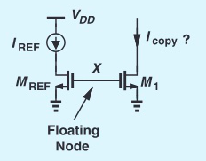

# 예제 9.20 — 게이트를 전원에 연결하지 않은 MOS 전류 거울

## 조건
- 예제 9.12와 9.13의 회로를 공부한 학생이 MOS의 게이트 전류가 0이라는 점을 떠올리고, 게이트를 전원에 연결하지 않은 채 MOS 전류 거울을 만들기로 함 (Fig 9.37)
- 즉 $M_{REF}$는 다이오드 연결되지 않고, 두 게이트의 공통 노드 X가 떠 있음(Floating Node)
- 소자 값은 주어지지 않음 (원문에 없음)

## 구할 것
- 어떤 일이 일어나는지 설명

## 상속·참조
- 예제 9.12 (E9.12): 바이폴라 거울에서 $Q_{REF}$의 베이스와 컬렉터를 잇지 않으면(Fig 9.25) 베이스 전류 경로가 없고 $V_{BE}$가 정해지지 않아 $I_{copy} = 0$
- 예제 9.13 (E9.13): 배터리 $V_X$로 두 베이스를 구동하면(Fig 9.26) $I_{copy} = I_{S1}\exp(V_X/V_T)$로 온도의 함수가 되고 $I_{REF}$와 무관 — 다이오드 연결 소자가 필요
- 본문 Fig 9.36(c) (교재 480쪽, 크롭 안 함): 올바른 MOS 전류 거울. $M_{REF}$가 다이오드 연결(게이트–드레인 연결)되어 $I_{REF}$로부터 $V_X$를 만들고 $M_1$ 게이트가 X에 연결
  - `I_REF: VDD → X`
  - `M_REF: D = X, G = X, S = 0`
  - `M1: D = out, G = X, S = 0` ($I_{copy}$가 드레인으로 들어감)
- 식 (9.129) (문턱 전압이 같고 채널 길이 변조 무시): $I_{copy} = \dfrac{(W/L)_1}{(W/L)_{REF}} I_{REF}$

## 회로 — Fig 9.37
```spice
IREF  VDD  n1
MREF  n1   X  0  nmos
M1    out  X  0  nmos
```
- 단자: VDD = 전원, 값 미지정 (T 전원 기호) / out = M1 드레인, I_copy가 들어가는 단자 (선 끝)
- 표시: 노드 라벨 VDD (T 기호 오른쪽), X (게이트 공통선 위, 가운데) / 소자 라벨 I_REF (전류원 왼쪽), M_REF (M_REF 왼쪽, 소스 높이), M1 (M1 오른쪽, 소스 옆) / 부호 없음 / 화살표 "I_copy ?": out, 아래 방향(M1 드레인으로 들어감), 도선 위, 글자는 화살표 오른쪽이고 물음표까지 인쇄됨; "Floating Node": X 게이트 공통선을 가리킴, 아래 글자에서 오른쪽 위로 향해 화살촉이 게이트 공통선 가운데 바로 아래에서 끝남, 도선 옆 별도 화살표 (직선), 글자는 게이트 공통선 아래 두 줄 Floating / Node / 수치·면적 라벨 없음
- 배치: 왼쪽 세로줄 위→아래 VDD T 기호, I_REF 전류원(화살표 아래), M_REF, 접지 / M_REF NMOS 좌우 반전(게이트 오른쪽, 드레인 왼쪽 위로 I_REF, 소스 왼쪽 아래·화살표 바깥, 접지) / M1 NMOS 보통 방향(게이트 왼쪽, 드레인 위, 소스 아래·화살표 바깥, 접지) / 게이트 높이의 한 가로선이 M_REF 게이트와 M1 게이트를 곧장 이음 = X / M_REF의 드레인과 게이트 사이에 연결선 없음 (다이오드 연결 없음), X는 두 게이트 말고 어디에도 연결되지 않음 / M1 드레인에서 세로선이 위로 올라가 선 끝, 그 선 위에 I_copy 화살표 / 두 소스 아래 각자 접지 (같은 높이) / 접속점: 없음 (세 갈래 이상 선이 만나는 곳 없음) / 교차: 없음



## 답 (검증용)
- 다이오드 연결 소자만이 식 (9.129)를 만족시키고 복사 전류를 소자 파라미터·온도와 무관하게 하므로 이 회로는 전류 거울이 아님
- $M_{REF}$와 $M_1$의 게이트가 떠 있어 X는 임의의 전압(예: 전원을 켤 때 X에 생긴 초기 상태)을 가짐 → $I_{copy}$가 매우 불완전하게 정의됨
