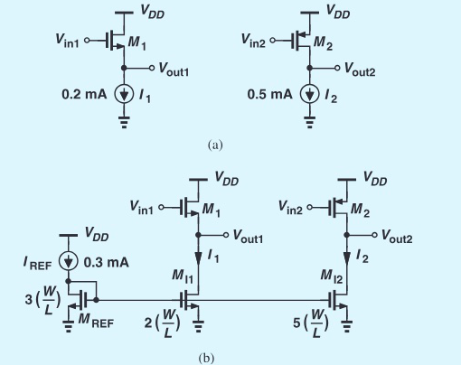

# 예제 9.21 — 0.3 mA 기준으로 소스 폴로어와 CS 단의 바이어스 전류 I1, I2 만들기

## 조건
- 집적 회로가 Fig 9.38(a)의 소스 폴로어($M_1$)와 공통 소스 단($M_2$)을 사용
- 필요한 바이어스 전류(그림 표기): $I_1 = 0.2\ \text{mA}$, $I_2 = 0.5\ \text{mA}$
- 기준 전류 $0.3\ \text{mA}$

## 구할 것
- $0.3\ \text{mA}$ 기준으로부터 $I_1$과 $I_2$를 만드는 전류 거울 설계

## 상속·참조
- 식 (9.129) (문턱 전압이 같고 채널 길이 변조 무시): $I_{copy} = \dfrac{(W/L)_1}{(W/L)_{REF}} I_{REF}$
- 본문 Fig 9.29–9.30 (교재 474쪽, 크롭 안 함)의 방법: 기준 소자와 복사 소자를 같은 단위 소자의 배수로 만들어 복사 전류를 크기 비로 정함. Fig 9.29는 기준 쪽을 같은 트랜지스터 3개($Q_{REF1}$–$Q_{REF3}$, $I_{REF} = 0.25\ \text{mA}$)로 나눠 단위 소자 하나인 $Q_1$에 $I_{REF}$의 1/3을 복사(부분 복사), Fig 9.30은 예제 9.15 풀이(기준 $4A_E$로 $A_E$와 $10A_E$ 두 전류)

## 회로 — Fig 9.38(a)
```spice
M1  VDD    Vin1  Vout1  nmos
I1  Vout1  0     0.2mA
M2  Vout2  Vin2  VDD    pmos
I2  Vout2  0     0.5mA
```
- 단자: VDD = 전원, 값 미지정 (T 전원 기호, 두 회로에 각각) / Vin1, Vin2 = 입력 (개방 원) / Vout1, Vout2 = 출력 (개방 원)
- 표시: 노드 라벨 VDD (각 T 기호 오른쪽), V_in1, V_in2 (각 입력 원 왼쪽), V_out1, V_out2 (각 출력 원 오른쪽) / 소자 라벨 M1 (M1 오른쪽, 소스 옆), M2 (M2 오른쪽, 드레인 옆), I_1 (왼쪽 전류원 오른쪽), I_2 (오른쪽 전류원 오른쪽) / 부호 없음 / 화살표 없음 / 수치·면적 라벨 "0.2 mA" (I_1 전류원 왼쪽), "0.5 mA" (I_2 전류원 왼쪽)
- 배치: 두 회로가 좌우로 나란히, 같은 높이 / 왼쪽(소스 폴로어): 세로줄 위→아래 VDD T 기호, M1, 출력 접속점, I_1 전류원(화살표 아래), 접지 / M1 NMOS 보통 방향(게이트 왼쪽, 드레인 위로 VDD, 소스 아래·화살표 바깥) / V_in1 원 → 가로선 → M1 게이트 / 오른쪽(공통 소스 단): 세로줄 위→아래 VDD T 기호, M2, 출력 접속점, I_2 전류원(화살표 아래), 접지 / M2 PMOS 보통 방향(게이트 왼쪽, 소스 위로 VDD·화살표 채널 쪽으로 들어감, 드레인 아래) / V_in2 원 → 가로선 → M2 게이트 / 각 출력 접속점에서 가로선이 오른쪽 V_out 원 / 접속점 (세 갈래 이상, 2곳): ① Vout1 = 위 M1 소스 + 아래 I_1 + 오른쪽 V_out1 선 (점) ② Vout2 = 위 M2 드레인 + 아래 I_2 + 오른쪽 V_out2 선 (점) / 교차: 없음


> 참고: 크롭 이미지 아래의 (b)는 예제 풀이 그림 (답 절 참고)

## 답 (검증용)
- 다이오드 연결 기준 소자 $M_{REF}$에 $3(W/L)$, $M_{I1}$에 $2(W/L)$, $M_{I2}$에 $5(W/L)$ → $I_1 = \tfrac{2}{3}(0.3\ \text{mA}) = 0.2\ \text{mA}$, $I_2 = \tfrac{5}{3}(0.3\ \text{mA}) = 0.5\ \text{mA}$ (Fig 9.38(b))

### 정답 회로 — Fig 9.38(b)
```spice
IREF  VDD    n1     0.3mA
MREF  n1     n1     0      nmos  W/L={W/L} m=3
M1    VDD    Vin1   Vout1  nmos
MI1   Vout1  n1     0      nmos  W/L={W/L} m=2
M2    Vout2  Vin2   VDD    pmos
MI2   Vout2  n1     0      nmos  W/L={W/L} m=5
```
- 단자: VDD = 전원, 값 미지정 (T 전원 기호, 기준부·M1·M2에 각각 하나씩 세 개) / Vin1, Vin2 = 입력 (개방 원) / Vout1, Vout2 = 출력 (개방 원)
- 표시: 노드 라벨 VDD (각 T 기호 오른쪽), V_in1, V_in2 (입력 원 왼쪽), V_out1, V_out2 (출력 원 오른쪽) / 소자 라벨 I_REF (전류원 왼쪽), M_REF (M_REF 오른쪽 아래, 접지 옆), M1, M2 (각 트랜지스터 오른쪽), M_I1 (M_I1 위, 드레인 선 왼쪽), M_I2 (M_I2 위, 드레인 선 왼쪽) / 부호 없음 / 화살표 "I_1": Vout1 접속점과 M_I1 드레인 사이 세로 도선, 아래 방향(M_I1 드레인으로 들어감), 도선 위, 글자는 화살표 오른쪽; "I_2": Vout2 접속점과 M_I2 드레인 사이 세로 도선, 아래 방향, 도선 위, 글자는 화살표 오른쪽 / 수치·면적 라벨 "0.3 mA" (I_REF 전류원 오른쪽), "3(W/L)" (M_REF 왼쪽), "2(W/L)" (M_I1 왼쪽 아래), "5(W/L)" (M_I2 왼쪽 아래)
- 배치: 왼쪽 아래 기준부: 세로줄 위→아래 VDD T 기호, I_REF 전류원(화살표 아래), n1 접속점, M_REF, 접지 / M_REF NMOS 좌우 반전(게이트 오른쪽, 드레인 왼쪽 위, 소스 왼쪽 아래·화살표 바깥) / 다이오드 연결: n1 접속점에서 가로선이 오른쪽으로 가다 아래로 꺾여 M_REF 게이트 바로 오른쪽 접속점 / 게이트 공통선: 그 접속점에서 게이트 높이로 오른쪽으로 가 M_I1 게이트에 닿고, 그대로 M_I1 기호(게이트 판과 채널 막대, 드레인·소스 인출선 사이 높이)를 가로질러(채널·드레인·소스와 접속 아님, 게이트선이 그림상 관통) 계속 오른쪽 M_I2 게이트까지 한 직선 / 가운데 세로줄 위→아래 VDD T 기호, M1(NMOS 보통 방향, 드레인 위로 VDD), Vout1 접속점, I_1 화살표, M_I1(NMOS 보통 방향, 게이트 왼쪽), 접지 / 오른쪽 세로줄 위→아래 VDD T 기호, M2(PMOS 보통 방향, 소스 위로 VDD), Vout2 접속점, I_2 화살표, M_I2(NMOS 보통 방향), 접지 / V_in1, V_in2 원 → 가로선 → 각 게이트, 각 출력 접속점 → 가로선 → 오른쪽 V_out 원 / 기준부 VDD는 M1·M2 쪽 VDD보다 낮은 위치, 세 접지(M_REF, M_I1, M_I2)는 같은 높이 / 접속점 (세 갈래 이상, 5곳): ① n1 = 위 I_REF + 아래 M_REF 드레인 + 오른쪽 다이오드 연결 선 (점) ② M_REF 게이트 = 왼쪽 M_REF 게이트 + 위 다이오드 연결 선 + 오른쪽 게이트 공통선 (점) ③ Vout1 = 위 M1 소스 + 아래 M_I1 드레인 선 + 오른쪽 V_out1 선 (점) ④ Vout2 = 위 M2 드레인 + 아래 M_I2 드레인 선 + 오른쪽 V_out2 선 (점) ⑤ M_I1 게이트 = 왼쪽 게이트 공통선 + 오른쪽으로 계속되는 게이트 공통선 + M_I1 게이트 (점 없음) / 교차: 없음


