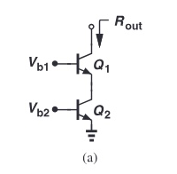

# 장말문제 9.1 — 바이폴라 캐스코드의 바이어스 전압 V_b2, V_b1

## 원문
In the bipolar cascode stage of Fig. 9.2(a), $I_S = 6 \times 10^{-17}\ \text{A}$ and $\beta = 100$ for both transistors. Neglect the Early effect.

(a) Compute $V_{b2}$ for a bias current of $1\ \text{mA}$.

(b) Noting that $V_{CE2} = V_{b1} - V_{BE1}$, determine the value of $V_{b1}$ such that $Q_2$ experiences a base-collector forward bias of only $300\ \text{mV}$.

## 조건
- 회로: Fig 9.2(a) 바이폴라 캐스코드 단
- 두 트랜지스터 모두 $I_S = 6 \times 10^{-17}\ \text{A}$, $\beta = 100$
- Early 효과는 무시

## 구할 것
- (a) 바이어스 전류 $1\ \text{mA}$에 필요한 $V_{b2}$
- (b) $V_{CE2} = V_{b1} - V_{BE1}$임을 이용해, $Q_2$의 베이스-컬렉터 순방향 바이어스가 $300\ \text{mV}$에 그치게 하는 $V_{b1}$ 값

## 회로 — Fig 9.2(a)
```spice
Q1  out  Vb1  n1  npn
Q2  n1   Vb2  0   npn
```
- 단자: Vb1, Vb2 = 이상적 DC 바이어스, 구할 값 (점 단자) / out = 출력, R_out 측정 단자 (개방 원)
- 표시: 노드 라벨 Vb1, Vb2 (각 점 단자 왼쪽) / 소자 라벨 Q1, Q2 (각 트랜지스터 오른쪽, 이미터 옆) / 부호 없음 / 화살표 "R_out": out 노드를 회로 쪽(아래)으로 들여다봄, 아래 방향, 도선 옆 별도 화살표 (┌ 꺾임: out 도선 오른쪽에 세로선을 두고 그 위 끝에서 짧은 가로선이 오른쪽 R_out 글자 쪽으로 뻗음, 화살촉은 아래 끝), 화살촉은 Q1 컬렉터 대각선 바로 위 높이에서 끝남 / 수치·면적 라벨 없음
- 배치: 한 세로줄 위→아래 out 원, Q1, Q2, 접지 / Q1, Q2 모두 보통 방향(베이스 막대 왼쪽, 컬렉터 오른쪽 위, 이미터 오른쪽 아래) / Vb1, Vb2 점 단자에서 가로선이 오른쪽으로 곧장 각 베이스 / Q1 컬렉터에서 세로선이 위로 올라가 out 원에서 끝남 / Q1 이미터에서 곧은 세로선이 Q2 컬렉터로 이어짐(n1, 라벨 없음) / Q2 이미터 아래 접지 기호 / 접속점: 없음 (세 갈래 이상 선이 만나는 곳 없음) / 교차: 없음


