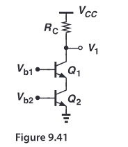

# 장말문제 9.2 — 부하 저항 R_C가 붙은 캐스코드의 바이어스와 R_C 최댓값

## 원문
Consider the cascode stage depicted in Fig. 9.41, where $V_{CC} = 2.5\ \text{V}$.

(a) Repeat Problem 9.1 for this circuit, assuming a bias current of $0.5\ \text{mA}$.

(b) With the minimum allowable value of $V_{b1}$, compute the maximum allowable value of $R_C$ such that $Q_1$ experiences a base-collector forward bias of no more than $300\ \text{mV}$.

## 조건
- 회로: Fig 9.41 캐스코드 단 (컬렉터 부하 $R_C$)
- $V_{CC} = 2.5\ \text{V}$
- 바이어스 전류 $0.5\ \text{mA}$ ((a)에서)
- 문제 9.1의 조건을 이어받음: 두 트랜지스터 모두 $I_S = 6 \times 10^{-17}\ \text{A}$, $\beta = 100$, Early 효과 무시

## 구할 것
- (a) 이 회로에 대해 바이어스 전류 $0.5\ \text{mA}$로 문제 9.1을 다시 풂: 필요한 $V_{b2}$, 그리고 $V_{CE2} = V_{b1} - V_{BE1}$을 이용해 $Q_2$의 베이스-컬렉터 순방향 바이어스가 $300\ \text{mV}$에 그치게 하는 $V_{b1}$
- (b) $V_{b1}$을 허용되는 최솟값으로 둘 때, $Q_1$의 베이스-컬렉터 순방향 바이어스가 $300\ \text{mV}$를 넘지 않게 하는 $R_C$의 최댓값

## 상속·참조
- 문제 9.1 (P9.01): Fig 9.2(a) 바이폴라 캐스코드(Q1 위, Q2 아래, 베이스는 $V_{b1}$, $V_{b2}$), 두 트랜지스터 $I_S = 6 \times 10^{-17}\ \text{A}$, $\beta = 100$, Early 효과 무시
  - (a) 바이어스 전류 $1\ \text{mA}$에 필요한 $V_{b2}$
  - (b) $V_{CE2} = V_{b1} - V_{BE1}$임을 이용해 $Q_2$의 베이스-컬렉터 순방향 바이어스가 $300\ \text{mV}$에 그치게 하는 $V_{b1}$

## 회로 — Fig 9.41
```spice
RC  VCC  V1   {R_C}
Q1  V1   Vb1  n1  npn
Q2  n1   Vb2  0   npn
```
- 단자: VCC = 2.5 V 전원, 그림에는 값 없이 VCC 라벨만 (T 전원 기호) / Vb1, Vb2 = 이상적 DC 바이어스, 구할 값 (점 단자) / V1 = 출력 (개방 원)
- 표시: 노드 라벨 VCC (T 기호 오른쪽), V1 (개방 원 오른쪽), Vb1, Vb2 (각 점 단자 왼쪽) / 소자 라벨 R_C (저항 왼쪽), Q1, Q2 (각 트랜지스터 오른쪽, 이미터 옆) / 부호 없음 / 화살표 없음 / 수치·면적 라벨 없음
- 배치: 한 세로줄 위→아래 VCC T 기호, 세로 저항 R_C, V1 접속점, Q1, Q2, 접지 / Q1, Q2 모두 npn 보통 방향(베이스 왼쪽, 컬렉터 오른쪽 위, 이미터 오른쪽 아래) / V1 접속점에서 짧은 가로선이 오른쪽으로 뻗어 V1 개방 원 / Vb1, Vb2 점 단자 → 가로선 → 각 베이스 / Q1 이미터에서 곧은 세로선이 Q2 컬렉터로 (n1, 라벨 없음) / Q2 이미터 아래 접지 / 접속점 (세 갈래 이상, 1곳): V1 = 위 R_C + 아래 Q1 컬렉터 + 오른쪽 V1 원으로 가는 선 (점) / 교차: 없음


