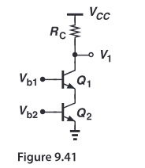

# 장말문제 9.3 — 부하 저항 캐스코드의 최대 바이어스 전류

## 원문
In the circuit of Fig. 9.41, we have chosen $R_C = 1\ \text{k}\Omega$ and $V_{CC} = 2.5\ \text{V}$. Estimate the maximum allowable bias current if each transistor sustains a base-collector forward bias of $200\ \text{mV}$.

## 조건
- 회로: Fig 9.41 캐스코드 단
- $R_C = 1\ \text{k}\Omega$, $V_{CC} = 2.5\ \text{V}$
- 각 트랜지스터에 베이스-컬렉터 순방향 바이어스 $200\ \text{mV}$를 허용함
- 그 밖의 소자 값($I_S$, $\beta$, $V_{b1}$, $V_{b2}$)은 주어지지 않음

## 구할 것
- 허용되는 최대 바이어스 전류 (추정)

## 회로 — Fig 9.41
```spice
RC  VCC  V1   {R_C}
Q1  V1   Vb1  n1  npn
Q2  n1   Vb2  0   npn
```
- 단자: VCC = 2.5 V 전원, 그림에는 값 없이 VCC 라벨만 (T 전원 기호) / Vb1, Vb2 = 이상적 DC 바이어스, 값 미지정 (점 단자) / V1 = 출력 (개방 원)
- 표시: 노드 라벨 VCC (T 기호 오른쪽), V1 (개방 원 오른쪽), Vb1, Vb2 (각 점 단자 왼쪽) / 소자 라벨 R_C (저항 왼쪽), Q1, Q2 (각 트랜지스터 오른쪽, 이미터 옆) / 부호 없음 / 화살표 없음 / 수치·면적 라벨 없음 (R_C = 1 kΩ은 문제 글에만 있음)
- 배치: 한 세로줄 위→아래 VCC T 기호, 세로 저항 R_C, V1 접속점, Q1, Q2, 접지 / Q1, Q2 모두 npn 보통 방향(베이스 왼쪽, 컬렉터 오른쪽 위, 이미터 오른쪽 아래) / V1 접속점에서 짧은 가로선이 오른쪽으로 뻗어 V1 개방 원 / Vb1, Vb2 점 단자 → 가로선 → 각 베이스 / Q1 이미터에서 곧은 세로선이 Q2 컬렉터로 (n1, 라벨 없음) / Q2 이미터 아래 접지 / 접속점 (세 갈래 이상, 1곳): V1 = 위 R_C + 아래 Q1 컬렉터 + 오른쪽 V1 원으로 가는 선 (점) / 교차: 없음



## 힌트
### 아래부터 최저 컬렉터 전압을 쌓는다
- $V_{b1}$, $V_{b2}$는 마음대로 고를 수 있으니, $Q_2$ 컬렉터를 허용 한계까지 낮추고 그 위에 $V_{BE1}$을 얹은 뒤 $Q_1$ 컬렉터도 허용 한계까지 낮춘다
- 그렇게 정한 $V_1$의 최저값과 $V_{CC}$ 사이가 $R_C$에 걸릴 수 있는 최대 전압이다. $I_S$가 없으니 $V_{BE}$는 전형적인 값으로 잡는다
