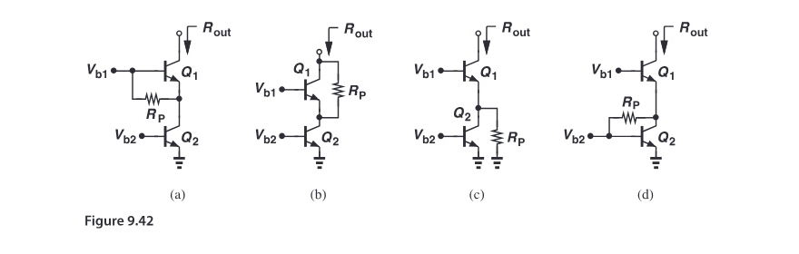

# 장말문제 9.4 — 기생 저항 R_P가 생긴 캐스코드의 출력 저항

## 조건
- 제조 오류로 바이폴라 캐스코드 전류원에 기생 저항 $R_P$가 생김
- $R_P$가 붙은 위치는 Fig 9.42 (a)–(d)마다 다름
- 소자 값은 주어지지 않음 → $g_m$, $r_O$, $r_\pi$, $R_P$ 기호로 답함

## 구할 것
- (a)–(d) 각 회로의 출력 저항 $R_{out}$

## 회로 — Fig 9.42(a)
```spice
Q1  out  Vb1  n1  npn
Q2  n1   Vb2  0   npn
RP  Vb1  n1              ; Q1 베이스 ↔ Q1 이미터
```
- 단자: Vb1, Vb2 = 이상적 DC 바이어스(값 미지정) / out = 개방 출력 단자
- 표시: R_out = out을 위에서 아래로 들여다보는 화살표 / R_P 라벨
- 배치: 위→아래 적층 Q1, Q2 / Vb1 선이 왼쪽에서 들어와 점에서 갈라져 한쪽은 Q1 베이스, 다른 쪽은 아래로 내려가 가로로 놓인 R_P를 거쳐 n1에 닿음

## 회로 — Fig 9.42(b)
```spice
Q1  out  Vb1  n1  npn
Q2  n1   Vb2  0   npn
RP  out  n1              ; Q1 컬렉터 ↔ Q1 이미터
```
- 단자: Vb1, Vb2 = 이상적 DC 바이어스(값 미지정) / out = 개방 출력 단자
- 표시: R_out = out을 위에서 아래로 들여다보는 화살표 / R_P 라벨
- 배치: 위→아래 적층 Q1, Q2 / R_P는 Q1 오른쪽에 세로로, 위 끝은 out(점), 아래 끝은 n1(점)

## 회로 — Fig 9.42(c)
```spice
Q1  out  Vb1  n1  npn
Q2  n1   Vb2  0   npn
RP  n1   0               ; Q1 이미터 ↔ 접지
```
- 단자: Vb1, Vb2 = 이상적 DC 바이어스(값 미지정) / out = 개방 출력 단자
- 표시: R_out = out을 위에서 아래로 들여다보는 화살표 / R_P 라벨
- 배치: 위→아래 적층 Q1, Q2 / n1에서 오른쪽으로 나간 선이 세로 R_P를 거쳐 따로 그린 접지 기호로 (Q2 접지 오른쪽)

## 회로 — Fig 9.42(d)
```spice
Q1  out  Vb1  n1  npn
Q2  n1   Vb2  0   npn
RP  Vb2  n1              ; Q2 베이스 ↔ Q2 컬렉터
```
- 단자: Vb1, Vb2 = 이상적 DC 바이어스(값 미지정) / out = 개방 출력 단자
- 표시: R_out = out을 위에서 아래로 들여다보는 화살표 / R_P 라벨
- 배치: 위→아래 적층 Q1, Q2 / Vb2 선이 왼쪽에서 들어와 점에서 갈라져 한쪽은 Q2 베이스, 다른 쪽은 위로 올라가 Q2 위에 가로로 놓인 R_P를 거쳐 n1에 닿음


