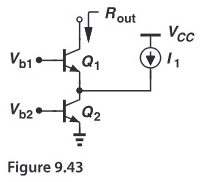

# 장말문제 9.5 — 캐스코드 가운데 노드에 전류원을 더한 회로의 출력 저항 (예제 9.1 변형)

## 조건
- 회로: Fig 9.43 (바이폴라 캐스코드의 가운데 노드에 $V_{CC}$에서 전류원 $I_1$이 전류를 넣음)
- $I_1$은 이상적인 전류원, $I_1 = 0.5\ \text{mA}$
- 즉 $I_{C1} = 0.5\ \text{mA}$, $I_{C2} = 1\ \text{mA}$
- 예제 9.1의 소자 값을 이어받음: 두 트랜지스터 모두 $\beta = 100$, $V_A = 5\ \text{V}$

## 구할 것
- 예제 9.1을 이 회로로 다시 풂: 출력 저항 $R_{out}$

## 상속·참조
- 예제 9.1 (E9.01): Fig 9.2(a) 바이폴라 캐스코드에서 $Q_1$, $Q_2$ 모두 $I_C = 1\ \text{mA}$, $\beta = 100$, $V_A = 5\ \text{V}$일 때 $R_{out}$을 구함 → $R_{out} \approx 328.9\ \text{k}\Omega$ (예제 풀이의 가정: 상온 $V_T \approx 26\ \text{mV}$, $g_m = I_C/V_T$, $r_O = V_A/I_C$, $r_\pi = \beta V_T/I_C$)
- 식 (9.5): 바이폴라 캐스코드 $R_{out} = [1 + g_{m1}(r_{O2} \parallel r_{\pi 1})] r_{O1} + r_{O2} \parallel r_{\pi 1}$
- 식 (9.7): $R_{out} \approx g_{m1} r_{O1} (r_{O2} \parallel r_{\pi 1})$

## 회로 — Fig 9.43
```spice
Q1  out  Vb1  n1  npn
Q2  n1   Vb2  0   npn
I1  VCC  n1   0.5mA
```
- 단자: Vb1, Vb2 = 이상적 DC 바이어스, 값 미지정 (점 단자) / out = 출력, R_out 측정 단자 (개방 원) / VCC = 전원, 값 미지정 (T 전원 기호)
- 표시: 노드 라벨 Vb1, Vb2 (각 점 단자 왼쪽), VCC (T 기호 오른쪽) / 소자 라벨 Q1, Q2 (각 트랜지스터 오른쪽, 이미터 옆), I_1 (전류원 오른쪽) / 부호 없음 / 화살표 "R_out": out 노드를 회로 쪽(아래)으로 들여다봄, 아래 방향, 도선 옆 별도 화살표 (┌ 꺾임: out 도선 오른쪽에 세로선, 위 끝에서 짧은 가로선이 오른쪽 R_out 글자 쪽으로, 화살촉은 아래 끝, Q1 컬렉터 대각선 바로 위 높이) / 수치·면적 라벨 없음 (0.5 mA는 문제 글에만 있음)
- 배치: 왼쪽 세로줄 위→아래 out 원, Q1, n1 접속점, Q2, 접지 / 오른쪽 세로줄 위→아래 VCC T 기호(out 원과 Q1 사이 높이), I_1 전류원(Q1 높이) / Q1, Q2 모두 npn 보통 방향(베이스 왼쪽, 컬렉터 오른쪽 위, 이미터 오른쪽 아래) / Vb1, Vb2 점 단자 → 가로선 → 각 베이스 / Q1 컬렉터 → 세로선 위로 out 원 / Q1 이미터 → n1 접속점 → Q2 컬렉터 / I_1 아래 끝에서 세로선이 n1 높이까지 내려가 모서리에서 왼쪽으로 꺾여 가로선으로 n1 접속점 / Q2 이미터 아래 접지 / 접속점 (세 갈래 이상, 1곳): n1 = 위 Q1 이미터 + 아래 Q2 컬렉터 + 오른쪽 I_1 가로선 (점) / 교차: 없음


