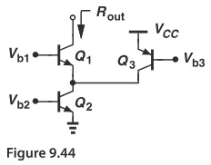

# 장말문제 9.6 — 전류원 I_1을 pnp Q3로 구현한 회로의 출력 임피던스

## 원문
Suppose the circuit of Fig. 9.43 is realized as shown in Fig. 9.44, where $Q_3$ plays the role of $I_1$. Assuming $V_{A1} = V_{A2} = V_{A,n}$ and $V_{A3} = V_{A,p}$, determine the output impedance of the circuit.

## 조건
- 문제 9.5의 Fig 9.43 회로를 Fig 9.44처럼 구현: $I_1$ 역할을 pnp 트랜지스터 $Q_3$이 맡음
- $V_{A1} = V_{A2} = V_{A,n}$, $V_{A3} = V_{A,p}$
- 그 밖의 값은 주어지지 않음. 답은 소신호 파라미터 기호로 나타냄 (원문에 없음)

## 구할 것
- 회로의 출력 임피던스 ($R_{out}$)

## 상속·참조
- 문제 9.5 (P9.05)의 Fig 9.43 (이 파일의 그림 목록에는 넣지 않음, 크롭은 fig9-43.png): npn 캐스코드($Q_1$ 위, $Q_2$ 아래)의 가운데 노드 n1에 $V_{CC}$에서 이상적 전류원 $I_1$이 전류를 넣음
  - `Q1: C = out, B = Vb1, E = n1`
  - `Q2: C = n1, B = Vb2, E = 0`
  - `I1: VCC → n1`
  - 문제 9.5의 값: $I_1 = 0.5\ \text{mA}$ ($I_{C1} = 0.5\ \text{mA}$, $I_{C2} = 1\ \text{mA}$), $\beta = 100$, $V_A = 5\ \text{V}$. 이 값들이 9.6에도 그대로 쓰이는지는 원문에 적혀 있지 않음 (원문에 없음)

## 회로 — Fig 9.44
```spice
Q1  out  Vb1  n1   npn
Q2  n1   Vb2  0    npn
Q3  n1   Vb3  VCC  pnp
```
- 단자: Vb1, Vb2, Vb3 = 이상적 DC 바이어스, 값 미지정 (점 단자) / out = 출력, R_out 측정 단자 (개방 원) / VCC = 전원, 값 미지정 (T 전원 기호)
- 표시: 노드 라벨 Vb1, Vb2 (각 점 단자 왼쪽), Vb3 (점 단자 오른쪽), VCC (T 기호 오른쪽) / 소자 라벨 Q1, Q2 (각 트랜지스터 오른쪽, 이미터 옆), Q3 (Q3 왼쪽) / 부호 없음 / 화살표 "R_out": out 노드를 회로 쪽(아래)으로 들여다봄, 아래 방향, 도선 옆 별도 화살표 (┌ 꺾임: out 도선 오른쪽에 세로선, 위 끝에서 짧은 가로선이 오른쪽 R_out 글자 쪽으로, 화살촉은 아래 끝, Q1 컬렉터 대각선 바로 위 높이) / 수치·면적 라벨 없음
- 배치: 왼쪽 세로줄 위→아래 out 원, Q1, n1 접속점, Q2, 접지 / 오른쪽에 Q3 (Q1 높이), 그 위 VCC T 기호 / Q1, Q2 npn 보통 방향(베이스 왼쪽) / Q3 pnp, 좌우 반전(베이스 막대가 오른쪽, 이미터 왼쪽 위·화살표가 막대 쪽으로 들어감, 컬렉터 왼쪽 아래), 베이스에서 가로선이 오른쪽으로 Vb3 점 단자 / Q3 이미터 → 세로선 위로 VCC T 기호 / Q3 컬렉터 → 세로로 n1 높이까지 내려가 모서리에서 왼쪽으로 꺾여 가로선으로 n1 접속점 / Vb1, Vb2 점 단자 → 가로선 → 각 베이스 / Q1 컬렉터 → 세로선 위로 out 원 / Q2 이미터 아래 접지 / 접속점 (세 갈래 이상, 1곳): n1 = 위 Q1 이미터 + 아래 Q2 컬렉터 + 오른쪽 Q3 컬렉터 가로선 (점) / 교차: 없음



## 풀이
### 가운데 노드에 달린 것
- $Q_3$은 베이스가 $V_{b3}$(AC 접지), 이미터가 $V_{CC}$(AC 접지)라 $v_{be3} = 0$이다. 가운데 노드에서 보면 $Q_3$의 출력 저항 $r_{O3}$ 하나다
- $Q_1$ 이미터에 달린 저항은 $r_{O2} \parallel r_{O3} \parallel r_{\pi 1}$ ($r_{\pi 1}$은 $Q_1$ 베이스가 AC 접지라서)
### 소신호 파라미터
- 가운데 노드 KCL로 $I_{C3} = I_{C2} - I_{C1}$ (베이스 전류 무시)
- $r_{O1} = V_{A,n}/I_{C1}$, $r_{O2} = V_{A,n}/I_{C2}$, $r_{O3} = V_{A,p}/I_{C3}$, $g_{m1} = I_{C1}/V_T$, $r_{\pi 1} = \beta/g_{m1}$
### 출력 저항
- 축퇴 저항이 $r_O$·$r_\pi$ 수준이라 $g_{m1}(r_{O2} \parallel r_{O3} \parallel r_{\pi 1}) \gg 1$이므로 $R_{out} \approx g_{m1} r_{O1} (r_{O2} \parallel r_{O3} \parallel r_{\pi 1})$
- $g_{m1} r_{O1} = V_{A,n}/V_T$이므로 $R_{out} \approx \dfrac{V_{A,n}}{V_T}\left(\dfrac{V_{A,n}}{I_{C2}} \parallel \dfrac{V_{A,p}}{I_{C2} - I_{C1}} \parallel r_{\pi 1}\right)$
- 이상적 $I_1$ 대신 $r_{O3}$가 병렬로 붙어 문제 9.5보다 작아진다
### 답
- $R_{out} \approx g_{m1} r_{O1} (r_{O2} \parallel r_{O3} \parallel r_{\pi 1})$, 곧 $\dfrac{V_{A,n}}{V_T}\left(\dfrac{V_{A,n}}{I_{C2}} \parallel \dfrac{V_{A,p}}{I_{C2} - I_{C1}} \parallel r_{\pi 1}\right)$
