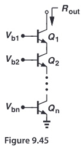

# 장말문제 9.7 — n단으로 쌓은 바이폴라 캐스코드의 최대 출력 임피던스

## 원문
Excited by the output impedance "boosting" capability of cascodes, a student decides to extend the idea as illustrated in Fig. 9.45. What is the maximum output impedance that the student can achieve? Assume the transistors are identical.

## 조건
- 캐스코드의 출력 임피던스 "부스팅" 능력에 고무된 학생이 그 아이디어를 Fig 9.45처럼 확장함 ($Q_1$부터 $Q_n$까지 $n$개를 직렬로 쌓음)
- 트랜지스터는 모두 같다고 가정
- 소자 값은 주어지지 않음

## 구할 것
- 학생이 얻을 수 있는 최대 출력 임피던스

## 회로 — Fig 9.45
```spice
Q1  out  Vb1  n1  npn
Q2  n1   Vb2  n2  npn
* Q2 이미터와 Qn 컬렉터 사이는 세로 점 3개(⋮)로 생략됨
Qn  nk   Vbn  0   npn   ; nk = 생략된 단의 마지막 노드 (라벨 없음)
```
- 단자: Vb1, Vb2, …, Vbn = 이상적 DC 바이어스, 값 미지정 (점 단자) / out = 출력, R_out 측정 단자 (개방 원)
- 표시: 노드 라벨 Vb1, Vb2, Vbn (각 점 단자 왼쪽) / 소자 라벨 Q1, Q2, Q_n (각 트랜지스터 오른쪽, 이미터 옆) / 부호 없음 / 화살표 "R_out": out 노드를 회로 쪽(아래)으로 들여다봄, 아래 방향, 도선 옆 별도 화살표 (┌ 꺾임: out 도선 오른쪽에 세로선, 위 끝에서 짧은 가로선이 오른쪽 R_out 글자 쪽으로, 화살촉은 아래 끝, Q1 컬렉터 대각선 바로 위 높이) / 수치·면적 라벨 없음
- 배치: 한 세로줄 위→아래 out 원, Q1, Q2, 세로 점 3개, Q_n, 접지 / 모든 트랜지스터 npn 보통 방향(베이스 왼쪽, 컬렉터 오른쪽 위, 이미터 오른쪽 아래) / Vb1, Vb2, Vbn 점 단자 → 가로선 → 각 베이스 / Q1 컬렉터 → 세로선 위로 out 원 / Q1 이미터에서 곧은 세로선이 Q2 컬렉터로 / Q2 이미터에서 짧은 세로선이 내려오다 끊기고, 그 아래 같은 x에 세로로 점 3개, 다시 짧은 세로선이 Q_n 컬렉터로 / Q_n 이미터 아래 접지 / 접속점: 없음 / 교차: 없음


