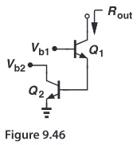

# 장말문제 9.8 — 축퇴 트랜지스터의 컬렉터와 베이스를 바꾼 캐스코드

## 원문
While constructing a cascode stage, a student adventurously swaps the collector and base terminals of the degeneration transistor, arriving at the circuit shown in Fig. 9.46.

(a) Assuming both transistors operate in the active region, determine the output impedance of the circuit.

(b) Compare the result with that of a cascode stage for a given bias current ($I_{C1}$) and explain why this is generally not a good idea.

## 조건
- 캐스코드 단을 만들던 학생이 축퇴 트랜지스터($Q_2$)의 컬렉터와 베이스 단자를 바꿔 연결해 Fig 9.46 회로가 됨
- $Q_2$의 베이스는 $Q_1$ 이미터에, 컬렉터는 $V_{b2}$에 연결됨
- 소자 값은 주어지지 않음. 답은 소신호 파라미터 기호로 나타냄 (원문에 없음)

## 구할 것
- (a) 두 트랜지스터가 모두 활성 영역에서 동작한다고 가정할 때 회로의 출력 임피던스
- (b) 주어진 바이어스 전류($I_{C1}$)에서 (a)의 결과를 캐스코드 단과 비교하고, 이 구성이 일반적으로 좋은 생각이 아닌 이유를 설명 (원문은 "given bias current"를 기울임꼴로 강조)

## 상속·참조
- 비교 기준: 보통의 바이폴라 캐스코드(Fig 9.2(a), $Q_2$ 컬렉터가 $Q_1$ 이미터, 베이스가 $V_{b2}$) 식 (9.7): $R_{out} \approx g_{m1} r_{O1} (r_{O2} \parallel r_{\pi 1})$

## 회로 — Fig 9.46
```spice
Q1  out  Vb1  n1  npn
Q2  Vb2  n1   0   npn    ; 컬렉터 = Vb2, 베이스 = n1(Q1 이미터), 이미터 = 접지
```
- 단자: Vb1, Vb2 = 이상적 DC 바이어스, 값 미지정 (점 단자) / out = 출력, R_out 측정 단자 (개방 원)
- 표시: 노드 라벨 Vb1 (점 단자 왼쪽), Vb2 (점 단자 왼쪽, Vb1보다 왼쪽·아래) / 소자 라벨 Q1 (Q1 오른쪽, 이미터 옆), Q2 (Q2 왼쪽, 이미터 위) / 부호 없음 / 화살표 "R_out": out 노드를 회로 쪽(아래)으로 들여다봄, 아래 방향, 도선 옆 별도 화살표 (┌ 꺾임: out 도선 오른쪽에 세로선, 위 끝에서 짧은 가로선이 오른쪽 R_out 글자 쪽으로, 화살촉은 아래 끝, Q1 컬렉터 대각선 바로 위 높이) / 수치·면적 라벨 없음
- 배치: 오른쪽 위에 Q1 (위로 out 원), 왼쪽 아래에 Q2 / Q1 npn 보통 방향(베이스 왼쪽), Vb1 점 단자 → 가로선 → Q1 베이스 / Q2 npn, 좌우 반전(베이스 막대가 오른쪽, 컬렉터 왼쪽 위, 이미터 왼쪽 아래·화살표 바깥) / Q1 이미터에서 세로선이 Q2 베이스 높이까지 내려가 모서리에서 왼쪽으로 꺾여 가로선으로 Q2 베이스 / Q2 컬렉터에서 세로선이 위로 올라가 Vb2 높이에서 왼쪽으로 꺾여 Vb2 점 단자 / Q2 이미터 아래 접지 / 접속점: 없음 / 교차: 없음



## 힌트
### (a) $Q_2$의 컬렉터·이미터는 AC 접지
- $V_{b2}$와 접지가 모두 AC 접지라서 $Q_2$의 종속 전류원과 $r_{O2}$는 두 끝이 같은 전위에 놓여 아무 전류도 보태지 않는다
- 그래서 $Q_1$ 이미터에서 보면 $Q_2$는 베이스 쪽 저항 하나로만 남는다
### (b) $Q_1$ 이미터 전류가 $Q_2$ 베이스로
- $Q_1$ 이미터 전류가 갈 곳은 $Q_2$ 베이스뿐이라, 같은 $I_{C1}$에서 $Q_2$의 컬렉터 전류와 그 베이스 쪽 저항이 어떻게 정해지는지 따져 본다

## 풀이
### (a) $Q_1$ 이미터에서 본 $Q_2$
- $Q_2$ 컬렉터는 $V_{b2}$, 이미터는 접지로 둘 다 AC 접지라 $Q_2$의 종속 전류원 $g_{m2} v_{be2}$와 $r_{O2}$는 전류를 보태지 않는다
- $Q_1$ 이미터에서 보면 $Q_2$는 베이스–이미터 저항 $r_{\pi 2}$ 하나다. $Q_1$의 $r_{\pi 1}$도 병렬로 붙는다
### (a) 출력 저항
- $Q_1$은 $r_{\pi 1} \parallel r_{\pi 2}$로 이미터 축퇴된다. $r_{\pi 2}$가 작을 수 있어 1을 남긴다
- $R_{out} \approx [1 + g_{m1}(r_{\pi 1} \parallel r_{\pi 2})]\, r_{O1}$
### (b) 같은 $I_{C1}$에서 $r_{\pi 2}$
- $Q_1$ 이미터 전류는 모두 $Q_2$ 베이스로 들어가므로 $I_{B2} \approx I_{C1}$, $I_{C2} = \beta I_{C1}$
- $r_{\pi 2} = \beta V_T / I_{C2} = V_T/I_{C1} = 1/g_{m1}$이고 $r_{\pi 1} = \beta/g_{m1} \gg 1/g_{m1}$이므로 $r_{\pi 1} \parallel r_{\pi 2} \approx 1/g_{m1}$
- $R_{out} \approx (1 + g_{m1}/g_{m1})\, r_{O1} = 2 r_{O1}$
### (b) 캐스코드와 비교
- 보통 캐스코드는 $R_{out} \approx g_{m1} r_{O1} (r_{O2} \parallel r_{\pi 1})$로 $r_{O1}$의 수십~수백 배다 (예: 예제 9.1 값이면 약 $66 r_{O1}$)
- 이 회로는 $2 r_{O1}$에 그치고, $Q_2$가 $\beta I_{C1}$을 $V_{b2}$에서 끌어와 전류를 크게 낭비한다
### 답
- (a) $R_{out} \approx [1 + g_{m1}(r_{\pi 1} \parallel r_{\pi 2})]\, r_{O1}$
- (b) 같은 $I_{C1}$이면 $I_{C2} = \beta I_{C1}$이라 $r_{\pi 2} \approx 1/g_{m1}$이 되어 $R_{out} \approx 2 r_{O1}$뿐이다. 캐스코드의 $g_{m1} r_{O1}(r_{O2} \parallel r_{\pi 1})$보다 훨씬 작고, $Q_2$가 $\beta$배의 전류를 소모하므로 좋은 생각이 아니다.
