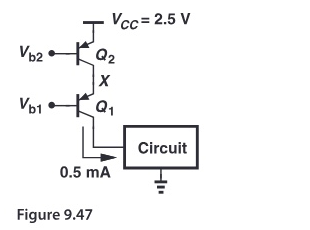

# 장말문제 9.10 — pnp 캐스코드 전류원의 바이어스 설계

## 조건
- Fig 9.47의 pnp 캐스코드가 어떤 회로("Circuit")에 바이어스 전류 0.5 mA를 공급해야 함
- $V_{CC} = 2.5\ \text{V}$
- $I_S = 10^{-16}\ \text{A}$, $\beta = 100$ (두 트랜지스터 동일)

## 구할 것
- (a) 필요한 $V_{b2}$
- (b) $V_X = V_{b1} + |V_{BE1}|$임을 이용해, $Q_2$의 베이스-컬렉터 순방향 바이어스가 200 mV를 넘지 않게 하는 $V_{b1}$의 최댓값

## 회로 — Fig 9.47
```spice
Q2  X   Vb2  VCC  pnp
Q1  n1  Vb1  X    pnp
X1  n1  0  box "Circuit"
```
- 단자: VCC = 2.5 V 전원 레일 / Vb1, Vb2 = 이상적 DC 바이어스(구할 값) / "Circuit" 상자는 한쪽이 Q1 컬렉터(n1), 다른 쪽이 접지
- 표시: 노드 X 라벨(Q2 컬렉터 = Q1 이미터) / Q1 컬렉터에서 Circuit 쪽으로 흐르는 전류 화살표 "0.5 mA"
- 배치: 위→아래 적층 VCC 레일, Q2, Q1 / 두 베이스 단자는 왼쪽 / Q1 컬렉터 선이 아래로 내려가 오른쪽으로 꺾여 Circuit 상자 왼쪽에 연결 / Circuit 상자 아래 접지


